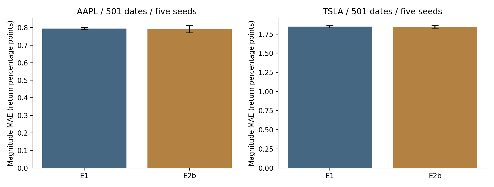

# E1–E2 — 隔日波動幅度與 Mamba 五種子

目標：100×|log(C[t+1]/C[t])|；誤差單位為報酬百分點。這是幅度回歸，沒有直接預測漲跌方向。

E1：Open、High、Low、Close、Volume、MA5、MA20、Volatility_10。E2b：再加入RV5、RV20、VIX／VXN及其變化。真正mamba_ssm.Mamba，seq60、width64、state16、conv4、expand2、AdamW lr8e-4、SmoothL1 beta.35、max30／patience6。batch8取代原始64，會改變最佳化路徑，不能稱完全重現原批次結果。

訓練2012–2022、驗證2023、測試2024–2025；每股501個共同日期，seeds42–46，共20組。seed42沒有覆蓋或重訓。既有E2c完整列篩選沿用，因此60列不保證每次都是60個連續交易日。

| 股票 | 設定 | MAE平均 | seed SD | RMSE平均 |
| --- | --- | --- | --- | --- |
| AAPL | E1 | 0.794985 | 0.005801 | 1.315335 |
| AAPL | E2b | 0.791657 | 0.020534 | 1.324468 |
| TSLA | E1 | 1.847154 | 0.015430 | 2.862535 |
| TSLA | E2b | 1.845582 | 0.017018 | 2.850634 |

E2b MAE相對改善AAPL約0.42%、TSLA約0.09%；主要配對HAC10／block10 bootstrap及Holm12後均不顯著（校正p=1）。AAPL RMSE及seed變異反而增加。尾端幅度測試只有23／26日，僅作描述。

[完整seed摘要](results/metrics_multiseed.csv)、[穩定性](results/metrics_stability.csv)、[全部配對檢定](results/paired_tests.csv)、[極端與其他狀態](results/regime_summary.csv)、[統計計畫](config/statistical_plan.json)。SD是seed間樣本SD，不是日期平均誤差的SE；五seed不能當五倍獨立日期。

程式：[runner](../../scripts/run_mamba_e1_e2b_own_safety.py)、[multiseed分析](../../scripts/analyze_mamba_multiseed.py)。原始E1/E2實驗模組另存[volatility_e1_e2](../../volatility_e1_e2/experiments/volatility_e1_e2.py)。原四模型×四arm的完整真實幅度回測未隨工作站素材提供，本階段不能用E3b分類結果補作幅度模型排名。

公開重現：`python scripts/reproduce_public.py --output-dir outputs/public_replay`。完整訓練需合法本機行情與凍結資產，見[重現說明](../../docs/REPRODUCIBILITY.md)。不要使用動態新下載資料冒充原快照。
