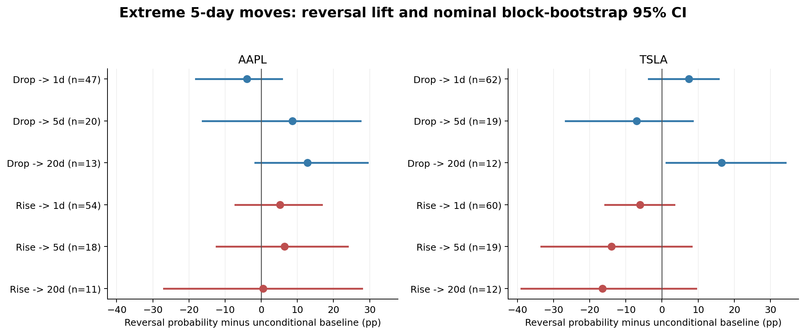
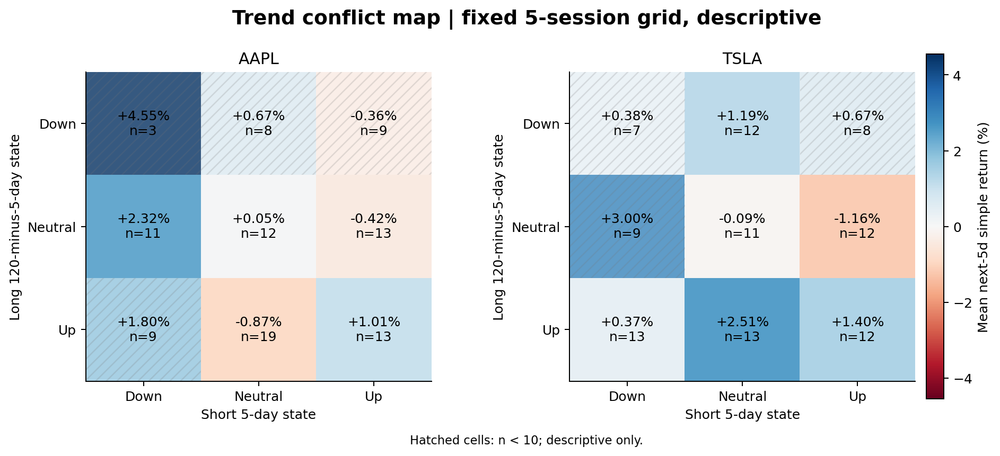

# E3a — Multi-Horizon Trend & Reversal Event Study

分析過去5／20／60／120日趨勢、相對歷史波動的異常價格變化，與事件後1／5／20日報酬、反轉、延續及幅度。訓練2012–2022固定門檻，2023驗證、2024–2025探索測試；共同合格日期482日，再按horizon去重疊。

急漲跌主門檻為訓練期past5的q10／q90：AAPL −4.3275／+4.9762、TSLA −8.4548／+9.4827個log報酬百分點。主要事件研究為收盤至收盤；與後續next-open標籤分開，不混用數值。

| 股票 | 事件 | n | 5日反轉率 | 後續平均簡單報酬 |
| --- | --- | --- | --- | --- |
| AAPL | 急跌 | 20 | 65.0% | +1.51% |
| AAPL | 急漲 | 18 | 50.0% | +0.85% |
| TSLA | 急跌 | 19 | 42.1% | -0.50% |
| TSLA | 急漲 | 19 | 36.8% | +3.56% |

AAPL急跌後反轉率65%高於相應基準56.4%；TSLA急跌則42.1%低於基準49.2%。TSLA急漲後20日延續率75%，但n=12。AAPL長期下跌＋短期急漲反轉率70%，亦僅n=10。98個預定比較中61個具足夠支持，主要HAC60／Holm98後無顯著發現；不支持普遍「大跌必反彈」。

Mamba的幅度誤差在部分事件附近增大，但這不是方向分類失敗的測量。見[誤差圖](figures/F04.png)、[統計檢定](results/statistical_tests.csv)、[穩健性](results/robustness.csv)、[趨勢組合](results/trend_combinations.csv)、[固定計畫](config/E3A_PROTOCOL.json)。

核心程式：[e3a_core.py](../../scripts/e3a_core.py)、[run_e3a.py](../../scripts/run_e3a.py)。原runner保護舊快照和預測資產，因此從空repo直接執行不會自動產生原研究。公開表格重現與本機完整資產條件見[REPRODUCIBILITY](../../docs/REPRODUCIBILITY.md)。
