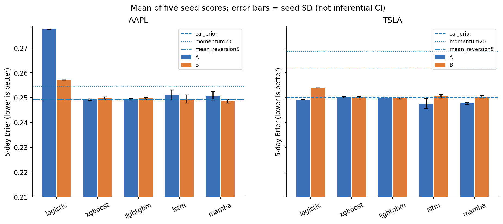
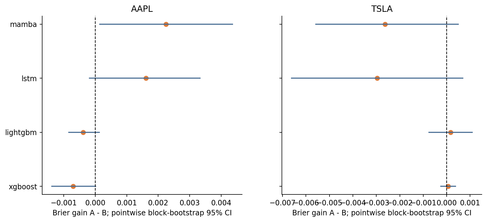
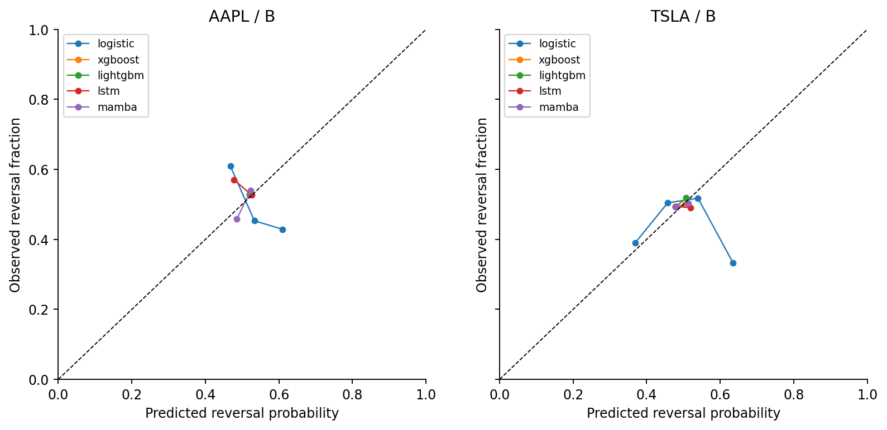

# E3b — Multi-Horizon Reversal Prediction Benchmark

比較XGBoost、LightGBM、LSTM、真正Mamba及Logistic／常數／動能／均值回歸基準。主目標h5，h1／h20次要。y=1若sign(past5)×log(C[t+h]/Open[t+1])<0，平盤未來為非反轉；當日收盤與市場指數資訊齊備後形成訊號。

A=14原市場／波動特徵+共同reference_sign（15維）；B再加23個多尺度特徵（38維）。所有模型見同一60×d歷史，樹／Logistic展平。3候選×3 expanding folds以seed42選模、五seed最終擬合；訓練2012–2022、2023H1早停／H2 C1 Platt校準、測試2024–2025，各482日。每區段t+20不跨界；神經batch64／max24／patience4，非幅度研究batch8。

| 模型 | AAPL A | AAPL B | TSLA A | TSLA B |
|---|---:|---:|---:|---:|
| XGBoost | .249141 | .249847 | .250272 | .250207 |
| LightGBM | .249319 | .249707 | .250019 | .249855 |
| LSTM | .251093 | .249484 | .247597 | .250556 |
| Mamba | .250736 | .248494 | .247662 | .250284 |
| 校準期常數 | .249267 | 同左 | .250112 | 同左 |

主指標Brier越低越好；上表為逐seed指標平均。AAPL Mamba B有最佳複雜模型點估計，但TSLA為LSTM A。Mamba的B特徵增益AAPL+.002242，TSLA−.002622，未跨股一致。主要102項HAC20／block20 bootstrap（4999）與Holm102後，無聯合通過的優勢；h1/h20另作204家族，不以次要發現替代主目標。

[完整模型／指標](results/metrics_comparison.csv)、[每seed](results/metrics_per_seed.csv)、[全部配對檢定](results/paired_tests.csv)、[全部horizon候選設定](config/selected_configs.json)、[固定方法](config/evaluation_plan.json)。原始hard 0/1規則只是診斷，不能當已校準機率或以擊敗它證明價值。

[訓練程式](../../scripts/run_e3b.py)、[模型](../../scripts/e3b_models.py)、[因果特徵與purging](../../scripts/e3b_protocol.py)。新輸出單模型重現可用[run_public_model.py](../../scripts/run_public_model.py)，必須提供符合[雜湊](../../docs/FROZEN_INPUTS.csv)的合法本機行情。此次整理沒有訓練或解封2026。
