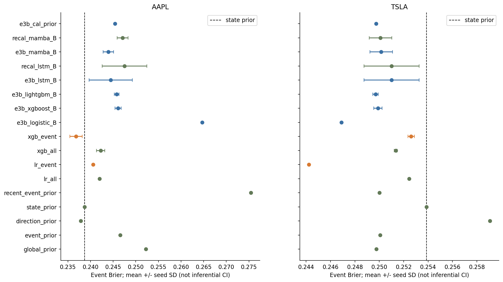
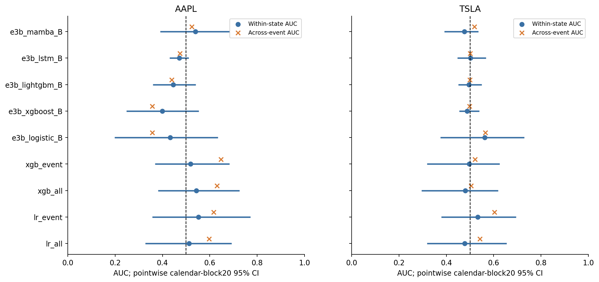

# E3c — Event-Conditioned Reversal Prediction（final v1.1）

主問題是「同一市場狀態內，模型能否辨識反轉時機」，而非只辨識不同狀態的平均機率。沿用E3a固定門檻與E3b h5可執行標籤、時間切分；AAPL101、TSLA122個尾端事件日，保留重疊但以完整日曆區塊推論。

比較全日期／事件專用Logistic、XGBoost及階層收縮條件機率。相同family全日期／事件分支等容量；3候選×3 expanding folds。事件樣本未通過神經模型的預定支持度門檻，未勉強新訓事件LSTM／Mamba。既有神經參考模型維持凍結。

| 股票 | 方法 | 事件Brier | 整體事件AUC | 同狀態AUC |
|---|---|---:|---:|---:|
| AAPL | state prior | .238702 | .6195 | .5（格內常數） |
| AAPL | event XGBoost | .236811 | .6474 | .5187 |
| TSLA | state prior | .253876 | .5234 | .5（格內常數） |
| TSLA | event Logistic | .244219 | .6032 | .5326 |

同狀態為過去方向×長期背景×VIX狀態。8組新方法沒有同時通過優於state-prior的Brier及格內排序標準；48個Brier／18個排序各自Holm校正，且區塊保持日期相依。反轉機率與反轉幅度分開，幅度關聯不當作方向勝率。

[主要測量](results/T08_event_models.csv)、[完整配對](results/paired_tests.csv)、[排序檢定](results/within_state_ranking_tests.csv)、[聯合判準](results/signal_vs_average_evidence.csv)、[狀態漂移](figures/F10.png)。採用已修復的v1.1數值校準，舊中斷版沒有混入成績。

[核心程式](../../scripts/e3c_core.py)、[v1.1校準器](../../scripts/e3c_calibration_v1_1.py)、[初版訓練](../../scripts/run_e3c.py)、[v1.1數值修復入口](../../scripts/recover_e3c_v1_1.py)、[數值修復記錄](../../scripts/E3C_NUMERICAL_RECOVERY.md)、[設定](config/evaluation_plan.json)。初版曾在測試預測產生前停止；完成版使用修復入口代入同一校準目標的Newton求解器，不可直接以初版runner冒稱v1.1重現。

## 保留期協定

[E3C_2026_PROTOCOL.md](protocol/E3C_2026_PROTOCOL.md)原樣保留，SHA見公開來源索引；此repo沒有2026測試資料。協定文件中的本機outputs路徑是原研究資產位置，並非此公開repo已附檔案的宣告。不新增E5候選，不在此次整理執行2026驗證。意外接觸及獨立性限制見[RESEARCH_INTEGRITY](../../docs/RESEARCH_INTEGRITY.md)。

另附原[機器可讀JSON](protocol/E3C_2026_PROTOCOL.json)、[原提案](protocol/ORIGINAL_PROPOSAL.json)、[hash lock](protocol/protocol_lock.json)及其固定code快照。只檢查協定、不讀行情的命令：`python scripts/freeze_e3c_2026.py --directory research/E3c/protocol --check`。這不是執行保留期驗證。
