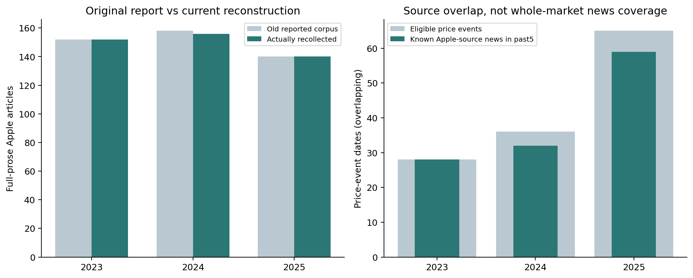

# E4a — News-Conditioned Reversal Feasibility

整合E3c尾端事件與新聞來源，先審查時間戳、可取得性與覆蓋，而非勉強建立新聞深度模型。最後找回52篇AAPL摘要與36篇Gemini輸出；「18篇早期子集」不是額外獨立文章。

事件資料沿用既有價格切分；嚴格PIT需要有時區的發布時間、精確文字版本、first-seen證據及可稽核來源。發布日期與2026回溯取得時間不等同歷史可用時間；不同假設與延遲另作敏感度。

樣本與來源不足以支持2012–2022新聞訓練或可信新聞條件反轉優勢。公開[年度來源覆蓋](results/coverage_news_sources_combined.csv)、[事件支持度](results/market_event_support.csv)、[時間敏感度](results/phase7a_timing_sensitivity.csv)，不發布逐篇摘要、Gemini文字或私人來源清單。

程式：[e4a_core.py](../../scripts/e4a_core.py)、[run_e4a.py](../../scripts/run_e4a.py)、[Phase7a整合](../../scripts/extend_e4a_phase7a.py)。固定的2026價格驗證協定未加入新聞模型。

新聞方法交叉連結：[stockllm-pit-news](https://github.com/yoyocar2333/stockllm-pit-news)。工作站使用的程式revision為`fdf6103ff22035a6cd9e6a7e946430f0c2b2e33d`，另有`e5a0767415a9123f0a338a73068aa564fac90585`的稽核記錄；本repo只附本研究整合程式，不複製其新聞、逐篇LLM回應或vendor原始碼。外部repo內容及資料須依各自授權。

公開資料只含彙整統計及自製圖，缺失新聞不當作「沒有新聞」；重建歷史頁面不證明嚴格歷史PIT。完整處理／重訓須合法自行取得原語料與已凍結特徵，見[資料政策](../../docs/DATA_POLICY.md)與[重現說明](../../docs/REPRODUCIBILITY.md)。
