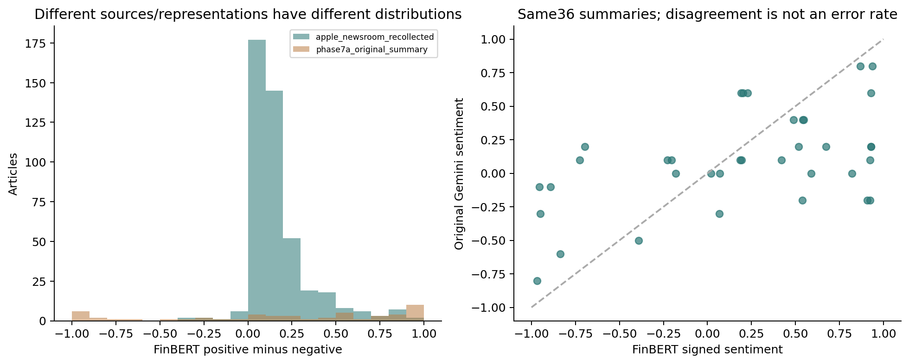

# E4b — Historical Financial News Recovery & Integration

從歷史網頁重建Apple Newsroom全文448篇：2023=152、2024=156、2025=140，與舊稱約450篇仍差2篇。現在抓回的內容與原始研究資料分開，不能證明當年版本相同。統一資料有2816新聞—股票—版本紀錄、2783 URL，兩者都不是獨立全文篇數。

FinBERT使用固定ProsusAI revision `0bc2ac10dda6929bcb1f77ccc43c7ec5c424f031`，3316文本視圖、4219 chunks。原始同36摘要FinBERT／Gemini情緒Spearman約.505，分箱47.22%不一致，沒有人工gold，不能稱錯誤率。事件抽取是V1語法啟發式，不是已人工驗證的財務事件真值。

本階段FNSPID的441／1875個AAPL／TSLA標題列是局部探查；**E4c後來完成的23.23GB Nasdaq全庫稽核才是完整年度證據**，兩者不可相加或混稱同一份資料。

[資料源比較](results/data_source_comparison.csv)、[時間品質](results/news_time_quality.csv)、[來源年度覆蓋](results/source_coverage_by_stock_year.csv)、[股票年度事件覆蓋](results/coverage_by_stock_year.csv)、[抽取品質旗標彙整](results/extraction_quality_summary.csv)。

程式：[recover_e4b_news.py](../../scripts/recover_e4b_news.py)、[extract_e4b_features.py](../../scripts/extract_e4b_features.py)、[analyze_e4b.py](../../scripts/analyze_e4b.py)。2012–2022新聞不連續，後續E4c改為2023–2025獨立探索性設計，沒有用零值補成完整市場。

新聞方法交叉連結：[stockllm-pit-news](https://github.com/yoyocar2333/stockllm-pit-news)。工作站使用的程式revision為`fdf6103ff22035a6cd9e6a7e946430f0c2b2e33d`，另有`e5a0767415a9123f0a338a73068aa564fac90585`的稽核記錄；本repo只附本研究整合程式，不複製其新聞、逐篇LLM回應或vendor原始碼。外部repo內容及資料須依各自授權。

公開資料只含彙整統計及自製圖，缺失新聞不當作「沒有新聞」；重建歷史頁面不證明嚴格歷史PIT。完整處理／重訓須合法自行取得原語料與已凍結特徵，見[資料政策](../../docs/DATA_POLICY.md)與[重現說明](../../docs/REPRODUCIBILITY.md)。
