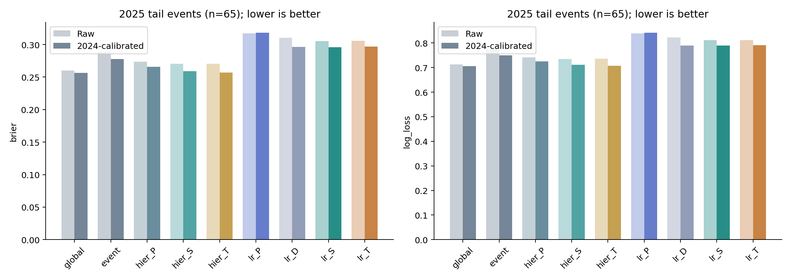
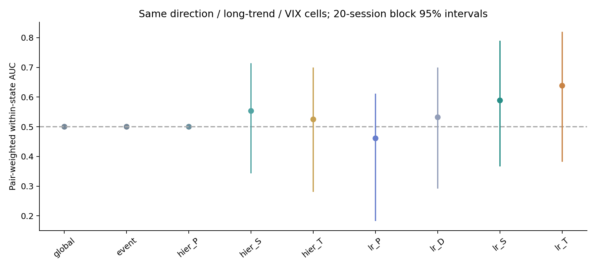
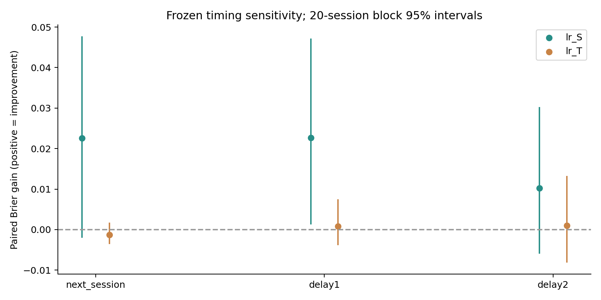
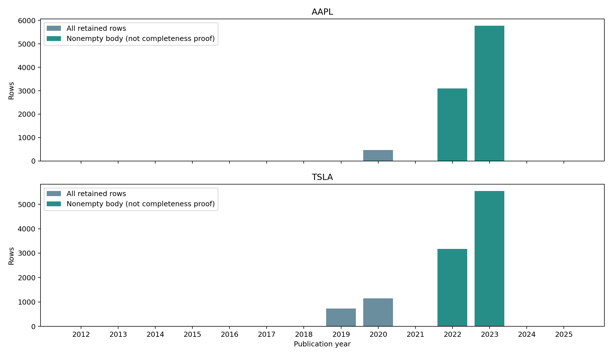

# E4c — News-Conditioned Reversal Prediction

Apple-only，2023訓練、2024選模與校準、2025探索性測試；不是E3的2012–2022訓練設計。相同日期與h5 next-open反轉標籤，train/val/test為224／232／230日，事件28／36／65個，每年t+20 purging。

P=8價格特徵；D=P+新聞存在與密度（次要拆解）；S=D+FinBERT有號情緒與方向交互作用（12維）；T=S+4類事件比例（16維）。正則化Logistic C=.01/.1/1由2024全日期raw Brier選，2024再作固定identity-prior Platt；階層條件機率pseudo-count30。確定性Logistic五seed相同，不當作五個獨立實驗。

| 方法 | 2025事件Brier | 事件AUC |
|---|---:|---:|
| Logistic P | .318276 | .394 |
| Logistic S | .295706 | .534 |
| Logistic T | .296955 | .532 |
| 階層機率 P | .265713 | .522 |
| 階層機率 S | .259011 | .587 |
| 階層機率 T | .257149 | .576 |
| 全域歷史機率 | .256489 | .500 |

P→S改善.022569（7.09%），主要bootstrap Holm2 p=.1512，未顯著；S→T惡化.001248。P→D已改善.021825，D→S僅.000744，不能把所有變化歸因情緒。階層P→S的次要家族p=.028，但延遲1／2日後不再顯著，且未超越全域基準。

同狀態Logistic S／T AUC=.589／.638，Holm5 p=.8726／.8544；不支持超越平均機率的可靠時機訊號。事件反轉率train39.3%、val61.1%、test64.6%，官方來源偏正向且僅65測試事件，限制外推。

## FNSPID全檔稽核（未進入模型）

完整EOF掃描23,232,979,597 bytes、15,549,299列。AAPL9338列／8865正文；TSLA10587列／8712正文。2012–2018兩股皆0，2021、2024、2025亦0；有效列集中2019–2020標題及2022–2023全文。約99.67%／99.76%時間落午夜，精確盤中可取得性不足。原資料授權及第三方全文權利未替讀者重新授權，因此不發布主檔、逐篇內容或清單。

[模型指標](results/T12_news_models.csv)、[配對主檢定](results/T13_news_tests.csv)、[所有預定檢定](results/paired_tests.csv)、[聯合證據判準](results/signal_vs_average_evidence.csv)、[年度稽核](results/T11_fnspid.csv)、[固定方法](config/research_plan.json)。程式：[run_e4c.py](../../scripts/run_e4c.py)、[audit_e4c_fnspid.py](../../scripts/audit_e4c_fnspid.py)。完整文章與逐篇特徵不隨public repo提供，無法在空repo宣稱重現整個新聞訓練。

新聞方法交叉連結：[stockllm-pit-news](https://github.com/yoyocar2333/stockllm-pit-news)。工作站使用的程式revision為`fdf6103ff22035a6cd9e6a7e946430f0c2b2e33d`，另有`e5a0767415a9123f0a338a73068aa564fac90585`的稽核記錄；本repo只附本研究整合程式，不複製其新聞、逐篇LLM回應或vendor原始碼。外部repo內容及資料須依各自授權。

公開資料只含彙整統計及自製圖，缺失新聞不當作「沒有新聞」；重建歷史頁面不證明嚴格歷史PIT。完整處理／重訓須合法自行取得原語料與已凍結特徵，見[資料政策](../../docs/DATA_POLICY.md)與[重現說明](../../docs/REPRODUCIBILITY.md)。
