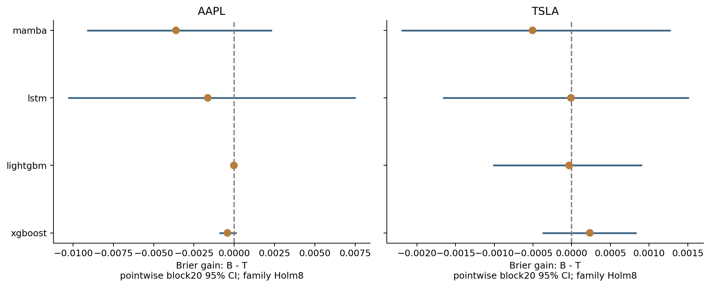
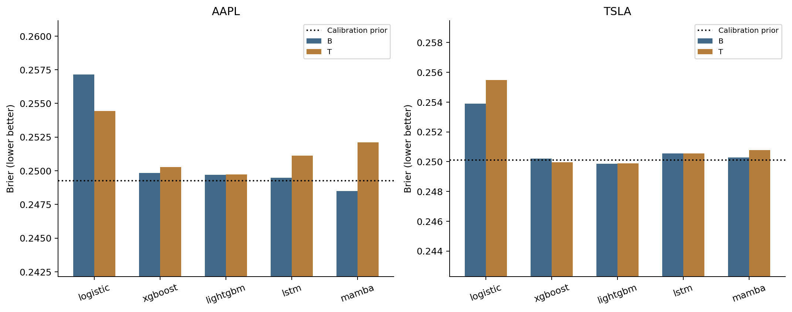
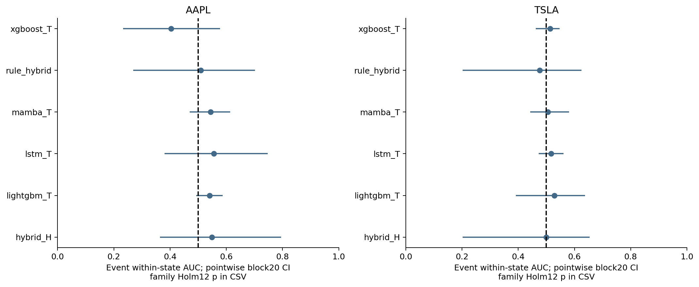
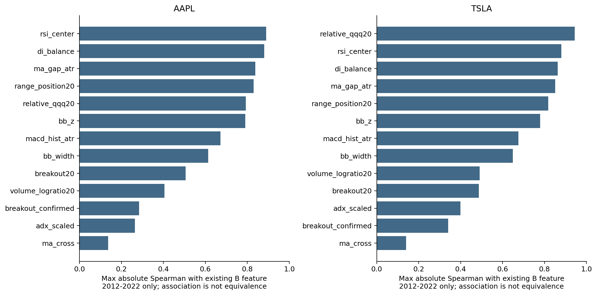
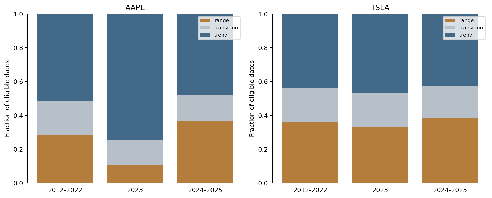
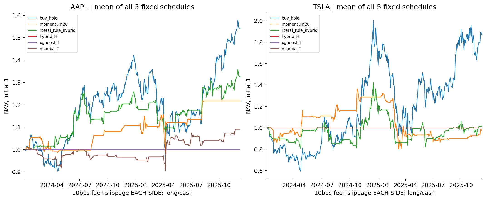

# E5 — Investor-Inspired Hybrid Stock Prediction

研究問題：一般投資者的技術分析是否提供既有多尺度特徵以外的五日反轉資訊？先查核[文獻與固定指標](LITERATURE.md)，再執行有限比較，沒有從測試挑門檻或擴大Hybrid。

B=E3b的38維多尺度特徵；T=B+12價格／量技術表示+1相對QQQ強弱。新增SMA20/60及交叉、Wilder RSI14(30/70)、MACD12/26/9、BB20±2SD、前20日高低點突破、量比1.5確認、ADX14趨勢>=25／盤整<20、DI balance、QQQ相對強弱。所有T模型見同一60×51資料；樹／Logistic展平3060欄。C=B+QQQ相對強弱，由Logistic／XGBoost隔離新增來源。

沿用2012–2022訓練、2023H1早停／H2 C1 Platt、2024–2025測試，各482日、seeds42–46、相同purging。162個新CV fit、90個新final fit；50個舊B只讀重用。神經batch64／max24／patience4，真正Mamba CUDA已通過；未更改原環境或2026協定。

| 模型 | AAPL B | AAPL T | TSLA B | TSLA T |
| --- | --- | --- | --- | --- |
| xgboost | 0.249847 | 0.250267 | 0.250207 | 0.249972 |
| lightgbm | 0.249707 | 0.249727 | 0.249855 | 0.249888 |
| lstm | 0.249484 | 0.251127 | 0.250556 | 0.250565 |
| mamba | 0.248494 | 0.252111 | 0.250284 | 0.250790 |

主要8項T−B比較HAC20／block20 bootstrap9999及Holm8後均無顯著增益；block60敏感度全列。AAPL四架構均變差，TSLA僅XGBoost改善約.000235。12個同狀態事件AUC檢定均未顯著。

## 規則、特徵還是架構？

- 訊號重複：RSI與原z20 Spearman約.890／.880，均線差與context60_ex5約.838／.851。相關不是資訊完全相同的證明。
- QQQ控制：TSLA XGBoost C／T皆約.249972；其微小B→T增益幾乎可在只加相對QQQ時重現。兩股Logistic T均劣於C；沒有可靠證據歸功其餘技術表示。
- 原規則與校準不同：校準MACD Brier AAPL.248145、TSLA.248287，但對常數的Holm14 p皆1，且AAPL斜率−.075、TSLA+.071。14規則校準器7個負斜率，不能稱原動能規則成功。
- Hybrid：固定ADX gate混合動能／均值回歸；學習Hybrid只有6欄、無交互作用對照4欄。加入gate在AAPL惡化.000315、TSLA改善.000050，均不顯著。AAPL學習Hybrid優於較差固定規則，是次要家族結果，globalHolm50未聯合顯著，未證明gate或架構優勢。
- 狀態漂移：AAPL趨勢占比train51.8%／val74.3%／test48.1%；兩股測試每日切換率6.24%／8.32%。ADX不是市場真實狀態。
- 最佳化差異：部分B／T選到不同配置，無法完全因果拆分表示與訓練；AAPL Mamba seed SD由.000700升到.004474。神經raw Brier亦惡化，不是所有負面結果都可歸咎校準。

## 成本後次要回測

固定long/cash、p_up>=.55、次日Open進／t+5 Close出；五個固定offset、每5交易日決策，不重疊、不槓桿／借券。主成本每邊fee5+slippage5=10bps，另5／20bps；五排程全報，沒有選最佳起始日。模型用均值概率ensemble，和主表平均seed損失分開。

平均累積淨報酬（約2024年1月至2025年12月初，各offset日期略異）：BuyHold AAPL54.11%、TSLA87.16%；原均線48.03%／23.03%；原MACD−12.28%／74.97%；原規則Hybrid32.53%／1.54%；soft momentum21.67%／−2.30%。TSLA原MACD五排程31.26%至146.98%，不能挑一個排程宣稱勝出。

TSLA原Hybrid每邊5／10／20bps約+5.72%／+1.54%／−6.32%。學習Hybrid兩股、XGBoost T兩股、TSLA Mamba T在固定門檻下零交易，0報酬不是避險成功；未因測試結果降門檻。BuyHold與long/cash曝險及隔夜風險不同，未聲稱顯著alpha。

[全部模型指標](results/metrics_comparison.csv)、[主要增益](results/feature_gains.csv)、[全部50比較與block60](results/paired_tests.csv)、[同狀態檢定](results/within_state_ranking.csv)、[全成本與排程](results/trading_per_schedule.csv)、[原規則覆蓋](results/literal_rule_coverage.csv)、[固定方法](config/evaluation_plan.json)。

核心程式：[e5_core.py](../../scripts/e5_core.py)、[原runner](../../scripts/run_e5.py)、[分析](../../scripts/analyze_e5.py)、[回測](../../scripts/backtest_e5.py)。公開重現不需checkpoint：`python scripts/reproduce_public.py --output-dir outputs/public_replay`。完整單模型重現用[run_public_model.py](../../scripts/run_public_model.py)及合法凍結行情；完整工作站archive不公開，以免夾帶行情和checkpoint。

**結論：尚未建立常見投資邏輯可穩定增加樣本外反轉預測能力的證據。**弱訊號、表示重複、狀態漂移與有限模型估計變異都與結果相容，仍未完成因果歸因。2024–2025已檢視，未使用2026調參，E5獨立驗證須另行預先登錄，不加入E3c原協定。
