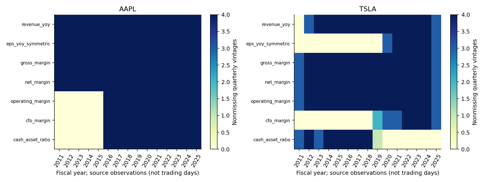
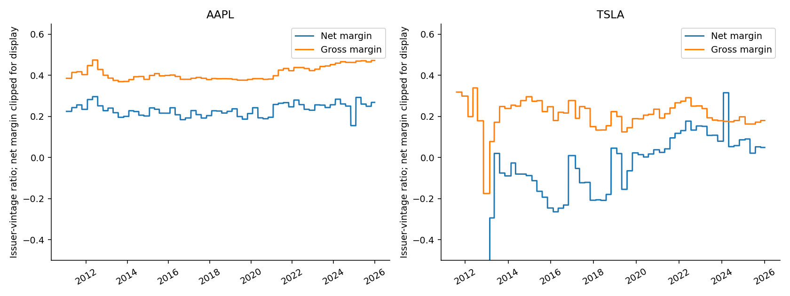
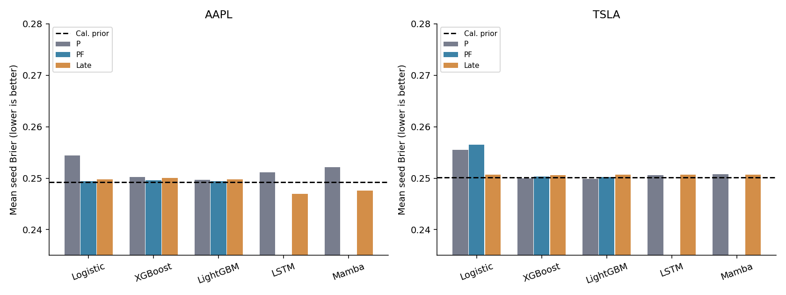
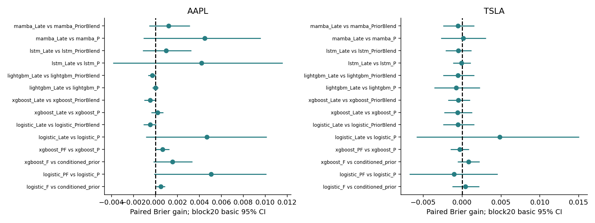
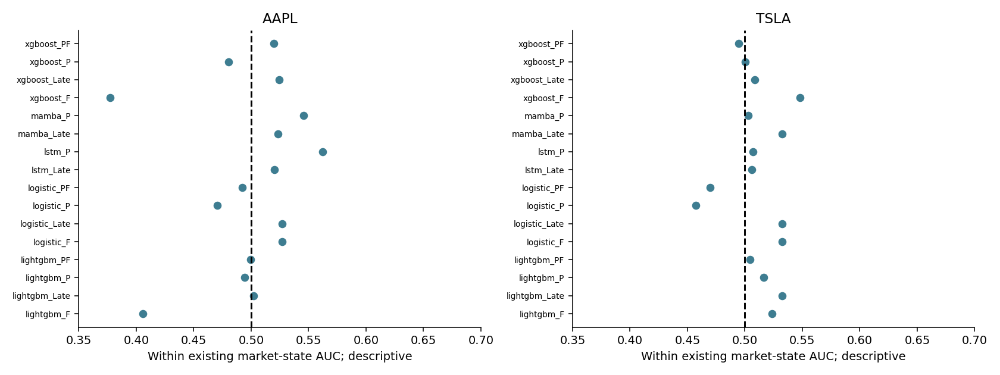
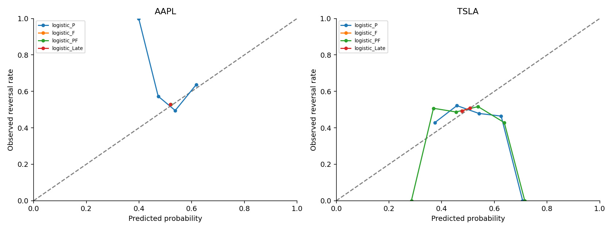

# E6 — Fundamental-Enhanced Hybrid Stock Prediction

研究日期：2026-11-06。對象：AAPL、TSLA。狀態：資料稽核、有限CPU實驗、統計、圖表與離線重現完成。這是已多次檢視的2024–2025資料上的探索性延伸，**不是新獨立樣本測試，也未證明基本面無效**。

## 摘要與教授問題的直接回答

本輪取得118個官方季度文件版本：AAPL60個、TSLA58個，分別涵蓋FY2011–2025與FY2011Q2–2025Q3。以舊E5價格／波動／技術P為固定參照，新增基本面F、Early Fusion和Late Fusion；共232次新CPU擬合、五seed42–46、每檔同482個測試交易日，完整逐日概率229,432列。已有真正Mamba及LSTM只以凍結E5預測參與Late Fusion，沒有重新訓練基本面神經編碼器或使用GPU。

**H1：尚無通過預先指定多重校正的基本面增量證據。** 主5日反轉的8項H1比較中，0項同時通過HAC與區塊bootstrap Holm8。AAPL Early Logistic的Brier從0.254449降至0.249389、XGBoost從0.250267降至0.249610；TSLA相對固定P則變差。AAPL單獨F LightGBM為0.248443、XGBoost為0.248708，但不能從這些探索性排名宣稱已確認基本面優勢。歷史分析師預期沒有可靠PIT快照，因此**投資者預期／Earnings Surprise的增量能力尚未被檢驗**。

**H3：尚無可靠的非退化融合優勢。** 主反轉的20項H3比較中0項同時通過兩種Holm20檢定。AAPL LSTM Late為0.246922、Mamba Late為0.247623，較各自P降低約1.67%／1.78%，但區塊20的未校正95%增益區間都跨0；TSLA未重現。與相同權重的P＋常數概率收縮控制相比，額外增益只剩約0.000980／0.001198，亦不顯著。所有112項次要同狀態排序檢定無校正後正向優勢。

次要直接上漲任務有一個必須如實呈現的顯著差異：AAPL Logistic Late相對非常弱的直接方向P（0.315318）降低Brier至0.251362，Holm12 bootstrap p=0.0024、同任務全部20項比較校正p=0.004。但其F權重=1，**實際完全棄用P，等於只用F，不能稱互補融合成功**；它沒有超越同校準期間常數概率0.251469（差0.000107，未校正bootstrap p=0.7603），也高於p=0.5固定猜測的Brier0.25。

最值得另行預先登錄的是**低複雜度、受限權重Late Fusion＋相同權重常數收縮控制**，而不是宣稱某一神經架構已勝出。先改善來源的真正PIT證據與增加獨立財報樣本，再進行一次未見期間驗證。

## 1. 動機、假說與既有研究連結

E0–E2顯示價格／波動幅度預測的複雜度不自動帶來優勢；E3研究區分平均反轉概率與同市場狀態內時機；E4未建立穩健新聞增量；E5技術表示沒有通過主多重比較。E6檢查新增的、來源不同的會計資訊能否超越這些確定性價格轉換。

H1專指資訊集：F對簡單條件概率、以及固定架構PF對P。H3專指融合方式：Late是否超越P以及相同權重P＋常數控制。不能把降低高維模型過度擬合、校準漂移或改變L2有效容量直接算成會計訊號。H2市場狀態模型／新門檻搜尋延後；僅沿用既有狀態作排名診斷。

會計研究的動機與這裡的任務有明確距離：Piotroski（2000）探討財務報表資訊；Bernard與Thomas（1989）研究盈餘公布後價格延遲反應。這些文獻不保證兩檔股票的5日反轉，也不能用實現EPS年增率冒充市場預期偏差。相關來源見文末。

## 2. 資料來源、覆蓋及PIT稽核

### 2.1 實際取得範圍

| ticker | quarterly_vintages | revenue_yoy | eps_yoy_symmetric | gross_margin | net_margin | operating_margin | cfo_margin | cash_asset_ratio |
|---|---|---|---|---|---|---|---|---|
| AAPL | 60 | 60 | 60 | 60 | 60 | 40 | 40 | 40 |
| TSLA | 58 | 54 | 22 | 58 | 58 | 58 | 23 | 31 |

表中為**非缺失季度版本數**，不是獨立每日樣本數。AAPL早期20個季度主要是當期官方發布稿中四捨五入的營收、獲利、毛利率和EPS；其餘40個季度有整份財務報表與官方網站提供的as-filed申報PDF。Tesla58個版本取自官方股東信／季度更新檔案，3個字型/影像表格以既有pdftoppm和Tesseract處理，保留原OCR、修正標頭、頁面圖片及人工視覺核對紀錄；沒有手工編造數值。

SEC submissions、companyfacts、Archives與官方FSDS ZIP在工作站直接請求均回傳403。這是取得限制，不代表SEC沒有資料，也不是模型結果。未繞過封鎖；採發行公司官方文件的不同公開管道。Apple目錄的ReportDate可能是季度排序欄位，例如FY2025Q4標成12/31，但實際發布稿日期為10/30；**本研究不用目錄ReportDate作可得時間**。Tesla的2012Q1目錄5/8與原PDF5/9、2019Q2目錄6/24與原PDF7/24不一致，在擬合前已採較晚原文日期修正。

LSEG I/B/E/S與FactSet提供PIT預期資料產品，但沒有本輪可合法使用的授權快照。Alpha Vantage文件描述EPS／營收預期與修訂欄位，仍未取得可驗證的歷史共識版本。未使用任何私人金鑰或購買資料，沒有補造Earnings Surprise。

### 2.2 可得時間與版本規則

1. 每個季度文件保留來源URL、發布DATE、抓取UTC、檔案SHA256、原文數值與擷取行。SEC acceptance、amendment時間未知時維持null；historical_first_seen_verified及historical_version_proven均為false。
2. 主對齊是發布DATE後**第二個嚴格後續交易日的收盤決策**，下一交易日開盤才起算標籤。發布當日不使用；另外固定延後5交易日敏感性。例：週五發布，週一仍不用，週二收盤才可用。這比猜測未知的盤前／盤後時刻保守。
3. 每個序列歷史時間點各自as-of join，不把新財報回填到60日序列的過去。未獲得當期資料不是零值；先保留缺失，模型只以訓練期中位數插補並加旗標，超過370日的會計數值視為缺失。
4. 後來報告的比較期修訂只會在該新報告已可得後出現；過往的日資料仍用原發布版本。EPS成長只用同份文件的可比數字；無法核對Tesla舊版EPS比較欄時保留缺失。不把拆股後最新EPS倒填，也不把回溯調整股價與歷史未調整EPS混算P/E。
5. Apple營運現金流通常是財年累計，分母使用同份報表的YTD營收，不除以單季營收；Tesla摘要的單季CFO與單季營收配對。舊股東信無法確認現金流期間時不猜測。

**證據上限：這是PIT-aware issuer-vintage重建，不是已認證的嚴格歷史PIT資料庫。** 今日官方URL標示的歷史發布DATE與as-filed副本，無法單獨證明歷史first-seen、網路延遲或檔案未被替換。缺少完整原始SEC接受／修訂鏈，不能承諾所有歷史版本問題已解決。本輪結果均以此限制為條件，未升格為確認性發現。

原市場輸入沿用E5相同凍結Yahoo調整OHLCV、QQQ、VIX/VXN與SHA256，沒有重新下載行情。這些是回溯調整快照，並非當年as-traded公司行動資料；基本面來源的PIT處理不能消除既有市場快照的限制。

| ticker | test_dates | first | last | test_distinct_vintages | training_distinct_vintages | extreme_event_dates | future_flat_returns | missing_any_accounting_on_test | max_release_date_used |
|---|---|---|---|---|---|---|---|---|---|
| AAPL | 482 | 2024-01-02 | 2025-12-02 | 9 | 45 | 101 | 0 | 0 | 2025-10-30 |
| TSLA | 482 | 2024-01-02 | 2025-12-02 | 9 | 45 | 122 | 0 | 482 | 2025-10-22 |

測試期每檔9個被使用的財報版本包含期初承接版本，只有8次新季度更新。TSLA在所有測試日期「至少一個會計欄缺失」主要來自未核對的cash/asset欄；不是所有基本面都缺失，也沒有將缺失當成公司無現金。

## 3. 任務、資訊與公平比較

主要標籤 `1[sign(log(C_t/C_(t-5))) × log(C_(t+5)/O_(t+1)) < 0]`。次要直接上漲標籤 `1[log(C_(t+5)/O_(t+1)) > 0]`；兩者是不同訓練任務。由反轉概率依已知過去方向映射的上漲概率另外保存，並非新方向模型；無未來零報酬時其Brier與反轉Brier代數完全一致，程式已核對。

- P：E5 T，60×51輸入。Logistic與樹模型攤平成3060欄，LSTM/Mamba用相同序列；選中設定及反轉預測原封重用。
- F：7個會計比率（營收YoY、對稱EPS YoY、毛利率、淨利率、營業利益率、CFO/對應營收、cash/assets）＋發布年齡＋7缺失旗標＋共同past5方向，共16個當日摘要。F含共同標籤方向metadata，不是完全無價格資訊的純財務模型。
- Early：P每個序列時間點追加15個當時可得F欄，60×66；共同方向不重複追加。新LR/XGB/LGBM使用各自E5 P已選超參數，只改輸入，不增加搜尋。
- Late：共同F Logistic專家與各P模型原始概率凸組合，F權重從0、.25、.5、.75、1用2017–2022原expanding CV選定，再對完整管線作相同2023H2 Platt校準。固定50/50也完整保存。相同權重P＋訓練期常數概率作收縮控制，不用測試挑選權重。
- Metadata控制：只有發布年齡、缺失旗標與方向的低維Logistic，用來區分會計數值和來源/時間代理；不是P＋metadata完全等容量因果消融。

訓練2012–2022，2023H1早停，2023H2校準，2024–2025測試。每個區段沿用end20 purge與完整60日歷史，即使主h5也保留20日邊界規則，因此測試信號至2025-12-02，末端報酬仍截至2025年。三個原fold：fit至2016/2018/2020年中、同年H2早停、接續兩年外層評估。F三候選×三fold×兩股×三模型＝54次CV；74次反轉最終/控制/延遲擬合；104次直接上漲最終/控制/延遲擬合，共232次。每次兩CPU執行緒，不修改環境或系統CUDA。

XGBoost/LightGBM上限300棵、25輪早停，參數空間與E3b/E5相同；LR採lbfgs上限500次。所有新LR無收斂警告。P與Early固定舊設定，F在原小型候選中選模；沒有使用測試結果換候選。直接上漲是次要凍結設定的壓力測試，沿用反轉選中設定及融合權重，並非充分調優的方向架構排名。

五seed不代表五倍獨立交易日；凸Logistic在固定資料下可能完全相同，零跨seed SD不是新的統計證據。每檔45個訓練財報版本未達事前100版本的新神經基本面模型門檻，因此新LSTM/Mamba Early沒有擬合；已完成的真正Mamba P參考可由保留的E5 smoke、版本與原模型來源hash稽核。**不可把本輪稱為新基本面Mamba已通過GPU訓練。**

## 4. 預先固定統計程序

主要為校準後Brier；另報LogLoss、ROC-AUC、Balanced Accuracy、MCC、ECE10與raw概率。每個日期先對五seed損失取平均，再比較同日期的損失差，正值=參照Brier−候選Brier。Bartlett HAC20與circular-block20 bootstrap9999次各做雙尾檢定與Holm校正；60、100交易日區塊為依賴敏感性，不挑選較顯著版本。

反轉H1家族8項＝兩股×LR/XGB×（F對方向條件先驗；Early對P）；H3家族20項＝兩股×五P架構×（Late對P；Late對同權重常數混合）。另列globalHolm28。次要直接上漲H1有8項、H3因只有三個CPU P模型而有12項，另列globalHolm20，不能混入主要反轉家族。

同狀態AUC只比較相同「past5方向×長120日排除近5日方向×VIX高低」格子內的正負標籤配對；先平均seed concordance kernel，再按完整交易日曆block20 bootstrap1999次。反轉與直接上漲的全日期/急漲跌診斷合計112項Holm。這是既有市場狀態的診斷，不新增H2市場狀態搜尋。事件／發布後與年度分組為描述性分析，不宣稱通過完整研究歷程的選擇校正。

## 5. H1：基本面資訊結果

| ticker | method | brier_mean | brier_sd | log_loss | AUC | balanced_accuracy | MCC |
|---|---|---|---|---|---|---|---|
| AAPL | cal_prior | 0.249267 | nan | 0.691681 | 0.500000 | 0.500000 | 0.000000 |
| AAPL | conditioned_prior | 0.250244 | nan | 0.693638 | 0.421551 | 0.500000 | 0.000000 |
| AAPL | lightgbm_F | 0.248443 | 0.000583 | 0.690030 | 0.541745 | 0.504685 | 0.017142 |
| AAPL | logistic_F | 0.249761 | 0.000000 | 0.692671 | 0.430854 | 0.500000 | 0.000000 |
| AAPL | logistic_metadata | 0.250104 | 0.000000 | 0.693358 | 0.409959 | 0.500000 | 0.000000 |
| AAPL | xgboost_F | 0.248708 | 0.000199 | 0.690562 | 0.525497 | 0.500000 | 0.000000 |
| TSLA | cal_prior | 0.250112 | nan | 0.693372 | 0.500000 | 0.500000 | 0.000000 |
| TSLA | conditioned_prior | 0.251088 | nan | 0.695328 | 0.485242 | 0.485242 | -0.029533 |
| TSLA | lightgbm_F | 0.250266 | 0.000160 | 0.693681 | 0.495084 | 0.497985 | -0.005126 |
| TSLA | logistic_F | 0.250651 | 0.000000 | 0.694454 | 0.498416 | 0.503547 | 0.010985 |
| TSLA | logistic_metadata | 0.250615 | 0.000000 | 0.694380 | 0.476624 | 0.500000 | 0.000000 |
| TSLA | xgboost_F | 0.250266 | 0.000145 | 0.693680 | 0.502261 | 0.506540 | 0.016051 |

F AAPL樹模型的Brier略低於同期間常數0.249267；TSLA F均未可靠超越0.250112。AAPL Logistic F與metadata-only的差為0.000343，未校正bootstrap p=0.0276，但同一預先次要比較家族校正後未通過；TSLA差為−0.000036。不能用單一未校正p值宣稱會計數值已提供額外資訊。

| ticker | candidate | reference | difference | hac_p_holm_family | bootstrap_p_holm_family | joint_positive_family |
|---|---|---|---|---|---|---|
| AAPL | logistic_F | conditioned_prior | 0.000483 | 0.166383 | 0.163200 | False |
| AAPL | logistic_PF | logistic_P | 0.005060 | 0.291234 | 0.312000 | False |
| AAPL | xgboost_F | conditioned_prior | 0.001536 | 0.444217 | 0.434000 | False |
| AAPL | xgboost_PF | xgboost_P | 0.000657 | 0.282082 | 0.256200 | False |
| TSLA | logistic_F | conditioned_prior | 0.000437 | 1.000000 | 1.000000 | False |
| TSLA | logistic_PF | logistic_P | -0.001027 | 1.000000 | 1.000000 | False |
| TSLA | xgboost_F | conditioned_prior | 0.000822 | 1.000000 | 1.000000 | False |
| TSLA | xgboost_PF | xgboost_P | -0.000329 | 1.000000 | 1.000000 | False |

H1改善不跨股票一致。Early新增高度重複、慢變的欄位，也會改變攤平輸入的有效正則化；固定C／樹深度避免更多搜尋，但不是完全隔離「純新資訊」與有限模型表示/容量的因果實驗。

## 6. H3：Early與Late融合

| ticker | model | P | F_logistic | Early_PF | Late | same_weight_prior_blend | F_weight |
|---|---|---|---|---|---|---|---|
| AAPL | logistic | 0.254449 | 0.249761 | 0.249389 | 0.249761 | 0.249260 | 1.000000 |
| AAPL | xgboost | 0.250267 | 0.249761 | 0.249610 | 0.250073 | 0.249598 | 0.500000 |
| AAPL | lightgbm | 0.249727 | 0.249761 | 0.249405 | 0.249739 | 0.249429 | 0.500000 |
| AAPL | lstm | 0.251127 | 0.249761 | nan | 0.246922 | 0.247902 | 0.750000 |
| AAPL | mamba | 0.252111 | 0.249761 | nan | 0.247623 | 0.248822 | 0.750000 |
| TSLA | logistic | 0.255476 | 0.250651 | 0.256504 | 0.250651 | 0.250121 | 1.000000 |
| TSLA | xgboost | 0.249972 | 0.250651 | 0.250301 | 0.250562 | 0.250092 | 0.750000 |
| TSLA | lightgbm | 0.249888 | 0.250651 | 0.250183 | 0.250651 | 0.250121 | 1.000000 |
| TSLA | lstm | 0.250565 | 0.250651 | nan | 0.250665 | 0.250159 | 0.750000 |
| TSLA | mamba | 0.250790 | 0.250651 | nan | 0.250651 | 0.250121 | 1.000000 |

NaN的LSTM/Mamba Early是事前樣本支持門檻未滿，**不是訓練失敗或測試不好被刪除**。AAPL/TSLA Logistic、TSLA LightGBM與TSLA Mamba的Late權重=1，直接退化成同一F Logistic；不可將這四個設定當作互補融合。

| ticker | candidate | reference | difference | hac_p_holm_family | bootstrap_p_holm_family |
|---|---|---|---|---|---|
| AAPL | logistic_Late | logistic_P | 0.004688 | 1.000000 | 1.000000 |
| AAPL | logistic_Late | logistic_PriorBlend | -0.000502 | 1.000000 | 1.000000 |
| AAPL | xgboost_Late | xgboost_P | 0.000193 | 1.000000 | 1.000000 |
| AAPL | xgboost_Late | xgboost_PriorBlend | -0.000476 | 1.000000 | 1.000000 |
| AAPL | lightgbm_Late | lightgbm_P | -0.000013 | 1.000000 | 1.000000 |
| AAPL | lightgbm_Late | lightgbm_PriorBlend | -0.000311 | 1.000000 | 1.000000 |
| AAPL | lstm_Late | lstm_P | 0.004205 | 1.000000 | 1.000000 |
| AAPL | lstm_Late | lstm_PriorBlend | 0.000980 | 1.000000 | 1.000000 |
| AAPL | mamba_Late | mamba_P | 0.004487 | 1.000000 | 1.000000 |
| AAPL | mamba_Late | mamba_PriorBlend | 0.001198 | 1.000000 | 1.000000 |
| TSLA | logistic_Late | logistic_P | 0.004825 | 1.000000 | 1.000000 |
| TSLA | logistic_Late | logistic_PriorBlend | -0.000530 | 1.000000 | 1.000000 |
| TSLA | xgboost_Late | xgboost_P | -0.000590 | 1.000000 | 1.000000 |
| TSLA | xgboost_Late | xgboost_PriorBlend | -0.000470 | 1.000000 | 1.000000 |
| TSLA | lightgbm_Late | lightgbm_P | -0.000762 | 1.000000 | 1.000000 |
| TSLA | lightgbm_Late | lightgbm_PriorBlend | -0.000530 | 1.000000 | 1.000000 |
| TSLA | lstm_Late | lstm_P | -0.000100 | 1.000000 | 1.000000 |
| TSLA | lstm_Late | lstm_PriorBlend | -0.000506 | 1.000000 | 1.000000 |
| TSLA | mamba_Late | mamba_P | 0.000139 | 1.000000 | 1.000000 |
| TSLA | mamba_Late | mamba_PriorBlend | -0.000530 | 1.000000 | 1.000000 |

AAPL LSTM相對P增益0.004205（區塊20基本95%CI −0.003878至0.011585），Mamba增益0.004487（−0.001104至0.009600），HAC/Bootstrap Holm20都未通過。只與P比較，約76.7%／73.3%的表面增益也能被相同權重的常數概率收縮重現。剩餘F增益0.000980／0.001198的CI亦跨0；因此不能將改善全部歸功於基本面時機訊號或神經網路長期記憶。

## 7. 概率校準與同狀態時機辨識

| ticker | method | group | within_state_auc | ci_low | ci_high | bootstrap_holm_all |
|---|---|---|---|---|---|---|
| AAPL | logistic_F | all | 0.527075 | 0.453350 | 0.628541 | 1.000000 |
| AAPL | logistic_F | extreme_any | 0.448387 | 0.213430 | 0.685501 | 1.000000 |
| AAPL | lstm_Late | all | 0.520047 | 0.436032 | 0.593829 | 1.000000 |
| AAPL | lstm_Late | extreme_any | 0.561935 | 0.349553 | 0.804054 | 1.000000 |
| AAPL | mamba_Late | all | 0.523325 | 0.474140 | 0.567749 | 1.000000 |
| AAPL | mamba_Late | extreme_any | 0.554839 | 0.462686 | 0.646482 | 1.000000 |
| TSLA | logistic_F | all | 0.532344 | 0.450125 | 0.592322 | 1.000000 |
| TSLA | logistic_F | extreme_any | 0.437390 | 0.225633 | 0.572728 | 1.000000 |
| TSLA | lstm_Late | all | 0.505962 | 0.439858 | 0.575746 | 1.000000 |
| TSLA | lstm_Late | extreme_any | 0.473369 | 0.354812 | 0.603672 | 1.000000 |
| TSLA | mamba_Late | all | 0.532344 | 0.450125 | 0.592322 | 1.000000 |
| TSLA | mamba_Late | extreme_any | 0.437390 | 0.225633 | 0.572728 | 1.000000 |

AAPL LSTM Late整體AUC0.583474，但同狀態AUC只有0.520047；Mamba Late分別0.549749與0.523325。這與主要辨識粗市場狀態、而非穩定辨識同狀態的反轉時點相容；不是對唯一成因的證明。急漲跌AAPL內的LSTM/Mamba同狀態AUC約0.562／0.555，區間寬且校正p=1；TSLA沒有一致結果。

共同沿用E5的C1 Platt允許負斜率，本輪460個命名完整的模型/混合校準紀錄中227個為負（這些並非獨立檢定）。例如AAPL Logistic F斜率−0.064676、TSLA Logistic F−0.598098；不能把校準後概率的反向排序當成原始會計經濟邏輯成功。Raw及校準指標均保存，不從測試二選一。凍結runner有輔助CSV的method名稱欄位被校準器字典覆蓋問題，已從不變raw概率重建名稱與係數，460條概率逐一吻合；修復不重新fit、不改預測、不改檢定，前版CSV及稽核完整保留。

## 8. 急漲急跌與時間敏感性

| ticker | method | n | brier | AUC |
|---|---|---|---|---|
| AAPL | cal_prior | 101 | 0.245392 | 0.500000 |
| AAPL | logistic_F | 101 | 0.246079 | 0.335304 |
| AAPL | lstm_Late | 101 | 0.241441 | 0.625929 |
| AAPL | lstm_P | 101 | 0.241931 | 0.539949 |
| AAPL | mamba_Late | 101 | 0.243250 | 0.576858 |
| AAPL | mamba_P | 101 | 0.248678 | 0.517314 |
| TSLA | cal_prior | 122 | 0.249736 | 0.500000 |
| TSLA | logistic_F | 122 | 0.249046 | 0.521388 |
| TSLA | lstm_Late | 122 | 0.249566 | 0.522142 |
| TSLA | lstm_P | 122 | 0.250275 | 0.507452 |
| TSLA | mamba_Late | 122 | 0.249046 | 0.521388 |
| TSLA | mamba_P | 122 | 0.251370 | 0.499596 |

事件定義沿用E3a訓練期past5的q10/q90，沒有以E6結果重新挑門檻。AAPL101事件、TSLA122事件是重疊日事件數，不是獨立財報數；表中AUC為事件內整體AUC，不能代替上一節的同狀態AUC。長短期衝突、發布後14曆日、陳舊60日以上、2024/2025分年與每5日非重疊資料都保存在event_and_release_age_metrics.csv；僅作描述，H2不新增主假說。

| ticker | candidate | difference | bootstrap_p | bootstrap_p_holm_family |
|---|---|---|---|---|
| AAPL | logistic_F_delay5 | 0.000618 | 0.104800 | 1.000000 |
| AAPL | logistic_PF_delay5 | 0.000123 | 0.631200 | 1.000000 |
| TSLA | logistic_F_delay5 | 0.000194 | 0.681600 | 1.000000 |
| TSLA | logistic_PF_delay5 | 0.000184 | 0.719900 | 1.000000 |

這裡的差值是「延後5日模型相對主延後2日模型」的Brier增益，不是與P相比的資訊增益。敏感性只依預先計畫重新fit seed42 Logistic F/PF，沿用同設定，不重選超參數。區塊60/100同樣未使主H1/H3取得可靠反轉優勢。100日區塊約只剩4.8個等效區塊，提醒季度叢聚造成的小樣本推論上限，不能把每日482列當成482份獨立基本面事件。

## 9. 直接上漲次要任務

| ticker | method | brier_mean | log_loss | AUC |
|---|---|---|---|---|
| AAPL | cal_prior | 0.251469 | 0.696085 | 0.500000 |
| AAPL | logistic_F | 0.251362 | 0.695871 | 0.557260 |
| AAPL | logistic_Late | 0.251362 | 0.695871 | 0.557260 |
| AAPL | logistic_P | 0.315318 | 0.849514 | 0.510962 |
| AAPL | logistic_PF | 0.317040 | 0.864059 | 0.481588 |
| AAPL | xgboost_F | 0.251754 | 0.696657 | 0.469349 |
| AAPL | xgboost_Late | 0.252094 | 0.697338 | 0.474534 |
| AAPL | xgboost_P | 0.254415 | 0.702093 | 0.501562 |
| AAPL | xgboost_PF | 0.252963 | 0.699109 | 0.488518 |
| TSLA | cal_prior | 0.253488 | 0.700149 | 0.500000 |
| TSLA | logistic_F | 0.253430 | 0.700037 | 0.480562 |
| TSLA | logistic_Late | 0.253430 | 0.700037 | 0.480562 |
| TSLA | logistic_P | 0.264075 | 0.721984 | 0.442790 |
| TSLA | logistic_PF | 0.290666 | 0.783129 | 0.441636 |
| TSLA | xgboost_F | 0.253466 | 0.700105 | 0.508349 |
| TSLA | xgboost_Late | 0.253526 | 0.700228 | 0.475789 |
| TSLA | xgboost_P | 0.254305 | 0.701814 | 0.497257 |
| TSLA | xgboost_PF | 0.253684 | 0.700547 | 0.495032 |

直接訓練方向的結果沒有顯示穩健新訊號。AAPL Logistic P與PF的Brier高於0.31，反映這組凍結、原為反轉選模的高維設定在方向任務及校準轉移上的失準；不能據此宣稱所有價格模型不適合方向預測。Late選到wF=1後從0.315318降至0.251362的顯著差異是真實表格結果，但它是移除弱P分支，沒有證明融合帶來互補，也沒有超越簡單概率。相同規則下TSLA的F與先驗差距更小。Mamba/LSTM沒有新直接方向fit；其代數映射上漲概率另存，不能拿來冒充本節獨立方向訓練。

## 10. 研究限制與完整性

1. 來源版本與接受時間未完全恢復，無法認證嚴格PIT；不能用保守延遲作其替代證明。財報發布瞬間前後的驚喜反應也可能被延遲規則刻意排除。
2. 只有兩個存活大型股票、45個訓練/9個測試承接版本；不同會計制度、Tesla加密資產重編、報表期間及來源缺失會造成非平穩性。分母與同文件比較期已核對，仍需更完整原始XBRL與修訂鏈。
3. 缺失指標及發布年齡可能是時間/來源代理；metadata-only不是完全等容量的P＋metadata消融。未取得分析師預期、盈餘預期修訂或arrival-time資料，不能對這部分H1下結論。
4. 固定P已知經歷測試檢視，E6又重用同2024–2025日期；Holm28只處理本輪明列家族，不控制E0–E6整個研究歷程的選擇偏誤。CV權重與F設定使用相同前期fold，CV數字含選擇樂觀性，不是新的獨立效能估計。
5. 五seed是訓練隨機性敏感性，不是五個市場樣本。樣本量門檻是務實複雜度控制，不是神經模型不可能有效的定理。本輪未執行新基本面LSTM/Mamba Early，不能對其優劣作無資料斷言。
6. 未建立交易策略或用報酬取代概率準確率；直接標籤用可執行開收盤時點，不代表已處理實盤交易成本、流動性或產生獲利證據。
7. 2026未用於任何模型資料、標籤、選模、調參或評分，既有E3c協定檔案保持不變。但本輪來源搜尋**意外顯示部分2026 AAPL/TSLA財報摘要數字**，另看到官方IR目錄2026連結；此前E4/E5也有已披露接觸。因此不得宣稱研究者完全未接觸2026資訊。存於holdout_access_disclosure.json；舊協定未執行，日後獨立性須依實際接觸及原協定重新稽核，不能默認保證。

## 11. E6獨立驗證提案（尚未執行、不改E3c協定）

先取得可授權的SEC原始申報與修訂接受鏈、或供應商真正歷史PIT財報/共識快照；建立每個欄位的arrival時間、公司行動單位與來源稽核。若只能維持兩股約每年8次季度更新，無法靠延長幾個月取得強推論，宜在驗證前預定擴大股票宇宙並處理存活者偏誤，或接受很寬的不確定性。

候選方法類型優先低維F Logistic與受限權重Late（共同F專家，價格分支固定），保留Early LR/XGB作比較，不因本次AAPL較佳就挑選只報AAPL或只報LSTM。確切模型、係數、權重選擇規則、PIT延遲、比較家族、最小事件數和一次性解封程序，都應在未來真正未見期間開始前另行預先登錄。原E3c2026協定與其候選完全不變，E6不得插隊；若2026已有資訊接觸影響獨立性，另選更晚、尚未開始且未被研究者看到的期間。未來驗證必須同時檢查：F相對條件概率、PF相對P、Late相對P/同權重先驗收縮，以及同狀態AUC；不只看單一排名或改善百分比。

## 12. 重現、稽核與檔案索引

詳見README_E6.md。離線重現使用保存的價格快照及逐日概率重算7張統計表，不呼叫網路、不使用GPU、不重訓模型。原訓練程式、54個CV fit、178個最終/控制/延遲fit、所有模型checkpoint、設定、訓練歷史、日誌與環境版本均保存。最終ZIP含版權財報與發布稿，僅供私人研究稽核；不代表可以公開再散布全文。

- 主要指標：tables/metrics_comparison.csv、metrics_per_seed.csv。
- H1/H3：information_and_fusion_gains.csv、paired_tests.csv、fusion_comparison.csv、fusion_weights.json。
- 排序/校準：within_state_ranking.csv、calibration_bins.csv、calibration_parameters.csv。
- 事件：event_and_release_age_metrics.csv；主同日預測：predictions/all_probabilities.csv.gz。
- 資料：inputs/fundamental_vintages.csv、兩股daily_fundamentals.csv、raw/原PDF/發布稿、audits/extraction_evidence.csv、document_hashes_final.json。
- 來源與保留期：data_source_audit.csv、holdout_access_disclosure.json、all_existing_protocol_lock_checks.json。
- 計畫與選模：evaluation_plan.json、plan_locked.json、selected_F_configs.json、selection_locked.json、frozen_manifest.json。

## 參考來源

1. [SEC EDGAR APIs：submission與XBRL資料、更新與歷史檔案](https://www.sec.gov/search-filings/edgar-application-programming-interfaces)。
2. [SEC Financial Statement Data Sets：as-filed範圍與限制](https://www.sec.gov/dera/data/financial-statement-data-sets.html)。
3. [Apple Investor Relations](https://investor.apple.com/investor-relations/)、[FY2025Q2原財務報表](https://www.apple.com/newsroom/pdfs/fy2025-q2/FY25_Q2_Consolidated_Financial_Statements.pdf)。逐篇原始URL見document_inventory.csv。
4. [Tesla Investor Relations](https://ir.tesla.com/)、[2025Q3官方季度更新](https://assets-ir.tesla.com/tesla-contents/IR/TSLA-Q3-2025-Update.pdf)、[同季原SEC申報](https://www.sec.gov/Archives/edgar/data/1318605/000162828025045968/tsla-20250930.htm)。
5. [LSEG I/B/E/S Estimates](https://www.lseg.com/en/data-analytics/financial-data/company-data/estimates/)、[FactSet PIT Consensus](https://www.factset.com/marketplace/catalog/product/factset-estimates-pointintime)、[Alpha Vantage API文件](https://www.alphavantage.co/documentation/)。產品文件不等於本輪已取得授權資料。
6. Piotroski, J. D. (2000). Value Investing: The Use of Historical Financial Statement Information to Separate Winners from Losers. Journal of Accounting Research, 38, 1–41. [論文副本](https://www.ivey.uwo.ca/media/3775523/value_investing_the_use_of_historical_financial_statement_information.pdf)。
7. Bernard, V. L., & Thomas, J. K. (1989). Post-Earnings-Announcement Drift: Delayed Price Response or Risk Premium? Journal of Accounting Research, 27, 1–36. [DOI](https://doi.org/10.2307/2491062)。
