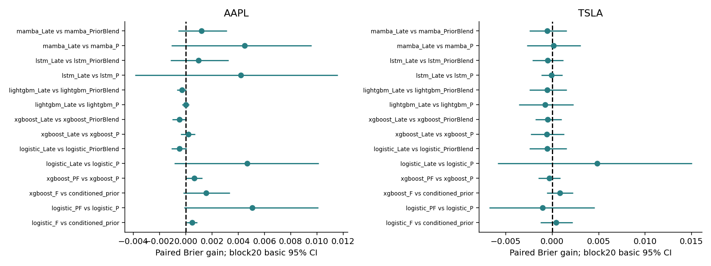

# E6 — Fundamental-Enhanced Hybrid Stock Prediction

H1基本面資訊增量、H3融合互補；H2延後。使用118個回溯issuer季度版本（AAPL60／TSLA58）、凍結E5 P51、F16與Early PF66；232次CPU擬合，沒有新增GPU訓練。真正Mamba／LSTM只用原E5凍結預測做Late，沒有新基本面神經編碼器。

主5日反轉：H1聯合校正0/8，H3 0/20；同狀態排名0/112。AAPL LSTM／Mamba Late點估計改善，但相同權重常數控制可重現大部分，未有可靠互補證據。直接上漲的一項顯著比較F權重=1、完全捨棄弱P，不是融合成功。歷史分析師預期沒有取得，不製造surprise。

**118個版本沒有SEC acceptance／修訂／firstseen完整鏈；按E7新嚴格契約0/118可進確認性主分析。** +2／+5交易日延遲是敏感性，不是PIT認證；2024–2025探索性。

[完整研究報告](E6_SUMMARY.md) · [主要配對檢定](results/paired_tests.csv) · [融合控制](results/fusion_comparison.csv) · [原計畫](config/evaluation_plan.json) · [2026意外接觸揭露](audits/holdout_access_disclosure.json)

公開程式e6_core／e6_data／run_e6／analyze_e6／replay_e6位於根scripts；完整訓練需合法取得原市場及季度文件、對應凍結manifest及E5預測。本repo不包含原文件、逐日受限輸入、模型、全文或完整工作站ZIP，不宣稱從彙整表可以重跑全部模型。原始報告中的outputs路徑是本機bundle相對路徑。公開彙整與E7控制重現見[說明](../../docs/REPRODUCIBILITY.md)。
