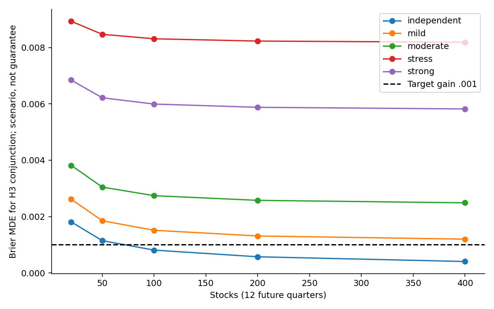

# E7a — Publication-Oriented Research Design & Validation Planning

主題：新增資訊的預測增益，還是校準、收縮、重複表示與選擇偏誤？本階段只做設計與CPU稽核；沒有新金融訓練或2026驗證。

- [研究設計／E0–E6證據](E7A_RESEARCH_DESIGN.md)
- [41篇結構化快速文獻回顧](LITERATURE_REVIEW.md)
- [缺口與貢獻](RESEARCH_GAP_AND_CONTRIBUTIONS.md)
- [資料與PIT可行性](DATA_FEASIBILITY_AND_PIT_AUDIT.md)
- [統計功效](STATISTICAL_POWER_ANALYSIS.md)
- [預分析協定候選](PREREGISTERED_EVALUATION_PROTOCOL.md)
- [論文架構](PAPER_OUTLINE.md)

**協定尚未對外註冊、資料／功效閘門未過、確認性研究未執行。** 六個主要比較同時控制metadata、重複價格、同權重及tuned常數收縮、最佳單模型。未來候選200股×16季度不等於目前已具功效；兩股開發變異無法代表跨產業人口，Early的必要變異也尚未量測。

```bash
python scripts/e7a_public_replay.py --bundle research/E7a --output-dir outputs/e7a_replay
E7A_OUTPUT=research/E7a python scripts/test_e7a.py
```

不需網路、GPU或原始行情；使用requirements/public-cpu.txt。重算4表及8個契約／控制測試。完整舊市場／來源管線不可僅憑公開彙整重現。根scripts中development_audit／evidence_audit等需工作站原研究資產；公開入口是e7a_public_replay。[詳細邊界](REPRODUCIBILITY.md)。


