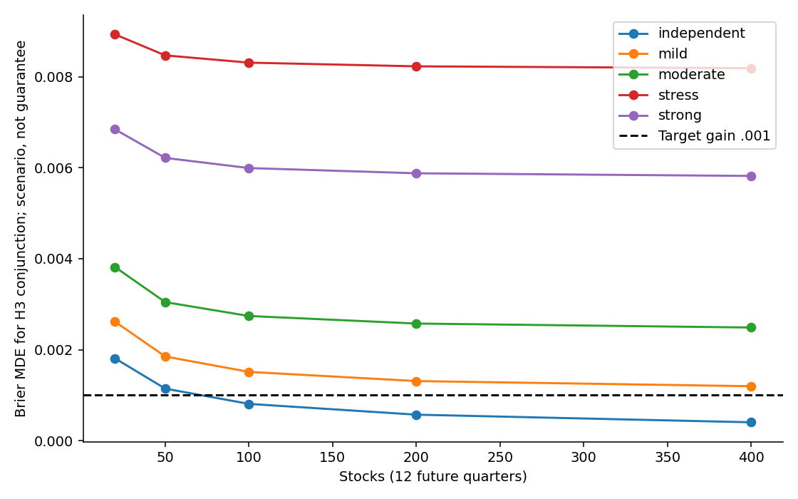
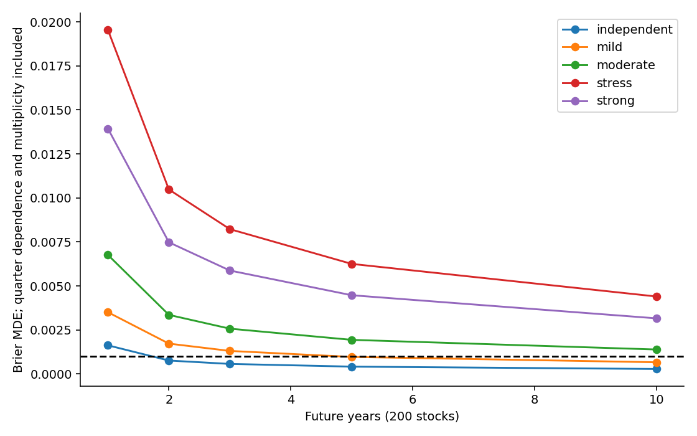

# 統計功效、相依性與可偵測效果量

## 1. 實際輸入與估計單位

功效尺度只用既有E5 P的Logistic／XGBoost config0、E6 F Logistic config0、seed42、固定50/50之2017–2022前向CV。市場副本截到2022，未使用新的2024–2025效果選樣本量。每股票／模型有1450個CV日、24個季度；兩公司提供48個公司季度，但只有24個共同日曆季度。12個模型×比較cell合成288列不是288個獨立財報事件。季度平均損失可描述，但日曆季度不等於精確的財報發布事件；未來另以accession統計更新。

本輪量測日損失HAC lag0/5/20/60、季度lag0/1/2/4及兩股相關診斷，完整CSV在tables。兩股相關不能代表跨產業人口ICC。原CV是探索性開發資料，這裡只取變異尺度、不用其平均增益作預期效果。

## 2. 規劃模型與推導

令σ為季度成對平均Brier損失差的SD，J為股票數、Q為季度數。情境分解為共通AR(1)市場項、持久公司項及個別AR(1)項，變異占比ρm、ρi及φ皆為假設：

`g(Q,φ)=[Q+2 Σ(l=1..Q−1)(Q−l)φ^l]/Q²`

`Var(mean)=σ²[ρm*g + ρi/J + (1−ρm−ρi)*g/J]`。

獨立時回到σ²/(JQ)；共同市場項不隨J消失，公司持久項不隨Q消失。以t(Q−1)及Bonferroni6保守近似Holm6，單比較80% MDE=(critical+z.8)*SE。H1或H3三項皆成功的80%規劃以union bound令每項功效≥.93333，因此MDE=(critical+z.93333)*SE；不是把三個80%相乘或把seed當樣本。此近似沒有模擬實際估計SE的分布。

假設獨立／mild(.01,0,.3)／moderate(.05,.10,.3)／strong(.15,.15,.6)／stress(.30,.20,.6)，另σ×.5/1/2，股票20–400、季度4–40。參考σ=.0059531805226298為目前同權重收縮增量中四個cell的最大值，不是跨產業保守上界。

## 3. 結果與設計含義

|情境，200股票|12季度三項聯合80% MDE|16季度三項聯合80% MDE|
|---|---:|---:|
|完全獨立|.000572|.000478|
|中度相關|.002575|.002184|
|強相關|.005877|.005027|

以上只適用σ參考，不代表六比較整體已具功效。J200、改善.001時，獨立需6季、mild19季、moderate91季（22.75年）；strong／stress於200季搜尋範圍仍未達標。改善.0025時moderate需13季，strong66季。由此不能只建議「多抓幾檔股票」；時間共同衝擊與更新頻率才可能是瓶頸。[全部情境](tables/power_design_grid.csv)、[所需期間](tables/required_period_scenarios.csv)、[16季比較](tables/variance_stress_and_16quarter_candidate.csv)。

**最關鍵的限制**：F-vs-prior季度σ最大 .008295；強XGBoost總改善 .006330；弱高維Logistic總改善 .058850，約為本參考10倍。尚無真正Early(P+M+F)對P+M的CV變異量。因此不能把matched-shrink結果當作所有H1／H3的功效保證。條件校準、panel訓練與更廣股票也會改變σ。[變異適用範圍](tables/variance_reference_limits.csv)。

## 4. 模擬與穩健性

每情境20,000次已知SE高斯panel-mean模擬，固定6項Holm、效果0/.0005/.001/.0025/.005、比較間相關0/.5/.9；報H3末三項聯合成功率與Monte Carlo SE。[模擬表](tables/power_simulation.csv)。它檢查規劃算術，不是對實際雙向cluster／block bootstrap檢定尺寸的驗證；null下保守也不能保證真實資料中正確。

SESOI預先暫定絕對Brier .001，規劃目標 .0025（相對.25約1%）；此為研究價值門檻，非經濟獲利換算，也非由測試期最佳效果取值。若將來CI寬，結論應為不足以判別；若要排除|δ|≥.001需另按固定界線作多重校正等效檢定，不能把p>.05當作無資訊。

## 5. 可行方案與啟動條件

近期先完成20公司PIT原型，再取得≥100開發公司×≥40季度，估計每個主比較的σ與共同時間依賴，進行實際推論null／coverage模擬。候選確認樣本為200股×16未來季度；只有在六項比較都通過最壞合理情境joint80%規劃且檢定尺寸合格時才註冊。這不是目前已可執行的保證；若σ接近弱Logistic或強共同衝擊，四年仍不足，應縮小論文主張或改為精確度／方法稽核研究，不追逐更多模型。

初稿5比較的功效輸出完整保留在`drafts/five_contrast_planning/`；正式候選採6比較。本文件所有主數字為6比較，原始開發變異表中`Bonf5`欄只屬初稿診斷，不能作本協定功效引用。
