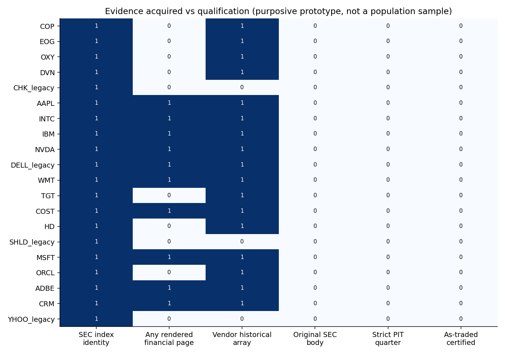
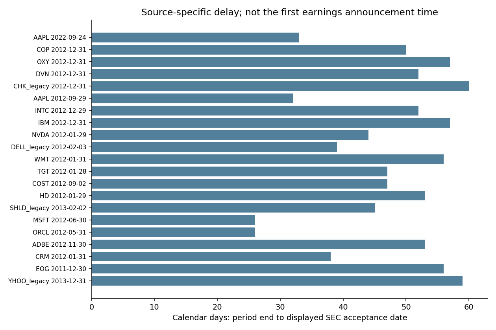
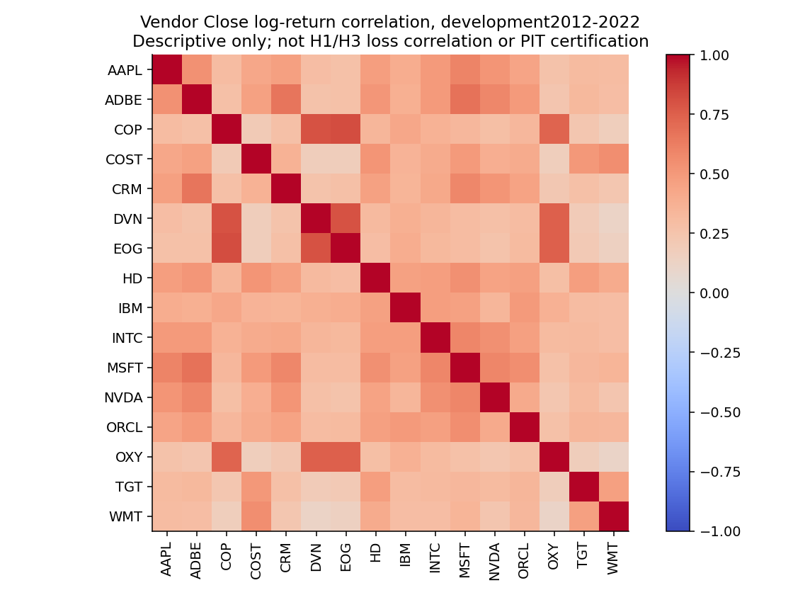

# E7b：20公司Point-in-Time財務資料原型

日期：2026-11-07。研究範圍：公開來源、2012–2022開發期。狀態：**資料取得／稽核與fail-closed工程原型完成；尚未建立可供H1／H3正式推論的合格PIT面板**。新增模型擬合0次、模型搜尋0次、GPU工作0次。使用者已確認目前沒有機構授權匯出，本輪不購買或假設具備權限。

## 1. 主要結果與可用範圍

|項目|實際取得／檢查|能否算正式資格|
|---|---:|---|
|固定公司／研究組|20／4|目的性技術與身分壓力樣本，不是代表性機率抽樣|
|由官方歷史索引核對CIK|20家|只確認所示歷史申報身分，不代表2011上市母體資格已核對|
|可讀唯一申報索引|21份|含額外AAPL2022案例；不能算21份原始申報全文|
|可讀SEC財務rendered頁|17頁、10家、90列候選顯示觀測|含parenthetical頁；非每家三大報表，更非原始XBRL context|
|查詢代號取得歷史行情|17個、45,893列|16個覆蓋2012–2022；舊Dell僅2016起，均未認證as-traded／身分鏈|
|原始SEC HTTP文件／XBRL instance bytes|0／0|未取得，不能以文字轉出檔雜湊替代|
|嚴格合格公司季度|0|不是宣稱公司沒財報，而是證據鏈尚未完成|
|獨立人工原文件核對|0／目標200|模型輔助索引閱讀與23項程式測試不等於人工200文件|
|六項主要比較的真損失變異／尺寸|NOT_ESTIMABLE|不補0、不拿價格相關代替、不啟動訓練|

本次取得成功與資格失敗同時保留。當前名義20×44季度＝880個公司日曆季度、7欄＝6,160個目標格；但退出／身分／交易資格母體尚未確認，這不是已認證的可觀測樣本分母，也不能要求每家公司都活滿44季。所有資格不足格均為null與原因，沒有填成經濟上的0。

## 2. 樣本及來源追溯

|公司／原型ID|預設研究組|可讀索引|財務rendered頁|歷史行情列|嚴格季度|
|---|---|---:|---:|---:|---:|
|COP|oil_gas_extraction|1|0|2768|0|
|EOG|oil_gas_extraction|1|0|2768|0|
|OXY|oil_gas_extraction|1|0|2768|0|
|DVN|oil_gas_extraction|1|0|2768|0|
|CHK_legacy|oil_gas_extraction|1|0|0|0|
|AAPL|computing_hardware|2|4|2768|0|
|INTC|computing_hardware|1|2|2768|0|
|IBM|computing_hardware|1|1|2768|0|
|NVDA|computing_hardware|1|1|2768|0|
|DELL_legacy|computing_hardware|1|1|1605|0|
|WMT|retail_trade|1|1|2768|0|
|TGT|retail_trade|1|0|2768|0|
|COST|retail_trade|1|2|2768|0|
|HD|retail_trade|1|0|2768|0|
|SHLD_legacy|retail_trade|1|0|0|0|
|MSFT|software_services|1|1|2768|0|
|ORCL|software_services|1|0|2768|0|
|ADBE|software_services|1|3|2768|0|
|CRM|software_services|1|1|2768|0|
|YHOO_legacy|software_services|1|0|0|0|

四組是能源／電腦硬體與半導體／零售／軟體服務的原型研究組，**不是E7a四個SIC大區間母體的已完成抽樣**。其中COP在原型預設13，但2013申報索引實際SIC為2911；保留不一致，不推定哪個分類一定正確，不偷偷換公司或改碼。完整[公司稽核](tables/company_PIT_coverage.csv)、[索引](tables/filing_index_metadata.csv)、[來源manifest](tables/source_manifest.csv)、[列示原始檔案位置與大小](tables/SEC_listed_artifact_manifest.csv)。

工作站普通公開請求在Sandbox內遇DNS限制，正常Sandbox外讀取SEC API／Archives／歷史index均回403；FSDS請求顯示Request Rate Threshold Exceeded，停止直接重試，沒有旋轉代理、偽裝身分或繞過限制。內建網頁服務可讀部分官方頁，卻不能匯出原始XML／ZIP bytes。這是本執行環境的取得限制，不是聲稱官方資料不存在。四筆HTTP失敗的原response未保存，所以SHA保持null，沒有捏造raw檔案。詳見`audits/direct_SEC_access_failures.json`。

## 3. 時間與版本：具體觀察

21份索引的period end至顯示Accepted日期差中位數為**50日**；10份顯示鐘面晚於17:00，2份顯示Accepted日期與Filing Date不同。AAPL2022顯示Accepted 2022-10-27 18:01:14、Filing Date 10/28；Sears顯示2013-03-19 19:43:54、Filing Date 3/20。這說明期末日、Filing Date與處理時刻不能互換。[時間診斷](tables/source_timing_diagnostics.csv)。

上述為官方索引的原顯示鐘面，尚未完成原SGML／時區／dissemination鏈的交叉認證；不直接把10筆視為已認證的紐約17:00後事件。50日是**相對SEC來源文件**的日期差，不是首次財報發布延遲；同一數字可能更早在公司發布稿出現。不得據此宣稱所有數值直到Accepted才首次公開。

來源公開／acceptance、歷史供應商received與現在retrieved分開儲存。未取得received不等於從未收到；retrieved2026不能當成2012可得證據。對可驗證原始SEC來源，E7a允許SOURCE_EVENT等級與COLLECTOR_ARRIVAL分開；本輪失格是原始檔、時鐘及修訂盤點未完成，**不是任意要求所有基本面都必須有付費供應商first-seen**。

## 4. 價格、公司行動與身分

- AAPL2014拆股前後供應商Close比約0.984，並未出現未調整價格約7倍的尺度變化；2020約0.967，亦非4倍。這與其Close已做拆股調整一致，不能稱當時未調整成交價。[拆股診斷](tables/split_adjustment_diagnostics.csv)。市場漲跌會影響比率，因此此圖不是單獨的公司行動認證。
- AAPL2012當年官方每股現金股利$2.65，供應商歷史事件金額0.094643，相差約28倍，與後來7×4拆股單位一致。官方record date 8/13、payment 8/16與供應商ex-date 8/9是不同時點；不能將它們不一致視為錯價。[股利單位案例](tables/cash_dividend_share_basis_witness.csv)。[發行公司來源](https://investor.apple.com/dividend-history/default.aspx)。
- 舊Dell CIK826083於2013收購轉為現金權利；現今DELL查詢返回2016-08-17起1,605列，而Dell Technologies為另一CIK1571996，且涉及Class V／Class C轉換。沒有證券與換股鏈就不得銜接回2012舊Dell。[舊Dell](https://www.sec.gov/Archives/edgar/data/826083/000119312513416110/d619138d8k.htm)、[新Dell](https://www.sec.gov/Archives/edgar/data/1571996/000157199619000008/delltechnologiesfy1910k.htm)。
- Chesapeake同CIK／CHK代號仍可能跨越2021舊股註銷與新股發行；CIK相同也不保證同一證券。[官方文件](https://www.sec.gov/Archives/edgar/data/895126/000089512621000033/ex9922021-02x09pr.htm)。
- Sears的2018 Nasdaq退出後預期轉SHLDQ OTC，不代表當日股權歸零；Yahoo更名Altaba也不是立即破產歸零。缺少退出／分配／結算時標為未知，不能把缺失報酬補成−100%。[Sears](https://www.sec.gov/Archives/edgar/data/1310067/000119312518299298/d622556d8k.htm)、[Yahoo／Altaba](https://www.sec.gov/Archives/edgar/data/1011006/000119312517198146/d409905dsctoia.htm)。

這些問題不表示所有舊回溯報酬必然錯誤；共同常數調整可能在報酬比率中相消。但不能因此把調整後絕對價格、不同股利單位與跨證券歷史視為已認證可執行財富序列。

## 5. as-of工程與品質閘門

`e7b_pit.py`實作來源／到達兩種可得模式、版本不回填、同concept／period／unit才選版本、原始XML與well-formed XHTML iXBRL數值／scale／context解析、財季／YTD／年度分離、EPS每股基準、雙時間證券身分及拆股／股利／退市財富會計。這是fail-closed原型，不是已涵蓋全部SEC HTML、taxonomy extension或供應商的production parser；不支援格式與未知會計映射須隔離。

`e7b_build_asof.py`另要求原始bytes雜湊及來源verification records，不能只在fact表把旗標設True。已產生880個17:00紐約鐘面轉UTC的日曆季末查詢；**不是已核對交易日**。0個合格輸入導致6,160個null值並附拒用理由；不作插補或模型擬合。[品質閘門](tables/quality_gates.csv)、[人工核對狀態](tables/manual_document_QA_gate.csv)、[六比較可行性](tables/six_contrast_variance_feasibility.csv)。

來源追溯100%、每欄80%、共同日期90%、人工200文件／零重大錯誤、數值99%、公司行動99.9%等E7a閘門均未被降標或假裝通過。對空資料集不報「100%合規」；對未核對文件不報「0錯誤所以合格」。

## 6. 存活者偏誤、擴充與近期成果

**2025年底股票規則若倒用於2012–2022訓練／回測，會條件化於未來存活、上市狀態與資料可取得性。** 它仍可定義之後未來樣本的條件母體，但不能回溯變成無存活者偏誤的歷史母體。四個退出壓力案例也不能恢復母體代表性。已提供[可稽核修正版](HISTORICAL_UNIVERSE_CORRECTION.md)與獨立selector，不改E7a封存檔或E3c2026協定。

16個非legacy查詢代號的共同2,767個開發期Close log報酬，成對相關中位數**0.3454**。這只是未認證快照的資料診斷，**不是六比較損失差ICC，不能塞進功效公式當作實測ρ**。沒有PIT面板與六組相同資訊的固定預測，因此真變異、依賴與檢定尺寸維持NOT_ESTIMABLE。

100公司×40日曆季度是名義4,000公司季度，不能篩選「完整活滿40季」的100公司。應以歷史時點安全母體選股，保留退出與新進，計算實際不平衡樣本／cluster數。按本次索引檔案大小的粗略情境，4,000份main HTML＋native XBRL約25.7GB，完整submission約86GB；這是所選年度文件尺度外推，不是實測下載量、供應商報價或足夠功效保證。[擴充／成本](EXPANSION_FEASIBILITY.md)。

近期最可行的是**資料時點、股利單位與證券身分稽核工作論文**，用可追溯案例與合成反例展示錯誤如何發生，完整保留失敗與來源偏差，不聲稱市場可預測性或新獨立確認。2027–2031確認性路線另維持為待資料／功效／推論閘門通過後的候選。[近期路線](SHORT_TERM_WORKING_PAPER_ROUTE.md)。

## 7. 完整性與重現

23項資料契約測試通過；它們是合成或工程測試，不是200份獨立人工財報核對，也不是H1/H3檢定尺寸驗證。完整離線重現會從保存的來源轉出／歷史sanitized arrays重算稽核與as-of；公開GitHub版只有自製程式、彙整、少量診斷與來源索引，不上傳完整行情、財報全文或當期報價envelopes。[重現說明](REPRODUCIBILITY.md)、[欄位字典](DATA_DICTIONARY.md)。

歷史搜尋曾附帶2026 filing／compensation片段，Yahoo回應也可能附帶當期quote metadata；前者限discovery，後者原始envelopes本機隔離，只有嚴格2012–2022 arrays進稽核。沒有用2026選模／調參／評分，沒有執行E3c2026驗證，不宣稱零暴露。既有382個成果／協定檔案以SHA保護。
