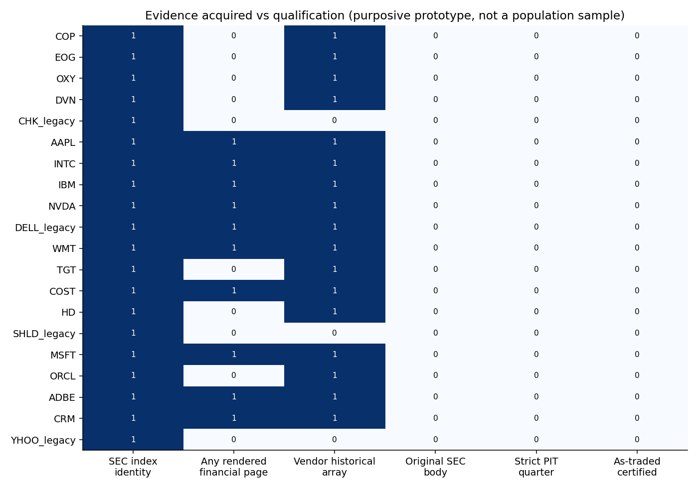

# E7b — 20-Company PIT Financial Data Prototype

**公開來源原型與稽核完成；嚴格PIT面板未建立，不可開始H1／H3正式推論。** 20公司、四個目的性研究組，保留退出／身分案例；不是歷史母體隨機樣本。

核對20家公司CIK／21份索引；10家17個rendered頁，90個未認證顯示候選；17個symbol取得45,893歷史行情列，但均未認證as-traded，舊Dell只有2016起資料。原始SEC／XBRL bytes0、嚴格合格季度0、獨立人工原文件QA0/200。缺資料不填經濟0，不以工程測試通過替代資料閘門。

[完整報告](E7B_SUMMARY.md) · [20公司覆蓋](tables/company_PIT_coverage.csv) · [品質閘門](tables/quality_gates.csv) · [來源manifest](tables/source_manifest.csv) · [歷史母體修正](HISTORICAL_UNIVERSE_CORRECTION.md) · [擴充可行性](EXPANSION_FEASIBILITY.md) · [近期工作論文路線](SHORT_TERM_WORKING_PAPER_ROUTE.md) · [資料字典](DATA_DICTIONARY.md)

```bash
python scripts/e7b_public_replay.py --bundle research/E7b
python scripts/test_e7b.py
```

公開重現只核對彙整一致性與23個合成／契約測試，不下載、訓練或使用GPU。完整離線source-capture與sanitized行情重算屬工作站完整ZIP，不在GitHub公開；不能只靠這裡的表重建原行情／申報／PIT真實性。root scripts中的setup/audit/fetch需相應本機資產與新輸出目錄；來源不合格就拒用。



近期以來源時點、證券身分與調整語意的稽核工作稿為路線，與2027–2031待閘門的候選確認研究分開。無新金融擬合；E3c2026協定原封不動、未執行、不加入新模型。E7外部預註冊仍未完成。
