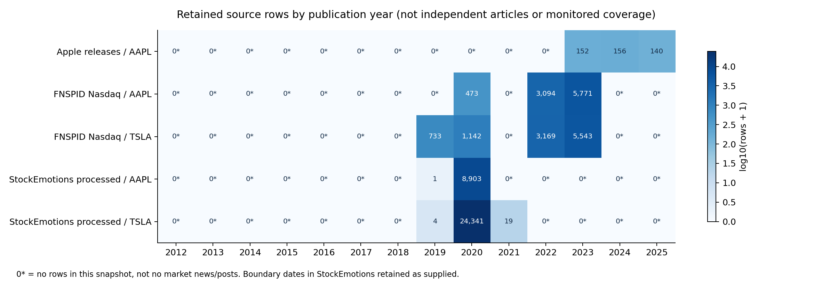
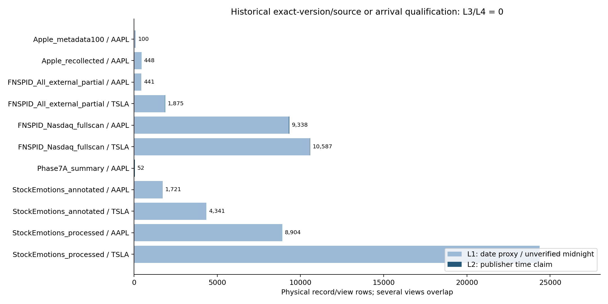
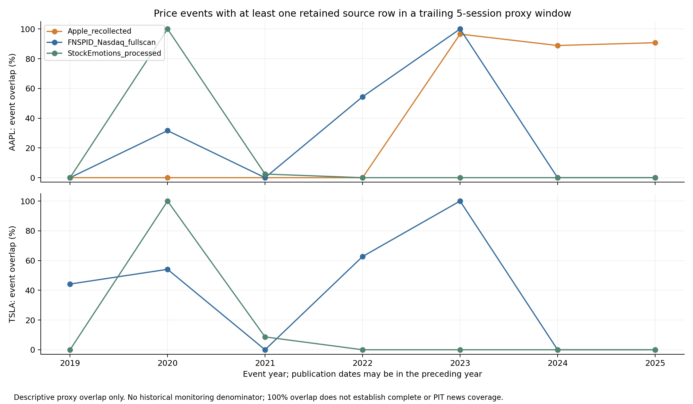

# E8a — 新聞與社群 PIT 資料可行性稽核

研究日期：2026-11-08。狀態：**稽核完成；E8b 正式 PIT 模型比較尚未具備資料條件。** 本階段新訓練模型0、GPU操作0；不修改舊實驗、E3c2026協定或其驗證。這不是新聞／社群無效的實證結果，而是能回答什麼問題的資料邊界。

## 1. 研究問題與稽核範圍

E4c尚未建立新聞相對價格／條件機率的穩定增量排序能力。E8a先區分內容、可得時間、版本、來源監測與合法研究使用，再考慮擴充社群訊號。**沒有以舊模型表現挑來源、門檻、股票或資料版本。** 技術與資料閘門先寫入[AUDIT_PLAN_LOCKED.json](AUDIT_PLAN_LOCKED.json)，屬本機稽核計畫，不是已完成外部預註冊，也不是功效已證明的樣本數。

盤點E4a–E4c全部輸出版本、重播副本、程式、原始資料／特徵／預測／圖表與模型檔案，共 **3,456個實體檔案**，其中3,452個重新計算SHA256，1,365組雜湊出現在多個檔案。重播、ZIP和重複檔案不是新觀測。模型檔僅作檔案稽核，未反序列化或執行。

主分析只從目前canonical E4a、E4b、E4c讀取文章層級輸入。得到 **22,841筆新聞稽核紀錄**，包含100篇metadata、2,816筆E4b版本及19,925筆FNSPID全掃描目標列；它們**不是22,841篇獨立新聞**。另有39,330筆重疊社群視圖metadata，合計62,171筆版本／股票／視圖紀錄；不把這個總數當獨立樣本量。

FNSPID23,232,979,597bytes、15,549,299列的EOF與全檔SHA證據沿用E4c，這一輪**沒有再次完整讀取23GB主檔**。重新hash及逐列分析兩股完整保留匯出，核對既有全掃描證據。詳見完整本機`audits/artifact_inventory.csv`、canonical輸入manifest和[實體檔案分類](tables/artifact_inventory_summary.csv)。

## 2. 新聞資產、特徵與預測核對

| 資料 | 本輪確認內容 | 範圍與限制 |
|---|---:|---|
| Apple Newsroom重建 | 448篇：2023年152、2024年156、2025年140 | 當前回抓版本、AAPL企業自發新聞；不是2012–2022新聞訓練集 |
| 原Phase7A | 52篇2025年1月摘要、36篇Gemini輸出 | 摘要不是全文；18篇smoke已含在36篇內；未補成54篇 |
| E4b局部FNSPID | AAPL441、TSLA1,875 | All_external.csv局部標題；與Nasdaq主檔不能當新增獨立語料 |
| E4c全掃描FNSPID | AAPL9,338、TSLA10,587 | 主檔目標保留列；非空本文AAPL8,865、TSLA8,712，不等於已核實完整全文 |
| StockLLM舊100篇metadata | 100篇2023來源核對清單 | 100個URL及文字hash均與448篇中的對應項重合，不加算新文章 |

本輪重新計算E4b2,816筆title＋空行＋content版本雜湊，錯誤0；3,316列特徵與父文章record_id＋text_sha256接合錯誤0，重複特徵視圖0，每篇恰好一個主要視圖。從4,219個既存chunks重算token加權FinBERT機率，誤差在1e-6內；36筆Gemini仍只接同摘要版本，錯接0。這七項[特徵一致性檢查](tables/feature_integrity.csv)**不是情緒或事件抽取準確率、歷史服務端revision認證，也不是人工語意gold**。

FinBERT仍為`ProsusAI/finbert` revision `0bc2ac10dda6929bcb1f77ccc43c7ec5c424f031`。未重做任何推論。舊Gemini模型字串和cache只能支持當時保存的回溯輸出身分，不能認證歷史訓練截止、服務端實際revision或過去可部署性。

E4c既存機率輸出按檔案、日期切分、timing、method和seed盤點，見[預測資產清單](tables/prior_prediction_inventory.csv)。未重新估計Brier、改選winner或把E4c2025與E3c2024–2025樣本混合；沒有新增預測。

## 3. AAPL／TSLA逐年覆蓋與重複

FNSPID在2012–2018兩股0筆保留列，AAPL2019也是0；兩股2021、2024、2025均沒有當年保留列。AAPL2020為473筆標題，2022為3,094、2023為5,771；TSLA2019為733、2020為1,142筆標題，2022為3,169、2023為5,543。大量資料集中2022–2023，不能說覆蓋1999–2023的資料庫就一定支援這兩檔完整歷史。

E4b441／1,875個同股票URL全部在FNSPID Nasdaq目標匯出中出現；兩股Nasdaq本身又共享1,061個URL，因此不能把來源／股票關聯當獨立新聞或獨立金融事件。**同URL只表示文件身分重合，不證明摘要、全文、修訂內容相同。** 精確文字hash亦有不同生成慣例，不能將跨慣例未命中當成版本衝突。E8a表內text重複是既定exact hash，不與E4c的NFKC／空白／casefold正規化重複率互換。

[逐股逐年全表](tables/source_stock_year_coverage.csv)對無保留列寫0，但歷史監測比例、完整市場新聞分母及真正無新聞日仍為**NA／UNKNOWN**。0只表示目前固定來源快照沒有保留紀錄，不是市場沒有新聞／貼文。來源選樣、刪除、漏頁、停機、平台移轉與股票實體辨識皆可能造成缺失。

## 4. 社群歷史來源調查與實際核對

| 來源 | 已確認取得途徑／範圍 | 本輪實際取得與判定 |
|---|---|---|
| X | 官方完整搜尋文件描述自2006-03，需開發者帳戶／token與用量或Enterprise權限 | 未呼叫平台搜尋、未購買；兩股逐年量UNKNOWN；created_at／edit IDs不足以證明歷史到達 |
| Reddit | RFR學術申請、機構贊助與倫理審查／豁免、個別研究者權限 | 未代送申請；未取得貼文；歷史範圍及兩股量UNKNOWN；研究刪除與不可轉交規則需先解決 |
| Stocktwits | 官方Firestream每日message／activity備份，需要stream授權 | 未取得授權備份；最早可授權年份／逐股完整度UNKNOWN，不把公開近期stream當歷史全集 |
| Bluesky | 公開GET／firehose值得評估；ATProto明示TID使用者可指定 | 未查即時貼文／未啟動collector；不能從TID或自行填寫createdAt認證過去公開時點 |
| StockNet作者資料 | README描述2014–2016與88股票 | 核到AAPL784個日期檔：2014年341、2015年355、2016年88；最晚2016-03-31。列出股票目錄無TSLA；沒有下載或計數貼文本文 |
| StockEmotions作者資料 | 作者描述2020年篩選語料與10,000標註句 | 固定Git版本4CSV逐一核對blob SHA，僅保留兩股日期／ticker／hash；原CSV與貼文全文未保存或公開 |

官方／作者來源：[X完整搜尋](https://docs.x.com/x-api/posts/search/quickstart/full-archive-search)、[Reddit研究計畫](https://support.reddithelp.com/hc/en-us/articles/49381918834964-Reddit-for-Researchers-Program)、[Stocktwits備份](https://firestream.stocktwits.com/documentation/backups)、[ATProto record key](https://atproto.com/specs/record-key)、[StockNet](https://github.com/yumoxu/stocknet-dataset)、[StockEmotions](https://github.com/adlnlp/StockEmotions)。文件現況截至本輪查核；不是已簽訂的資料權利或歷史查詢成功證據。[來源可行性矩陣](tables/data_source_feasibility.csv)保留取得層級、缺口與下一步。

StockEmotions處理後資料2020年AAPL **8,903**、TSLA **24,341**；另AAPL2019-12-31有1筆、TSLA同日4筆及2021-01-01有19筆，原樣保留日期，沒有未經證據改回2020。這些邊界可能涉及上游日期處理，但本輪無時區證據判定原因。處理後兩股共33,268列；標註視圖另6,062列（AAPL1,721／TSLA4,341），不能加成39,330個獨立貼文。

兩套ID命名空間未核實、沒有ID重合，但原文字hash分別重合1,720／4,335個；標註有1／6個不同文字hash未在處理後資料命中，保留而不強接或刪除。**不以不同ID判定新文章，也不以同文字推定同一金融事件。** train／val／test各檔日期都跨2020多個月、彼此重疊，不能沿用為時序驗證。見[社群逐年與分檔數據](tables/social_author_dataset_coverage.csv)及[視圖重合](tables/social_view_overlap.csv)。這是作者篩選的情緒語料，不是完整Stocktwits訊息流或可直接回測的當時投資者訊號。

## 5. PIT時間與資訊品質

採L0無可用時間、L1日期proxy／未核實午夜、L2有時區發布聲明、L3精確歷史版本＋獨立可得時點證據、L4再加認證供應商到達時間。**L3可用足夠早的獨立歷史capture作保守上界，不要求憑空還原真正第一眼first_seen。** 現在抓取的版本、現在取得時間或未綁定版本的created_at不會升級。

| source | ticker | rows | L1_DATE_PROXY | L2_PUBLISHER_TIME_CLAIM | L3_SOURCE_VERSION_VERIFIED | L4_ARRIVAL_VERIFIED |
|---|---|---|---|---|---|---|
| Apple_metadata100 | AAPL | 100 | 100 | 0 | 0 | 0 |
| Apple_recollected | AAPL | 448 | 448 | 0 | 0 | 0 |
| FNSPID_All_external_partial | AAPL | 441 | 431 | 10 | 0 | 0 |
| FNSPID_All_external_partial | TSLA | 1875 | 1865 | 10 | 0 | 0 |
| FNSPID_Nasdaq_fullscan | AAPL | 9338 | 9307 | 31 | 0 | 0 |
| FNSPID_Nasdaq_fullscan | TSLA | 10587 | 10562 | 25 | 0 | 0 |
| Phase7A_summary | AAPL | 52 | 0 | 52 | 0 | 0 |
| StockEmotions_annotated | AAPL | 1721 | 1721 | 0 | 0 | 0 |
| StockEmotions_annotated | TSLA | 4341 | 4341 | 0 | 0 | 0 |
| StockEmotions_processed | AAPL | 8904 | 8904 | 0 | 0 | 0 |
| StockEmotions_processed | TSLA | 24364 | 24364 | 0 | 0 | 0 |

FNSPID Nasdaq AAPL9,307／9,338（99.67%）、TSLA10,562／10,587（99.76%）為午夜UTC聲明；只當日期型proxy，不相信格式看似秒級便有真實秒級精度。Phase7A52筆雖有時區時間，也缺歷史版本／到達證據。**本輪L3／L4合格均0**，代表證據未取得，不是認定這些內容當年不存在。

發布、修改、歷史版本首次可見、供應商收到、現在取得、特徵模型release／revision、推論完成、決策cutoff各自分欄。回溯計算本身不必然造成洩漏：若有合格歷史文本與事先固定、可證明當時已可用的語意模型，現在可重算time-consistent backtest；但不能宣稱當年已部署。較晚才訓練的LLM可能帶入未來知識，需獨立控制。推論時間晚於決策只會否定「當時已產出該特徵」的部署主張，不單憑這點否定所有離線回溯研究。

社群likes、retweets、留言數、帳號追蹤數、當前sentiment圖表若是現在取得的累計值，不可當歷史特徵；需每個歷史cutoff的獨立快照。編輯／刪除、repost／thread去重、bot／宣傳選樣、cashtag與Apple／Tesla一般文字的公司相關性也須核對，不以本文hash推定情緒真值或完整度。

## 6. 市場事件支援與時間敏感度

沿用凍結E3c事件及5日標籤，不重估事件門檻。新聞日期型資料延到其日期後第一個實際交易日；可信度仍只是proxy。有發布時區的聲明則按17:00 America/New_York cutoff；另固定延後1／2資訊交易日，不挑最佳結果。**完整行情交易日曆與經purge的評估日期分開**，避免年底錯移；此工程修正和回歸測試記於`audits/calendar_quality_correction.json`，原E4科學產物未改。

| year | price_events | events_with_retained_source_in_last5 | snapshot_event_overlap_fraction |
|---|---|---|---|
| 2023 | 29 | 28 | 0.9655172413793104 |
| 2024 | 36 | 32 | 0.8888888888888888 |
| 2025 | 65 | 59 | 0.9076923076923077 |

上表2023分母29為E8a保留所有既有評估事件的診斷；E4b原報告28為當時完整來源窗口篩選後分母，不能將本輪28／29與原28／28互換。2024的32／36、2025的59／65與同來源原窗口結果對照。兩者都不是市場新聞完整率；跨年過去5交易日可有上一年文章，因此「本年0文章」仍可能有少量年初事件重合。

為避免大量重疊事件膨脹樣本，先在完整價格事件日曆固定取每5交易日第一個事件，再檢查來源重合，不能每個來源各挑最有利的事件起點。Apple在舊2023驗證診斷只11個source-overlap非重疊事件，舊2024–2025共34；FNSPID全掃描舊訓練來源支援也遠少於每日新聞列數。StockEmotions數萬貼文則集中單一年、不能獲得多個獨立市場年份。[舊分割支援表](tables/legacy_partition_support.csv)只是可行性診斷，沒有重新定義E4c切分；正式合格事件仍0。事件數也不是功效認證，沒有IID二項檢定、新聞有效性p值或模型增益主張。

## 7. E8b決策與後續路線

**不開始正式新聞＋社群模型比較。** 八項[資料閘門](tables/E8b_readiness_gates.csv)尚未全部通過，特別是歷史版本／時間、來源持續觀測、獨立人工QA與未見驗證。100篇人工文件／版本檢查仍0；25項程式合成契約測試和離線重播不是人工QA或預測證據。

優先取得一個法律與研究使用範圍明確、能提供原始訊息／修改／到達／完整監測資訊的固定來源小樣本，按AAPL／TSLA及年份交叉抽驗，再決定是否擴大；Stocktwits金融cashtag來源可列優先詢樣候選，但尚無授權或實際長期覆蓋承諾。Reddit需要教授／學校的申請與倫理審查，不能自行代為聯繫或假裝已批准。沒有預算／授權時，維持公開作者語料的描述或情緒方法重現，不以短單年資料勉強訓練深度反轉模型。

正式E8b最低篩選目標為固定來源至少2訓練＋1驗證＋1測試年、每段≥90%可證監測session、兩檔各100／40／60個不重疊事件及類別最低量；均是事先固定的工程／可行性screen，不代表已達80%統計功效。仍需開發期配對損失依賴、block長度與共同多重比較功效驗證。未達標可明確另立受限探索方案，不能默默放寬後稱正式通過。

未來設計應固定價格P、新聞／社群metadata-only、情緒／事件訊號、條件機率，以及同權重常數收縮控制，拆開校準與同條件排序增益；不因結果才決定哪個來源有效。完整建議見[E8b可行性決策](E8B_FEASIBILITY_DECISION.md)與[後續優先工作](NEXT_STEPS.md)。目前結論是「歷史PIT證據及來源一致性不足」，**不是新聞／社群缺乏預測力的否定結論**。

## 8. 完整性與可重現性

原E3c2026固定JSON SHA256 `9ffe3c31bbfabb6609ee69dde1deab7a13729b43511a9c045d945b5b03453940`保持不變，未執行；E8模型不加入該協定。2024–2025已多次檢視，E8未來確認需另行預先登錄未見期間。既有2026新聞彙總／其他來源片段接觸紀錄保留，不能聲稱整個研究史零接觸；本輪未要求新的2026金融新聞／社群貼文或行情標籤。讀取當前平台政策文件不等於開啟2026金融驗證。

完整本機包包含content-free逐筆metadata、CSV表、來源文件擷取／API目錄metadata、程式、雜湊、圖與稽核，不重包原新聞全文／貼文、23GB主檔、checkpoint或私人金鑰。公開GitHub只發布程式、彙整資料與自製圖，不發布逐篇／逐貼metadata或本文。原文與研究整合的分工見[stockllm-pit-news](https://github.com/yoyocar2333/stockllm-pit-news)。[重現說明](REPRODUCIBILITY.md)清楚區分彙整檢查、metadata重播與原始來源認證。
