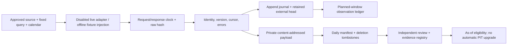

# 前瞻收集器設計與觀測契約

狀態：可離線測試的核心；**沒有network adapter、排程或真實來源啟動**。真正部署需另行授權、時鐘／資安／故障實測和E8獨立協定，不能因unit tests通過宣稱production-ready。E3c2026不變。

## 固定資訊與權限

部署候選固定AAPL／TSLA、source namespace、cashtag與經核對historical entity map；每個query記版本與hash。query與實際交易日曆於收集前鎖定，禁止由實際回傳日期反造分母，也不依模型成績增加alias。消息ID只在來源namespace內唯一。原生symbol關聯仍需公司相關性QA。

每個source/ticker/session window明列start/end與17NY資訊cutoff，完整交易日曆與purged評估日期分開。密鑰僅由部署時的核准secret引用注入adapter，request logs只存非敏感參數hash，不記Authorization、cookies、URLtoken或個人資料。此版不讀環境key、不實作HTTP或collector scheduler。

## 原回應、時鐘、版本與生命週期

核心只接收顯式synthetic fixture bytes，保留內容位址hash、request_started/response_received、query/window、cursor和原status。real envelope被拒絕。成功／錯誤／schema拒絕與顯式retry都記錄；partial HTTP200不能當完成。

created/edit/delete有原事件時間與獨立version ID，同ID/version不同text會拒用；parent、reshare／thread由adapter映射到版本schema，保留source關聯。當前followers/likes不作歷史特徵；如未來需要，只使用當cutoff實際捕獲的版本。事件時間不等於實際arrival，collector自己的receipt亦不能認證之前供應商arrival。

## Pagination、故障與分母

opaque cursor原值保留、重啟重建狀態並核對同plan；循環或錯頁拒用。只有完整terminal、無errors、明示連續觀測證據、在cutoff前收到且非事後backfill才記query complete。本離線核心對出錯窗口保守維持UNKNOWN；真實恢復需另外核准的可追溯gap reconciliation，不由後一次200抹掉舊失敗。

分母D為事前固定的source×query×ticker×session windows；分子為有完整收集與時鐘證據的windows。分割／股別各自算，實際取樣分母不是「有貼文的天數」。uptime要獨立heartbeat、cursor/checkpoint、429/timeout/重連、漏抓起訖／重補來源及時間。每次補抓記original_observation與recovered_at，後補不冒充原持續觀測。Stocktwits24h恢復界限是供應商特定限制，不能藉任意重試繞過。

空完整query只表示該固定查詢／來源在該次回應沒有紀錄，不保證整平台沒有貼文；零retained可能是刪除後的狀態，不能稱原來沒貼文。缺失時count、情緒及完整率保留NA。demo2windows的1/2僅工程例，不是正式90%達成情況。

## 每日manifest、不可變性與刪除

UTC每日manifest記當日response objects、hash、plan及journal head，使用create-exclusive拒絕覆寫；journal hash-chain及raw bytes修改會被核對。但本地hash chain不是WORM／外部可信timestamp，攻擊者可重寫整條鏈；需將每日head由研究機構獨立保存／簽章或object-lock，而本輪沒有實作或認證此服務。

原內容置私有可刪除儲存；不可將原文放進不可刪journal。收到刪除／撤回政策觸發後，刪受影響payload並記最小tombstone，標示相關特徵／分析須失效重算。核心示範保守刪除包含該紀錄的整個response blob；其餘紀錄保留性可能下降，不能默默填0。需一併處理備份、派生物與retention期限；此版未宣稱完成雲端所有副本刪除。hash／tombstone本身也須依授權與隱私政策最小化。

## Schema與證據資格

[record schema](tables/provenance_record.schema.json)及[offline plan schema](tables/collector_config.schema.json)供adapter contract使用。它們是描述性JSON Schema與核心欄位檢查，不是完整生產adapter／完整JSON Schema驗證套件。L3/L4仍須人工認證的外部證據registry；記錄一致和工程收集成功都不自動升級。
