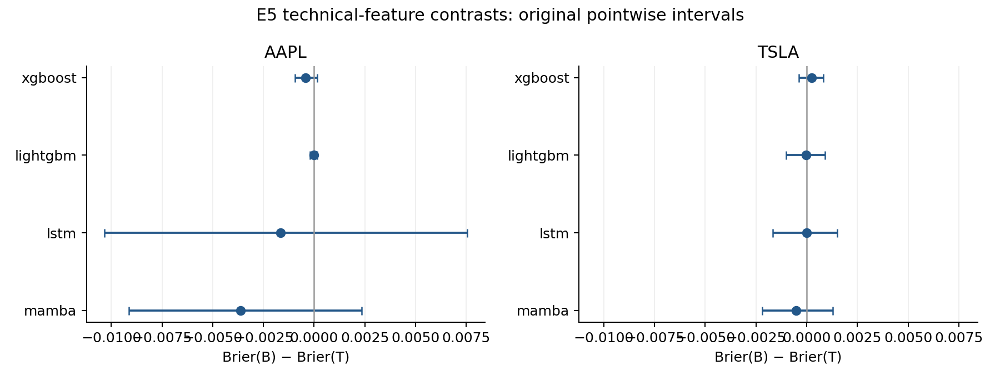
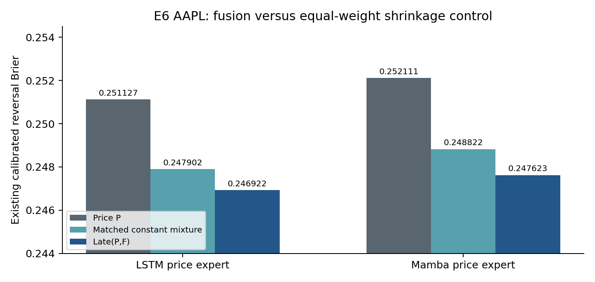
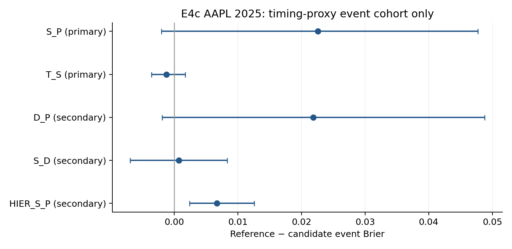

# Auditing Incremental Predictive Value in Financial Machine Learning

## Information Redundancy, Probability Shrinkage, and Point-in-Time Data Integrity

Working paper, E9a · 14 November 2026 · Version 1.0

Authors and institutional affiliation: to be confirmed by the research team. This draft does not assign authorship or institutional endorsement. Repository: https://github.com/yoyocar2333/financial-sequence-benchmark

# 繁體中文重點摘要

本研究整合 E0–E8a.1 的既有成果，問的不是哪個模型分數最低，而是新增技術指標、基本面及新聞後，改善能否與資訊重複、校準、機率收縮及研究選擇偏誤區分。主題為未來五交易日反轉機率；隔日波動幅度僅作不同任務的研究背景。

E5 在 AAPL、TSLA 各 482 個已檢視測試日期比較多尺度價格 B 與技術增強 T。四架構共八項主比較均未同時通過原 HAC 與區塊 bootstrap 的 Holm 校正。E6 的八項資訊增量及二十項融合比較亦無聯合通過結果；AAPL LSTM／Mamba 的 Late Fusion 點估計改善大多可由相同權重常數收縮控制重現，這是描述性比較，不能當因果比例。

E4c 是不同的 AAPL-only 研究：2023 訓練、2024 選模及校準、2025 探索性測試。65 個重疊極端事件中，Logistic P→S 的 Brier 改善為 0.022569，但 bootstrap Holm2 p=0.1512。階層機率的次要 P→S 比較 p=0.028，延後一／二個資訊交易日不再顯著，也未證明同狀態內的反轉時機辨識。E6 次要直接上漲任務也有顯著改善，但融合權重等於一，實際僅使用基本面分支，不能稱互補融合成功。

資料稽核同樣重要：E7b 尚無通過嚴格資格的公司季度；E8a／E8a.1 的 L3 歷史來源版本及 L4 到達證據均為零。這表示研究尚缺可驗證證據，並不表示原內容當年不存在，亦不能推論新聞必然無效。現階段最適合的貢獻是透明的探索性增量價值與資料品質稽核；正式資訊增益主張須補齊合格資料、等資訊控制、依賴下功效及真正未見驗證。

2024–2025 已反覆探索。既有 E3c2026 固定協定保持不變且未執行；先前部分 2026 新聞彙總與搜尋片段的意外接觸如實保留，不能聲稱整個研究歷程完全零暴露。本輪未訓練模型、產生新金融分數或 p-value，也未啟動新聞／社群收集。

# Abstract

Adding information sources and model complexity to financial prediction can improve a reported probability score without establishing incremental predictive information. We audit an existing sequence of exploratory studies of AAPL and TSLA, distinguishing next-day return magnitude from five-session reversal prediction and separating three noninterchangeable cohorts. In the technical-indicator study, none of eight primary feature contrasts satisfies both source-stage multiplicity-adjusted inference procedures. In the fundamentals study, none of eight information contrasts or twenty fusion contrasts satisfies that joint standard. Apparent improvements in two AAPL neural-price late-fusion pipelines are substantially reproduced by matched-weight constant-probability controls, without reliable remaining complementarity. In a separate, retrospectively reconstructed Apple Newsroom cohort, sentiment augmentation improves event Brier score by 0.022569, but its primary adjusted bootstrap p-value is 0.1512. A significant secondary hierarchical-probability contrast is sensitive to timing assumptions and does not establish within-state event ranking. We retain a significant secondary direct-up result whose fusion weight discards the price expert, rather than treating it as complementary fusion. Finally, financial-document and news/social provenance audits distinguish downloadable artifacts from qualified historical versions and delivery evidence; the latter remain unavailable under the project's strict gates. The contribution is an evidence-linked audit and validation design, not a new forecasting architecture, a causal decomposition, or an independently confirmed rejection of non-price information. Licensed version evidence, matched information controls, dependence-aware power assessment, and genuinely unseen validation remain necessary.

Keywords: financial machine learning; incremental prediction; probability calibration; forecast combination; point-in-time data; reproducibility

# 1. Introduction

Financial forecasting often begins with a plausible expansion of the information set: prices become technical indicators; accounting statements supply firm characteristics; news supplies sentiment and event context; several models are then fused. Each step can alter predictive performance. The harder question is whether an apparent gain comes from new, decision-time information, an easier representation of existing information, lower effective model complexity, better probability calibration, or choices made after observing evaluation results.

These alternatives matter particularly for short-horizon probabilities. A nearly constant forecast can have a competitive Brier score if outcome prevalence is stable or an unconstrained predictor is overconfident. Conversely, a predictor can rank cases well and remain poorly calibrated. A comparison against a weak price model alone therefore cannot identify an information contribution. Nor can a low score in a selected event subset establish that a method identifies the timing of reversals within the same historical state.

The existing project evolved from conventional stock-price prediction (E0), through next-day volatility-magnitude forecasting (E1–E2), multiscale event studies and reversal classifiers (E3), reconstructed financial news (E4), technical indicators and hybrid rules (E5), fundamentals and fusion (E6), and publication-oriented data and validation audits (E7–E8a.1). This progression is useful evidence about practical research design. It is also a source of selection risk: the same two stocks and repeatedly inspected evaluation years cannot become fresh independent tests with each new experiment.

We synthesize the existing artifacts without fitting or selecting a new model. Our empirical focus is E5, E6 and E4c, with E3 defining the task and E7–E8 identifying the evidential ceiling. We preserve the distinct cohorts and correction families. The draft asks what the present evidence permits, rather than arranging incompatible Brier scores into a universal leaderboard.

Three contributions are currently supportable. First, the paper provides an auditable cross-experiment account of apparent incremental gains and negative results, including locally significant exceptions. Second, it organizes controls that distinguish price representation, metadata, calibration and constant shrinkage from complementary information. Third, it connects those comparisons to explicit historical-version and data-access requirements. These are empirical and methodological audit contributions. We do not claim to invent technical indicators, probability shrinkage, forecast combination, PIT analysis, or multiple-testing correction, and we do not claim a demonstrated general impossibility of stock prediction.

# 2. Related Work

## 2.1 Financial prediction and technical representations

Machine-learning asset-pricing research shows that flexible nonlinear methods can exploit large cross-sectional information sets [R01], while the equity-premium literature documents the difficulty of achieving stable out-of-sample improvements over historical benchmarks [R02]. These populations and targets differ from two-stock, five-day reversal classification. Complexity can be useful under appropriate data and regularization [R21]; image-based trend representations offer another way to learn price structure [R22]. Neither result implies that additional complexity will dominate in this project's small, repeatedly examined samples.

Technical analysis has been studied through explicitly defined trading rules and statistical procedures [R03, R32]. Its evaluation is inseparable from the search over indicators, thresholds and rules [R04]. We use these studies as motivation for transparent baselines, not as proof that an RSI, MACD or regime gate must predict short-horizon reversals. Because a deterministic transformation cannot enlarge a complete underlying information set, an observed gain from technical indicators may be a representation or optimization gain. In practice, finite histories and an added market series mean that information equivalence must be checked rather than assumed.

## 2.2 Financial text and accounting information

Media content and financial language have empirical associations with market behavior [R05, R06]. FinBERT adapts pretrained language modeling to financial sentiment [R07], but text-classification accuracy is not equivalent to incremental financial forecasting performance. A sentiment model can be accurate while a selected issuer-news sample contains little usable cross-event variation. A later text revision or model revision can also compromise a claimed historical information set.

Financial-statement analysis and post-earnings-announcement drift motivate the use of fundamentals [R08, R09]. Their findings do not supply a historical analyst-consensus series, nor do realized accounting changes define an earnings surprise without expectations observed before release. Missing financial data may have structure [R23]; treating release-age or missingness patterns as if they were the value of accounting numbers risks conflating metadata and financial content. A recent multimodal dataset proposal illustrates interest in integrated sources [R30], but advertised scale is not certification of our sample's rights, version history or arrival times. We treat that reference as a preprint, not peer-reviewed predictive validation.

## 2.3 Combination, calibration and credible evaluation

Forecast combination has a long history [R10]. Estimated combination weights can incur costs that help explain why simple averages are difficult to beat [R11]. Proper scoring rules support honest probability evaluation [R12], and the classical probability-score decomposition distinguishes reliability from resolution [R13]. Modern neural-network calibration research further motivates evaluating the complete calibration pipeline [R14]. None of these results makes a lower Brier score a causal measure of new information.

Model selection itself can overfit [R15], and a testing procedure applied after extensive specification search does not erase the preceding research history [R16]. We retain source-stage HAC [R17], Holm correction [R18], block-resampling motivation [R19], and paired forecast comparison [R20], while being explicit that the implemented circular blocks are not the stationary-bootstrap algorithm in [R19]. Panel dependence also matters [R31]. Sample-size justification and preregistration should be grounded in the intended estimand and dependence structure [R24, R25]. This is a targeted evidence review rather than a registered systematic review or exhaustive novelty search.

## 2.4 Architectures in scope

The project includes logistic regression, XGBoost [R27], LightGBM [R28], LSTM [R29], and the genuine selective-state-space Mamba implementation motivated by [R26]. Using the named implementation establishes architecture identity, not superior financial performance. In E6, LSTM and Mamba contribute their previously frozen price predictions to late fusion; no fundamental neural encoder was trained. This distinction is necessary when discussing fusion versus architecture claims.

# 3. Research Questions and Evidential Criteria

H1 asks whether information beyond the available price set improves prediction after controlling for metadata and representation. H3 asks whether a nondegenerate combination provides complementarity beyond its best standalone branch and comparable probability shrinkage. Historical market-state analyses serve as diagnostics; a new regime-learning hypothesis is not the principal claim.

A credible H1 comparison requires a strong price benchmark, the same dates and label, matched source metadata, and controls for redundant price representations. A credible H3 comparison requires a price expert P, an additional expert F, late fusion, matched-weight P-plus-constant shrinkage, independently tuned constant shrinkage, and the best single expert. A weight of one on F is selection of F, not complementarity. E7a specifies these controls, but the complete design has not yet been executed with qualified data.

Three questions accompany the hypotheses. Does improvement survive calibration controls and within-state ranking diagnostics? Is the feature version demonstrably available at the decision cutoff? Does the observed sample and its dependence permit the intended inference? Failure to reject a null is not evidence of equivalence; a wide interval may leave economically or scientifically relevant effects unresolved. A result significant only in a secondary family remains a secondary result.

# 4. Data and Methods

## 4.1 Distinct cohorts and targets

| Stage | Population and unit | Fit / validate / evaluate years | Interpretation |
| --- | --- | --- | --- |
| E0–E2 | AAPL/TSLA; old magnitude cohorts | 2012–22 / 2023 / 2024–25 | Price/magnitude; not direction classification |
| E3 | AAPL/TSLA; 482 common classifier dates each | 2012–22 / 2023 / 2024–25 | Events; next-open reversal in E3b/c |
| E4c | AAPL; 230 test dates, 65 extreme dates | 2023 / 2024 / 2025 | Price/news, date-proxy timing; 22 nonoverlap events |
| E5 | AAPL/TSLA; 482 test dates each | 2012–22 / 2023 / 2024–25 | B38 versus T51; five seeds |
| E6 | Same 482 dates each; 9 test vintages each | Same as E5 | P=E5 T; F16; neural P reused |
| E7–E8a.1 | Data/protocol audits; no new prediction task | Development/audit scope only | Qualification, access and future inference design |

Table 1. Cohort and information-set registry. Each row is its own experiment; scores must not be pooled across rows. Source: existing stage reports, linked in CLAIM_EVIDENCE_MATRIX.csv.

E1–E2 predict 100 times the absolute next-day close-to-close log return, a nonnegative magnitude. A magnitude model has no direct up/down output. E3a examines close-to-close event returns, while E3b onward principally uses an executable next-open convention. The E3a descriptive reversal rates are therefore not interchangeable with classifier labels or test denominators.

For the main classifier task, let s_t be the sign of the preceding five-session close-to-close log return. The label is

`y_rev(t) = 1{ s_t × log(C[t+5] / O[t+1]) < 0 }`.

The decision uses information through day t, entry is the next session's open, and exit is the fifth future session's close. Past-flat cases are excluded according to the frozen pipeline. E6 also fits a secondary direct-up task, `y_up(t)=1{log(C[t+5]/O[t+1])>0}`. Mapping a reversal probability to an up probability using the known past sign is not direct-up model training.

E3a fixed acute-move thresholds from training-period past-five-day quantiles, and later studies reuse the event definitions rather than reselecting thresholds on test outcomes. Trend-conflict and VIX-based strata are historical diagnostics. Overlapping five-day labels create dependence even when each date is listed once. Event subsets and horizon-spaced descriptive samples have different effective support.

## 4.2 Prices, technical representations and experimental fairness

Existing frozen market snapshots contain retrospective adjusted OHLCV and the project's VIX/VXN series. They are not newly downloaded in E9a and are not certified as contemporaneous as-traded corporate-action histories. E5 additionally introduces relative strength against QQQ. The training period is 2012–2022, with 2023 divided between stopping and calibration, and 2024–2025 used for the already-inspected evaluation. Common test dates run from 2024-01-02 to 2025-12-02, with future returns remaining within 2025 under the original boundary rules.

E5 B contains the existing 38 multiscale features. T adds 12 technical price/volume representations and one QQQ-relative feature, producing 51 dimensions. The additions cover SMA20/60 and crosses, Wilder RSI14, MACD12/26/9, Bollinger20, prior-high/low breakout and volume confirmation, ADX/DI representations and relative strength. The C control adds QQQ relative strength alone. The model input is the same 60-row information history within each arm; logistic and tree models flatten it, whereas sequence models retain its ordering. Equal observed information does not mean equal inductive bias or effective capacity. Recursive indicators also incorporate warm-up history, so T is not proven to be a transformation solely of the finite B input.

E5 reuses frozen B fits and follows the existing bounded expanding-window selection, seeds 42–46, stopping and calibration procedure for T. Its neural batch size is 64, unlike the earlier magnitude Mamba batch-size-eight experiment. This is not a new resource or training choice made in E9a. The original Platt procedures differ across stages; they must not be silently substituted by E7a's later candidate protocol. Supplementary trading rules include costs and execution conventions, but trading returns do not establish probability improvement or risk-adjusted alpha.

## 4.3 Fundamentals and fusion

E6 P is E5 T, not E5 B. Its 118 issuer-quarter document vintages comprise 60 AAPL and 58 TSLA records. The F input includes seven numerical accounting measures, release age, seven missingness indicators and the shared past-five-day direction. It is therefore not an entirely price-free expert. Numerical measures include revenue and symmetric EPS growth, gross/net/operating margins, period-consistent operating cash flow to revenue, and cash to assets. Historical analyst expectations were not reliably obtained; no earnings surprise was manufactured.

Dates are aligned after two strictly subsequent trading sessions, with a five-session sensitivity. This is conservative treatment of uncertain release dates, not historical-version certification. Features are joined as of each historical sequence position, without backfilling a later report into earlier rows. Unknown SEC acceptance, amendment and historical first-seen fields remain unknown. Current issuer-hosted copies cannot alone certify that exact historical bytes were present at the reported date.

Early fusion appends the accounting-related columns to the existing price sequence. Late fusion combines frozen P predictions with the F logistic expert. F weights in {0, .25, .5, .75, 1} are selected with existing forward development predictions, followed by stage-specific calibration. Matched-weight P-plus-training-constant mixtures provide a shrinkage control. The metadata-only expert is low-dimensional; it is not the complete capacity-matched P-plus-metadata control required for attribution. No new neural early-fusion model is claimed: each stock had only 45 distinct training vintages, below the study's fixed gate.

Although E6 evaluates 482 dates per stock, its test features use nine distinct vintages per stock, including one carried into the period and only eight new updates. Repeating quarterly numbers daily does not create independent financial-report events. The frozen market snapshots and incomplete vintage provenance limit all conclusions.

## 4.4 News reconstruction and prediction

E4a recovered 52 article summaries and 36 reproducibly joined Gemini outputs. E4b reconstructed 448 Apple Newsroom full-text articles dated 2023–2025; this is not proof of complete recovery of the earlier approximately 450-article corpus. FinBERT extraction uses the recorded model revision; event structures are deterministic extraction features without a comprehensive independent semantic gold standard. Gemini observations come from a smaller summary-version subset and are not an interchangeable full-corpus predictor.

E4c uses only the reconstructed Apple corpus, with 2023 training, 2024 selection plus calibration, and 2025 exploratory testing. After its own window and boundary filters there are 224/232/230 dates and 28/36/65 acute-event dates. Only 22 test events remain under the fixed five-session nonoverlap diagnostic. Test event prevalence is 42/65; this is not an annual population probability estimate.

The eight-dimensional price set P differs from E5/E6. D adds news existence and density; S adds FinBERT sentiment and a direction interaction; T adds four event-type proportions. Regularized logistic regression and hierarchical shrinkage probabilities are compared on the same dates. Logistic C is selected from a small fixed grid using 2024 raw Brier, and 2024 is reused for calibration; it is not a separate untouched calibration study. Deterministic logistic solutions are identical across seeds and do not create five replications of market evidence.

The primary timing proxy makes date-only articles usable at the next trading session. Fixed additional one- and two-session delays examine timing sensitivity. These are proxies, not proof of a publication-time historical content version. Missing source observations cannot be interpreted as a genuine absence of market news.

## 4.5 Scores, pairing and inference

Brier score, the mean of `(p-y)^2`, is the principal probability score. Log loss, AUC, balanced accuracy, MCC and calibration summaries are secondary. We retain each source's existing values; E9a computes no new financial scores or statistical tests. Mean seed losses in E5/E6 differ from scoring the mean probability. The latter defines E7a's candidate future estimand and cannot be substituted retrospectively.

Paired date-level differences use a positive-benefit convention: reference Brier minus candidate Brier. Existing E5/E6 primary analyses use HAC and circular block resampling at 20 sessions, with fixed longer-block sensitivity analyses and their own Holm families. E5 has eight main feature contrasts; E6 reversal has eight H1 and twenty H3 contrasts, with a global twenty-eight comparison report. E4c uses its separately fixed two-comparison families. A source-stage adjusted p-value is not a correction for every decision across E0–E8. Reported bootstrap intervals are pointwise intervals, not simultaneous confidence sets matching the corrected p-values.

Within-state AUC compares positive and negative event cases sharing the predefined past-direction, long-trend and volatility cell. It helps distinguish historical state prevalence from within-cell timing discrimination. Sparse same-cell pairs and serial dependence remain limitations. This diagnostic is not conditional mutual information, a causal information measure, or a universal requirement that every useful forecast be a ranker.

# 5. Empirical Findings

## 5.1 Technical indicators do not establish incremental value

| Stock / model | B | T | Benefit B−T | 95% interval | HAC / bootstrap Holm8 |
| --- | --- | --- | --- | --- | --- |
| AAPL / xgboost | 0.249847 | 0.250267 | -0.000420 | [-0.000942, 0.000143] | 0.9992 / 0.9952 |
| AAPL / lightgbm | 0.249707 | 0.249727 | -0.000020 | [-0.000190, 0.000148] | 1.0000 / 1.0000 |
| AAPL / lstm | 0.249484 | 0.251127 | -0.001643 | [-0.010325, 0.007534] | 1.0000 / 1.0000 |
| AAPL / mamba | 0.248494 | 0.252111 | -0.003616 | [-0.009143, 0.002335] | 1.0000 / 1.0000 |
| TSLA / xgboost | 0.250207 | 0.249972 | 0.000235 | [-0.000378, 0.000837] | 1.0000 / 1.0000 |
| TSLA / lightgbm | 0.249855 | 0.249888 | -0.000033 | [-0.001017, 0.000911] | 1.0000 / 1.0000 |
| TSLA / lstm | 0.250556 | 0.250565 | -0.000009 | [-0.001664, 0.001517] | 1.0000 / 1.0000 |
| TSLA / mamba | 0.250284 | 0.250790 | -0.000506 | [-0.002202, 0.001278] | 1.0000 / 1.0000 |

Table 2. E5 calibrated five-seed mean Brier and original paired tests. Lower Brier is better; positive gain favors T. The intervals are source pointwise block-bootstrap intervals. HAC and bootstrap p-values are Holm-adjusted across the eight main feature comparisons. Evidence: E5_AAPL_xgboost through E5_TSLA_mamba, including B/T metric cells.

AAPL deteriorates in all four primary architectures. TSLA XGBoost improves by only 0.000235, with an interval spanning zero; the other TSLA architectures do not improve. None of the eight primary comparisons passes both adjusted procedures. The result is lack of reliable incremental evidence in this design, not an equivalence result or a general rejection of technical analysis.

The TSLA XGBoost comparison against C is approximately −0.000000510 Brier benefit, with adjusted bootstrap p=1. The small gain over B is thus almost reproduced by adding QQQ alone. This does not causally quantify the contribution of technical indicators, because representations and selected configurations can interact. Training-only RSI/z20 rank correlations are high, consistent with redundancy, but high correlation does not prove conditional redundancy. Likewise, a calibrated trading rule whose learned calibration slope reverses its literal interpretation is not proof that the original investor rule worked.

T increases the AAPL Mamba seed SD from approximately 0.000700 to 0.004474. This is algorithmic variability conditional on one sample, not the standard error of a market effect. The project also reports no corrected within-state ranking advantage in E5. Taken together, these controls do not identify a winning architecture or a stable technical-information channel.

Figure 1. E5 source-stage Brier benefit of T versus B, with the original pointwise bootstrap intervals. The zero line separates improvement from deterioration. This figure does not pool stocks or produce a new test.

## 5.2 Fundamentals: point gains versus identifiable information

| Stock / expert | P | F logistic | Early | Late | Constant mix | F weight |
| --- | --- | --- | --- | --- | --- | --- |
| AAPL / logistic | 0.254449 | 0.249761 | 0.249389 | 0.249761 | 0.249260 | 1.0 |
| AAPL / xgboost | 0.250267 | 0.249761 | 0.249610 | 0.250073 | 0.249598 | 0.5 |
| AAPL / lightgbm | 0.249727 | 0.249761 | 0.249405 | 0.249739 | 0.249429 | 0.5 |
| AAPL / lstm | 0.251127 | 0.249761 | — | 0.246922 | 0.247902 | 0.75 |
| AAPL / mamba | 0.252111 | 0.249761 | — | 0.247623 | 0.248822 | 0.75 |
| TSLA / logistic | 0.255476 | 0.250651 | 0.256504 | 0.250651 | 0.250121 | 1.0 |
| TSLA / xgboost | 0.249972 | 0.250651 | 0.250301 | 0.250562 | 0.250092 | 0.75 |
| TSLA / lightgbm | 0.249888 | 0.250651 | 0.250183 | 0.250651 | 0.250121 | 1.0 |
| TSLA / lstm | 0.250565 | 0.250651 | — | 0.250665 | 0.250159 | 0.75 |
| TSLA / mamba | 0.250790 | 0.250651 | — | 0.250651 | 0.250121 | 1.0 |

Table 3. E6 reversal Brier, including matched-weight constant shrinkage. P is E5 T. Blank Early cells indicate that no corresponding neural fundamental model was fit. The reported F is the common logistic expert used in late fusion. Source: E6_FUSION_*; do not compare these columns with E4c P as if it were the same model.

The primary H1 comparisons do not jointly pass their original HAC and bootstrap corrections. AAPL early logistic improves from 0.254449 to 0.249389, and early XGBoost from 0.250267 to 0.249610. TSLA does not reproduce those improvements. These are potentially useful development observations, but neither the sample nor the metadata controls support a confirmed incremental financial-content claim.

For AAPL LSTM, late fusion reaches 0.246922 versus P at 0.251127; the matched-weight constant mixture reaches 0.247902. For Mamba, late fusion reaches 0.247623 versus P at 0.252111, while the constant control reaches 0.248822. The remaining advantages over the constant mixtures are about 0.000980 and 0.001198, and neither is statistically reliable under the source H3 family. The original total-gain intervals also cross zero. Describing how much of the point gain is reproduced by a constant control is arithmetic, not a causal decomposition into shrinkage and genuine information. All twenty primary H3 comparisons fail the source joint criterion; TSLA supplies no consistent replication.

A significant exception must be retained. In the secondary AAPL direct-up task, logistic Late decreases Brier from 0.315318 to 0.251362, with source bootstrap Holm12 p=0.0024 and all-twenty adjustment p=0.004. However, F weight is one: Late equals F alone. The calibrated constant has Brier 0.251469, and a fixed probability of 0.5 has Brier exactly 0.25 for a binary outcome. This is evidence against that weak direct-up P pipeline, not evidence of complementary fusion or superiority to simple probability baselines. Its task, hyperparameter procedure and correction family are separate from primary reversal inference.

Figure 2. Existing AAPL neural-price reversal pipelines and their same-weight constant controls. All values are from the original fusion table; no new neural fundamentals model is represented.

## 5.3 News: a local result with substantial qualifications

| Method | Brier | Log loss | AUC |
| --- | --- | --- | --- |
| lr_P | 0.318276 | 0.841749 | 0.394410 |
| lr_D | 0.296450 | 0.790007 | 0.476190 |
| lr_S | 0.295706 | 0.788906 | 0.534161 |
| lr_T | 0.296955 | 0.791471 | 0.532091 |
| hier_P | 0.265713 | 0.725124 | 0.522257 |
| hier_S | 0.259011 | 0.711600 | 0.586957 |
| hier_T | 0.257149 | 0.707756 | 0.575569 |
| global | 0.256489 | 0.706133 | 0.500000 |

Table 4. E4c AAPL 2025 extreme-event metrics under next-session proxy timing. There are 65 overlapping event dates. D is an additional density control; S and T include density. These are not the 482-date, two-stock E5/E6 evaluations. Evidence: E4C_* metric claims.

| Contrast / family | Benefit | 95% interval | HAC / bootstrap Holm2 |
| --- | --- | --- | --- |
| S_P / primary_LR_news2 | 0.022569 | [-0.002035, 0.047736] | 0.175113 / 0.1512 |
| T_S / primary_LR_news2 | -0.001248 | [-0.003561, 0.001717] | 0.327617 / 0.3445 |
| D_P / secondary_density_sentiment2 | 0.021825 | [-0.001903, 0.048796] | 0.207627 / 0.1928 |
| S_D / secondary_density_sentiment2 | 0.000744 | [-0.006932, 0.008301] | 0.843969 / 0.8564 |
| HIER_S_P / secondary_hier_news2 | 0.006702 | [0.002417, 0.012570] | 0.013587 / 0.0280 |

Table 5. E4c original paired Brier contrasts. Corrections apply within each named two-comparison family, not across all rows of this table or the whole project. Confidence intervals are pointwise source bootstrap intervals. HIER_S_P is a secondary comparison. Evidence: E4C_DIFF_*.

The primary logistic P-to-S benefit is 0.022569, with bootstrap Holm2 p=0.1512 and a pointwise interval including zero. T does not improve over S. The density-only D control already accounts arithmetically for almost all of the P-to-S point change, whereas S versus D improves only 0.000744 and has adjusted p=0.8564. The experiment consequently does not isolate a reliable sentiment-content contribution.

The secondary hierarchical S-versus-P benefit of 0.006702 is significant within its own family: HAC Holm2 p=0.013587 and bootstrap Holm2 p=0.028. It must not be suppressed because the primary contrast is nonsignificant. It also must not rescue the primary hypothesis. With one- and two-session additional information delays, its bootstrap Holm2 p-values become 0.1894 and 0.3714. The hierarchical S event Brier remains above the global historical-probability baseline in the main alignment.

Hierarchical S has within-state AUC 0.5532 with unadjusted bootstrap p=0.5721. Logistic S/T have within-state AUC 0.5887/0.6383 and Holm5 p=0.8726/0.8544. Thus the project has not demonstrated a stable ability to identify which otherwise comparable acute moves will reverse. Small same-state support, shifting prevalence, issuer-selected content and the time proxy remain plausible explanations. Probability calibration may matter even without strong ranking, but the present evidence does not establish robust superiority to historical probabilities.

Figure 3. E4c existing event Brier benefits, separated from E5/E6. Intervals are original pointwise bootstrap intervals; inferential scope is given in Table 5 rather than inferred from overlapping bars.

## 5.4 Background event and magnitude results

E1–E2's small five-seed magnitude improvements were not significant after their original correction, and they do not answer direction questions. E3a found stock-specific descriptive reversal/continuation patterns rather than a universal rebound rule. Its small nonoverlapping event groups, horizon differences and main multiple-testing correction limit generalization. E3b–E3c made the distinction between all-date reversal probability and event-conditional ranking operational, without providing independent confirmation of a cross-stock timing signal.

These earlier stages motivate the audit rather than add independent replications to E4–E6. All-stage selection correction is unavailable: local frozen plans and complete tables improve transparency but cannot turn repeatedly viewed 2024–2025 observations into preregistered holdouts. No cross-stage aggregate p-value or combined effect is reported.

# 6. Data Integrity Audit

## 6.1 Financial reports, identity and survivorship

E7b is a purposive 20-company, four-group prototype, including difficult identity and exit cases, rather than a probability sample representing an historical investment universe. It obtained 21 readable SEC filing indexes and 17 rendered financial pages across ten firms, containing 90 displayed candidate rows. Original SEC filing-body bytes and XBRL instance bytes were not obtained; strictly eligible company quarters and independent original-document QA were both zero. A readable rendering cannot replace an original context-linked financial value and amendment history.

Retrospective issuer copies used in E6 do not automatically become qualified under E7's stricter contract. The absence of qualified evidence does not imply that companies failed to publish statements. Direct SEC acquisition failures were environment-specific; they were not evidence that EDGAR data do not exist. Source-public availability and vendor arrival are separate modes, and source-mode financial analysis does not inherently require purchasing a historical vendor first-seen record.

The prototype also identifies security-history problems. Back-projecting a year-end-2025 survivor list into earlier development years conditions the universe on future survival. A modern ticker history cannot safely stand in for an old issuer or a canceled security. Split-adjusted cash amounts and historical per-share statements may use different share bases; CIK continuity alone does not establish security continuity. E7b preserves these failures and proposes historical-universe correction without rewriting previous experiments. It has not yet produced a representative, corporate-action-certified panel for H1/H3.

## 6.2 News scale is not PIT qualification

The full existing FNSPID external-file audit scanned 15,549,299 rows in a 23,232,979,597-byte file. AAPL has 9,338 retained target rows, 8,865 with body content; TSLA has 10,587 rows, 8,712 with bodies. Coverage is discontinuous, with no target records in 2012–2018, 2021, 2024 or 2025 in that file. Approximately 99.67%/99.76% of target timestamps are midnight claims, not demonstrated intraday arrival precision. These findings concern that frozen file, not every possible FNSPID release or the absence of real-world news. The file was not mixed into the Apple-only E4c prediction experiment.

E8a reproduces 2,816 news-stock-version records, 3,316 feature-view rows and 36 Gemini joins. These are different counting units and must not be added into a number of unique articles. StockEmotions contributes date-only, selected 2020 samples; many rows in one selected year do not satisfy the fixed multi-year monitoring requirement. Public downloadability does not establish transferable research, preservation or redistribution rights.

The L0–L4 contract distinguishes no usable time, date proxies, publisher timestamp claims, independently supported exact historical source versions (L3), and additional verified arrival evidence (L4). An early independent capture can establish a conservative availability bound; it need not prove the first person ever to see an item. L3 nevertheless does not imply L4, and today's retrieval cannot stand in for historical arrival. A content hash proves equality relative to a file, not that the file existed before a past cutoff.

E8a and E8a.1 report zero qualified L3 and L4 records; the latter acquired zero real pilot samples and completed zero independent human QA. The offline provenance and collector tests check engineering behavior with clearly separated synthetic responses. They are not data certification, actual historical observations, or human review. E8b remains NOT_READY under the unchanged gates.

## 6.3 External access decision

Official Stocktwits documentation provides a basis for an Enterprise inquiry, not evidence that this project holds access or that historical coverage is complete. A limited 30–50-record request should establish exact content versions, usable timestamps, deletion handling, arrival provenance and research rights before a purchase or expanded extraction. The documentation's stream envelope and daily-backup route do not by themselves reconstruct historical delivery completeness. See policy sources POL01–POL04 and the separate decision brief.

Reddit for Researchers requires an institutional sponsor and ethics approval or exemption. Its published monthly dataset is delayed and uses current content versions, excluding deleted content. Approved access therefore does not by itself solve historical-version PIT. The appropriate route is an institution-led clarification of fit, preservation and review access, not an unauthorized archive substitution. Costs remain vendor- and agreement-dependent. No request, application, payment or collector was initiated in E9a.

# 7. Discussion

The studies support an attribution problem more strongly than a predictive-discovery claim. Technical indicators may make a useful representation of prices without contributing outside information. Fundamentals add an external source in principle, yet a low-dimensional F expert can also regularize a weak high-dimensional P pipeline. A mixture closer to the base rate may improve a proper score even when its additional branch has little within-state resolution. Issuer-news density can change a forecast without establishing sentiment-content value. In each case, a plausible mechanism remains a hypothesis until matched controls and qualified data identify the relevant contrast.

This does not imply that calibration improvements are worthless. Well-calibrated probabilities can be useful even when ranking gains are small. The scientific claim must match the evidence: better reliability against a specified baseline is different from new information, event timing, cross-stock generalization or investable alpha. Similarly, a significant difference from an inadequate benchmark is still a genuine observed difference; it simply answers a narrower question than model superiority over strong alternatives.

Data provenance is part of the estimand. A retrospective text classifier applied to a version that appeared after the decision cutoff cannot represent the same historical information set. Adding a fixed delay does not undo unknown edits or deleted-record selection. Conversely, offline computation is not inherently invalid: an adequately evidenced historical version and a time-appropriate frozen feature model can support a retrospective analysis, although not a claim of historical deployment. Source rights, content time, arrival time and feature-model availability must therefore remain separate fields.

The most defensible near-term paper is an exploratory, reproducible audit of incremental-value claims and data qualification, supported by the source-linked cases above. A more ambitious article establishing H1/H3 requires the complete controls and a broader qualified population. The E7a power scenarios show why adding daily rows or seeds is not enough: shared calendar shocks and quarterly updates can dominate precision. Those scenarios are planning assumptions, not a measured guarantee that a proposed sample size will work.

# 8. Limitations and Research Integrity

The empirical population is two selected, prominent survivors. It does not identify average effects across sectors, smaller firms or failed securities. The exploratory sequence repeatedly inspects 2024–2025. Local Holm families do not account for the full sequence of modeling and reporting decisions, and the current synthesis is not a newly preregistered test. Event subsamples, overlapping horizons and quarterly persistence further reduce effective independent support.

Input histories, dimensions, labels, calibration procedures and sample filters differ across experiments. Flattening high-dimensional sequences may handicap some estimators even when information is formally equal. E5 B/T configuration changes prevent a causal decomposition into representation and optimization. E6 metadata controls do not fully match capacity or P-plus-metadata information. E4c's selected issuer corpus and small effective event sample cannot establish the value of general financial media or investor discourse. No historical analyst-expectation effect has been tested.

PIT qualifications remain incomplete. The existing markets are adjusted retrospective snapshots; the fundamental and news versions do not meet the strict confirmation gates. Historical access and redistribution rights are not implied by a public URL. Independent manual QA and original-document verification cannot be replaced by automated or model-assisted checks. Reproducibility from aggregates is not equivalent to legally reconstructing every input and refitting every model.

The E3c2026 fixed protocol remains unchanged and was not executed here. Earlier stages incidentally encountered some 2026 news aggregates and discovery snippets; the project must not claim globally zero exposure. These exposures were disclosed separately from fitting or label-based selection. E9a requests existing reports and current policy/bibliographic pages, not a new financial-label dataset. The subscription-policy page incidentally displays current market-quote chrome; those values are not retained as research inputs or used in any selection, fitting or evaluation. E6/E7/E8/E9 are not added to the old frozen protocol. Future claims need a separately registered, genuinely unseen validation design with controlled access.

This draft has been checked computationally for source consistency and visually for document rendering. It has not undergone independent human scientific replication, institutional legal review or peer review. Citation metadata verification does not certify every inference in a cited paper. Faculty review, author confirmation and venue-specific formatting remain necessary.

# 9. Next Evidence and Validation Plan

The E7a document is a frozen candidate protocol, not an externally registered or executed confirmation study. Its six H1/H3 controls include strong P, matched metadata and redundant-price inputs, and late fusion against same-weight shrinkage, independently tuned shrinkage and the best single branch. Nondegenerate weights are required for a complementarity claim. These controls should be retained and audited before a future test, rather than selected for their already-viewed performance.

Three evidence packages are the minimum next priorities. First, acquire a legally usable, version-traceable dataset with security identities, corporate actions, document times and independent QA; for text, separate exact source-version evidence from vendor arrival. Second, run the fixed matched controls on a wider development-only panel and estimate each paired contrast's dependence, variance, uncertainty coverage and power, using filing events and shared calendar blocks rather than daily repetition as independent information. Third, externally register a small primary comparison family and evaluate once on genuinely unseen data, under independent label custody or prospective prediction sealing. None is replaced by more models on the current holdout.

A limited Stocktwits Enterprise sample is worthwhile only if it can resolve provenance and rights. Reddit may support a different retrospective content question if its version policy cannot support historical decision-time prediction. If neither can supply the required evidence at a feasible cost, a data-quality methods working paper remains a coherent outcome. The research question should change transparently rather than relabel proxy data as strict PIT.

The proposed long-term validation timetable is not a promise of data or power. A near-term undergraduate report can be completed using the current exploratory evidence and explicit limits; a peer-reviewed predictive-value claim requires the missing packages. Suitable submission framing is reproducibility, empirical methodology and data integrity, with no guarantee of acceptance and no claim that methods already established in the literature are novel.

# 10. Conclusion

The existing experiments do not establish reliable incremental five-day reversal information from the tested technical, fundamental or reconstructed-news additions after their stated controls. They also do not demonstrate equivalence to zero information. Locally significant secondary results are present, but neither the alignment-sensitive news contrast nor a fusion weight that discards P establishes the broad H1/H3 claim.

The supportable contribution is a transparent audit of why a lower probability score can fail to identify new information, and what source, control and validation evidence is needed to improve that inference. It links quantitative negative and mixed findings to documented data-access failures without converting missing proof into proof of absence. The next advance should be better-qualified data and sharper controls, followed by an independent test, rather than another search for the lowest score in the same two stocks.

# Appendix A. Evidence and Reproducibility

The draft is based on main commit `e2bc7a3f686a213e25635172a19018934df944cb`. CLAIM_EVIDENCE_MATRIX.csv links quantitative claims to exact source selectors, record numbers and SHA256 values; `audits/cell_provenance.json` retains the selected original aggregate rows. E9a tables are deterministic selections and formatting of existing results. They contain no re-estimated financial score or p-value. The sources remain in their original research-stage directories and are not overwritten.

The E9a reproduction script checks the frozen source hashes, regenerates aggregate tables and figures, rebuilds the draft from its template, and verifies the document-level claims. Original raw market, financial, news and social inputs, article-level private manifests, API responses, checkpoints and credentials are excluded from public distribution. Full model reproduction would separately require legitimate access to the original frozen inputs and environment; E9a aggregate replay does not claim to provide it. News-method context is cross-linked at https://github.com/yoyocar2333/stockllm-pit-news.

The frozen E3c2026 protocol hash reported in the existing audit is `9ffe3c31bbfabb6609ee69dde1deab7a13729b43511a9c045d945b5b03453940`. Protection checks verify prior artifacts without running that protocol. Current-policy evidence cards are research notes, not original HTTP archives, licenses or historical content samples. Email drafts remain unsent.

# Appendix B. Policy Sources

POL01. Stocktwits terms, revision 2026-07-10: https://stocktwits.com/about/legal/terms/

POL02. Firestream stream data and recovery: https://firestream.stocktwits.com/documentation/stream

POL03. Firestream authenticated daily backup documentation: https://firestream.stocktwits.com/documentation/backups

POL04. Stocktwits Enterprise API contact route: https://stocktwits.com/subscriptions

POL05. Reddit for Researchers, update 2026-10-05: https://support.reddithelp.com/hc/en-us/articles/49381918834964-Reddit-for-Researchers-Program

These official pages were checked on 2026-11-14. They establish published policy or product descriptions, not project authorization, guaranteed coverage or a project-specific quotation. See DATA_ACCESS_DECISION_BRIEF.md for the decision boundaries.

# References

[R01] Gu, Shihao; Kelly, Bryan; Xiu, Dacheng (2020). Empirical Asset Pricing via Machine Learning. The Review of Financial Studies 33(5), 2223-2273. https://doi.org/10.1093/rfs/hhaa009

[R02] Welch, Ivo; Goyal, Amit (2008). A Comprehensive Look at The Empirical Performance of Equity Premium Prediction. Review of Financial Studies 21(4), 1455-1508. https://doi.org/10.1093/rfs/hhm014

[R03] Lo, Andrew W.; Mamaysky, Harry; Wang, Jiang (2000). Foundations of Technical Analysis: Computational Algorithms, Statistical Inference, and Empirical Implementation. The Journal of Finance 55(4), 1705-1765. https://doi.org/10.1111/0022-1082.00265

[R04] Sullivan, Ryan; Timmermann, Allan; White, Halbert (1999). Data‐Snooping, Technical Trading Rule Performance, and the Bootstrap. The Journal of Finance 54(5), 1647-1691. https://doi.org/10.1111/0022-1082.00163

[R05] TETLOCK, PAUL C. (2007). Giving Content to Investor Sentiment: The Role of Media in the Stock Market. The Journal of Finance 62(3), 1139-1168. https://doi.org/10.1111/j.1540-6261.2007.01232.x

[R06] LOUGHRAN, TIM; MCDONALD, BILL (2011). When Is a Liability Not a Liability? Textual Analysis, Dictionaries, and 10‐Ks. The Journal of Finance 66(1), 35-65. https://doi.org/10.1111/j.1540-6261.2010.01625.x

[R07] Dogu Araci (2019). FinBERT: Financial Sentiment Analysis with Pre-trained Language Models. arXiv preprint arXiv:1908.10063. https://doi.org/10.48550/arXiv.1908.10063

[R08] Piotroski, Joseph D. (2000). Value Investing: The Use of Historical Financial Statement Information to Separate Winners from Losers. Journal of Accounting Research 38, 1. https://doi.org/10.2307/2672906

[R09] Bernard, Victor L.; Thomas, Jacob K. (1989). Post-Earnings-Announcement Drift: Delayed Price Response or Risk Premium?. Journal of Accounting Research 27, 1. https://doi.org/10.2307/2491062

[R10] Bates, J. M.; Granger, C. W. J. (1969). The Combination of Forecasts. Journal of the Operational Research Society 20(4), 451-468. https://doi.org/10.1057/jors.1969.103

[R11] Smith, Jeremy; Wallis, Kenneth F. (2009). A Simple Explanation of the Forecast Combination Puzzle*. Oxford Bulletin of Economics and Statistics 71(3), 331-355. https://doi.org/10.1111/j.1468-0084.2008.00541.x

[R12] Gneiting, Tilmann; Raftery, Adrian E (2007). Strictly Proper Scoring Rules, Prediction, and Estimation. Journal of the American Statistical Association 102(477), 359-378. https://doi.org/10.1198/016214506000001437

[R13] Murphy, Allan H. (1973). A New Vector Partition of the Probability Score. Journal of Applied Meteorology 12(4), 595-600. https://doi.org/10.1175/1520-0450(1973)012<0595:anvpot>2.0.co;2

[R14] Chuan Guo; Geoff Pleiss; Yu Sun; Kilian Q. Weinberger (2017). On Calibration of Modern Neural Networks. Proceedings of Machine Learning Research 70, 1321–1330. https://proceedings.mlr.press/v70/guo17a.html

[R15] Gavin C. Cawley; Nicola L. C. Talbot (2010). On Over-fitting in Model Selection and Subsequent Selection Bias in Performance Evaluation. Journal of Machine Learning Research 11(70), 2079–2107. https://www.jmlr.org/papers/v11/cawley10a.html

[R16] White, Halbert (2000). A Reality Check for Data Snooping. Econometrica 68(5), 1097-1126. https://doi.org/10.1111/1468-0262.00152

[R17] Newey, Whitney K.; West, Kenneth D. (1987). A Simple, Positive Semi-Definite, Heteroskedasticity and Autocorrelation Consistent Covariance Matrix. Econometrica 55(3), 703. https://doi.org/10.2307/1913610

[R18] Holm, Sture (1979). A Simple Sequentially Rejective Multiple Test Procedure. Scandinavian Journal of Statistics 6(2), 65–70. https://www.jstor.org/stable/4615733

[R19] Politis, Dimitris N.; Romano, Joseph P. (1994). The Stationary Bootstrap. Journal of the American Statistical Association 89(428), 1303-1313. https://doi.org/10.1080/01621459.1994.10476870

[R20] Diebold, Francis X.; Mariano, Roberto S. (1995). Comparing Predictive Accuracy. Journal of Business &amp; Economic Statistics 13(3), 253-263. https://doi.org/10.1080/07350015.1995.10524599

[R21] KELLY, BRYAN; MALAMUD, SEMYON; ZHOU, KANGYING (2024). The Virtue of Complexity in Return Prediction. The Journal of Finance 79(1), 459-503. https://doi.org/10.1111/jofi.13298

[R22] JIANG, JINGWEN; KELLY, BRYAN; XIU, DACHENG (2023). (Re‐)Imag(in)ing Price Trends. The Journal of Finance 78(6), 3193-3249. https://doi.org/10.1111/jofi.13268

[R23] Bryzgalova, Svetlana; Lerner, Sven; Lettau, Martin; Pelger, Markus (2025). Missing Financial Data. The Review of Financial Studies 38(3), 803-882. https://doi.org/10.1093/rfs/hhae036

[R24] Lakens, Daniël (2022). Sample Size Justification. Collabra: Psychology 8(1). https://doi.org/10.1525/collabra.33267

[R25] Nosek, Brian A.; Ebersole, Charles R.; DeHaven, Alexander C.; Mellor, David T. (2018). The preregistration revolution. Proceedings of the National Academy of Sciences 115(11), 2600-2606. https://doi.org/10.1073/pnas.1708274114

[R26] Albert Gu; Tri Dao (2023). Mamba: Linear-Time Sequence Modeling with Selective State Spaces. arXiv:2312.00752; author preprint, version 2 dated 2024-05-31. https://doi.org/10.48550/arXiv.2312.00752

[R27] Chen, Tianqi; Guestrin, Carlos (2016). XGBoost: A Scalable Tree Boosting System. Proceedings of the 22nd ACM SIGKDD International Conference on Knowledge Discovery and Data Mining, 785-794. https://doi.org/10.1145/2939672.2939785

[R28] Guolin Ke; Qi Meng; Thomas Finley; Taifeng Wang; Wei Chen; Weidong Ma; Qiwei Ye; Tie-Yan Liu (2017). LightGBM: A Highly Efficient Gradient Boosting Decision Tree. Advances in Neural Information Processing Systems 30. https://proceedings.neurips.cc/paper_files/paper/2017/hash/6449f44a102fde848669bdd9eb6b76fa-Abstract.html

[R29] Hochreiter, Sepp; Schmidhuber, Jürgen (1997). Long Short-Term Memory. Neural Computation 9(8), 1735-1780. https://doi.org/10.1162/neco.1997.9.8.1735

[R30] Wenyan Xu; Dawei Xiang; Yue Liu; Xiyu Wang; Yanxiang Ma; Liang Zhang; Shu Hu; Chang Xu; Jiaheng Zhang (2025). FinMultiTime: A Four-Modal Bilingual Dataset for Financial Time-Series Analysis. arXiv:2506.05019; version 2 dated 2025-09-11; under review, not treated as peer-reviewed evidence. https://doi.org/10.48550/arXiv.2506.05019

[R31] Petersen, Mitchell A. (2009). Estimating Standard Errors in Finance Panel Data Sets: Comparing Approaches. Review of Financial Studies 22(1), 435-480. https://doi.org/10.1093/rfs/hhn053

[R32] BROCK, WILLIAM; LAKONISHOK, JOSEF; LeBARON, BLAKE (1992). Simple Technical Trading Rules and the Stochastic Properties of Stock Returns. The Journal of Finance 47(5), 1731-1764. https://doi.org/10.1111/j.1540-6261.1992.tb04681.x
