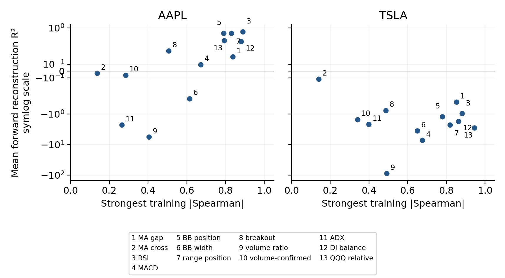
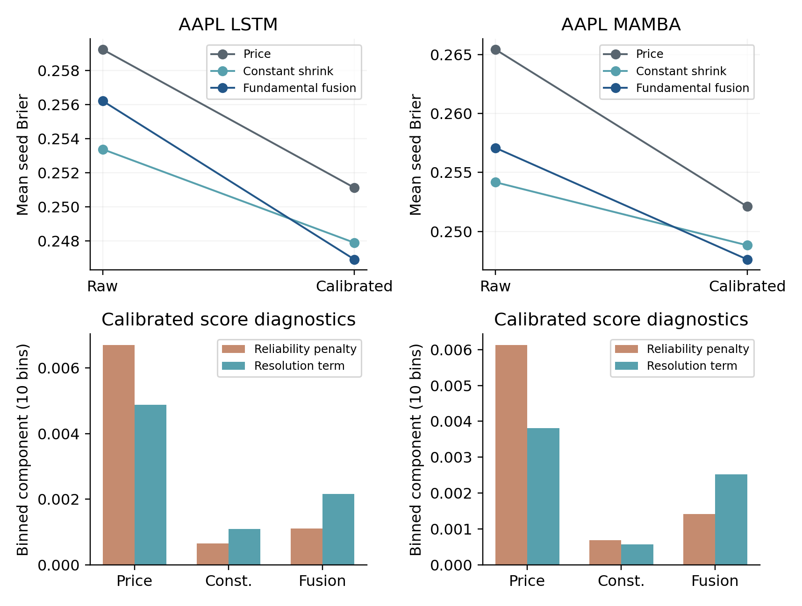
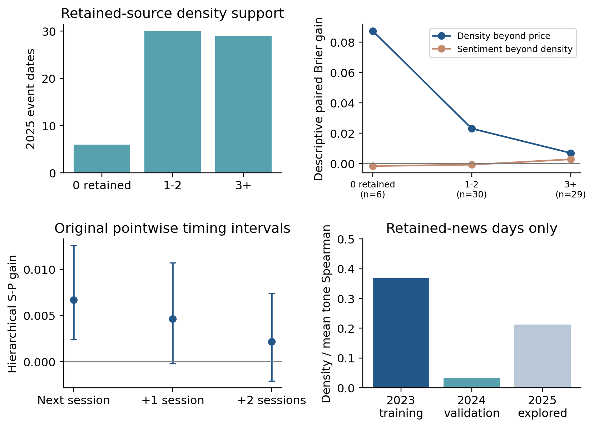

# Understanding the Sources of Apparent Predictive Gains in Financial Machine Learning

## Representation, Probability Shrinkage, News Density, and Temporal Data Integrity

Working paper · Revised 15 November 2026

Authors and institutional affiliation: to be confirmed

# 繁體中文重點摘要

本研究探討金融機器學習加入技術指標、基本面及新聞後，預測分數的變化究竟來自新增資訊、特徵表示、機率收縮或校準。研究以 AAPL、TSLA 的五日反轉機率為主，整合既有實驗，並以固定計畫完成開發期控制及凍結預測診斷。

技術指標與價格特徵有高度樣本內相關，但固定前向線性重建在兩股之間並不穩定。基本面融合的十組未校準預測都劣於同權重常數收縮；分別校準後，部分 AAPL 神經模型才出現額外點改善。24 次固定 Logistic 與 36 次固定樹模型擬合進一步比較 metadata、真實會計數值與等維重複價格；一項補充分支選擇比較的改善集中於冷啟動期，且對較長統計區塊敏感。

新聞研究中，密度控制重現大部分原本的 Brier 點改善，情緒增量則隨保留新聞密度而異。原次要顯著結果及時間敏感性均保留。研究據此建立一套更具解釋力的增量比較流程：同時檢查資訊內容、機率表示、校準與時間證據。2024–2025 已反覆探索，資料歷史版本與跨股票獨立驗證仍是後續推論的必要基礎。

# Abstract

Financial prediction gains can arise from additional information, a different representation of existing prices, or changes in forecast concentration and calibration. We study these channels using AAPL and TSLA reversal probabilities, combining archived technical, fundamental and news experiments with fixed supplementary analyses. Large training-period correlations between technical and price features coexist with unstable forward linear reconstruction, separating representation overlap from reliable transfer. Across ten stock–price-expert settings, uncalibrated fundamental fusion underperforms its matched-weight constant mixture; the small additional gains of two calibrated AAPL neural pipelines therefore depend on the complete calibration procedure. Development-only Logistic, XGBoost and LightGBM fits add matched metadata, numerical-accounting and duplicate-price controls. A prequential expert-allocation contrast improves during initialization, while subsequent forecasts select the same single component. In an issuer-news cohort, publication density reproduces most of the sentiment-augmented point improvement, whereas the remaining sentiment contribution varies across density strata. We retain both the original nonsignificant primary contrasts and significant secondary exceptions. Historical content-version and availability audits connect these comparisons to the information set a retrospective forecast can represent. The contribution is a linked empirical account of apparent gains across representation, shrinkage, initialization and text composition, together with controls that make these explanations distinguishable. Broader temporal validation requires verified historical versions and a separately registered unseen sample.

Keywords: incremental prediction; financial machine learning; calibration; forecast combination; news sentiment; point-in-time data

# 1. Introduction

A common response to weak financial forecasts is to add technical indicators, accounting variables or text, and then combine increasingly flexible models. A lower prediction loss is useful, but its interpretation depends on what changed. An indicator may expose a price pattern more conveniently. A low-dimensional accounting expert may stabilize a high-dimensional price model. A news variable may alter a forecast through publication density rather than sentiment. Recalibrating the resulting probabilities introduces a further channel.

We investigate these explanations for five-session stock reversals. The question differs from predicting a price level or next-day absolute return: it concerns the probability that the next executable return opposes the preceding trend. Existing financial machine-learning work demonstrates the potential of nonlinear information processing [R01, R21, R22], while forecast-benchmark research emphasizes the difficulty of stable out-of-sample improvement [R02]. Our focus is the source of a measured gain within a specified forecasting pipeline.

The study makes three contributions. First, it connects technical-feature comparisons to training redundancy and forward representation diagnostics, showing why strong contemporaneous correlations alone are an incomplete explanation of forecasting performance. Second, it evaluates fundamental fusion against constant shrinkage, separately examining raw forecasts, recalibrated forecasts, matched input formats and sequential expert allocation. Third, it separates publication density from sentiment and event features, and relates the resulting estimates to historical content-version evidence. These comparisons bring forecast-evaluation controls into a common financial research setting.

We use archived predictions and fixed data snapshots, supplementing them with development-only controls specified before computation. The empirical studies retain their own cohorts and correction families. The 2024–2025 period has been repeatedly explored, so the contribution is an explanatory empirical study rather than a fresh confirmation test. Detailed provenance records and the experiment chronology are supplied separately from the article.

# 2. Conceptual Framework and Related Work

## 2.1 Information versus representation and estimation

Let I denote the available information, η(I)=E[Y|I] the optimal probability for binary outcome Y, and q(I) an estimated forecast. Squared probability loss obeys

`E[(Y-q)²] = E[Var(Y|I)] + E[(q-η(I))²].`  (1)

A lower Brier score can therefore reflect a richer information set or a smaller estimation error within an existing set. Technical indicators constructed from a complete price history change its representation; an additional market series or longer warm-up history can also enlarge a finite model's observed inputs. This distinction motivates explicit relative-market and duplicate-feature controls.

Technical-analysis research has long examined rule definitions and statistical evaluation [R03, R32], including selection across large rule families [R04]. Modern price representations pursue a similar compression problem with flexible learners [R22]. Our addition is an empirical comparison between training overlap and fixed forward reconstruction alongside the original forecast contrasts. Reconstruction assesses a particular linear mapping, while reversal prediction assesses a different target.

## 2.2 Probability combination and calibration

Forecast combination integrates errors and information across components [R10]. Estimated weights also introduce uncertainty [R11, R34], and probability pooling can change calibration [R33]. Proper scores [R12] and probability-score decompositions [R13] provide complementary ways to examine these effects; calibration research supplies practical diagnostics [R14, R35, R36].

For price forecast p, fundamental forecast f, training constant c and fixed weight w, define q=(1-w)p+wf and q₀=(1-w)p+wc. Their realized loss difference is

`L(q₀,y)-L(q,y) = 2w(f-c)(y-q₀) - w²(f-c)².`  (2)

The first term records alignment of the added forecast deviation with the comparator's residual; the second penalizes that deviation. This exact arithmetic clarifies what a same-weight constant control measures. Separate nonlinear recalibration of q and q₀ creates distinct pipelines, so raw and calibrated comparisons are reported together.

We also examine fixed-bin reliability and resolution. With within-bin mean forecast p̄_b, event rate ȳ_b and weight v_b, REL=Σv_b(p̄_b-ȳ_b)², RES=Σv_b(ȳ_b-ȳ)² and UNC=ȳ(1-ȳ). For continuous archived probabilities,

`BS = REL - RES + UNC + G,`  (3)

where G=mean[(p-p̄_b)²-2(p-p̄_b)(y-ȳ_b)] is a signed grouping remainder. This preserves the original score rather than silently replacing each forecast by its bin mean. Finite-sample bin estimates remain descriptive [R35]; stable reliability methods such as CORP address related estimation issues [R36].

## 2.3 Financial text, fundamentals and temporal validity

Financial language and media content motivate sentiment and event predictors [R05, R06, R07]. Event-driven models [R40], StockNet's joint price/text model [R39] and newer multimodal datasets [R30] establish a substantial literature on source integration. Our question is narrower: does sentiment outperform a density control, and does a fused probability outperform an equally contracted price forecast?

Accounting research motivates numerical fundamentals [R08, R09], while missing-data research makes metadata a substantive control [R23]. These considerations connect information ablation to temporal validity. A financial value can have a fiscal period, an initial release, later revisions and vendor delivery times. Text has analogous content-version and observation histories. Language-model parameters introduce a further temporal boundary, as discussed by Glasserman and Lin [R38] and addressed through time-specific models by Drinkall et al. [R37]. We incorporate these distinctions into the interpretation of the observed information set.

# 3. Data and Experimental Design

## 3.1 Outcome, information sets and cohorts

The principal label compares the past-five-session direction s_t with the next executable five-session return:

`Y_rev(t) = 1{ sign(log(C_t/C_[t-5])) × log(C_[t+5]/O_[t+1]) < 0 }.`  (4)

Information is frozen after session t, entry is the next session's open and exit is the fifth future session's close. Source rules exclude a flat reference direction and purge boundaries using the original twenty-session rule. Earlier close-to-close event studies and next-day magnitude regressions supply context in Supplement S1; their scores are distinct outcomes.

{{COHORT_TABLE}}

Table 1. Cohort registry. The numerical scores belong to their own rows. P in the fundamental study is the technical-enhanced price model; the news study uses a smaller price summary.

The technical study compares B38 multiscale inputs with T51, adding twelve price/volume indicators and QQQ-relative strength. All models receive sixty sessions of observations; logistic and tree models flatten them, while LSTM and genuine Mamba retain sequence structure [R26, R27, R28, R29]. A QQQ-only C39 arm isolates the extra market series. The original bounded expanding-window searches, stopping and calibration procedures are preserved.

The accounting study fixes T51 as P. Its compact F expert contains seven accounting measures, release age, seven missingness flags and the shared past-direction indicator. Early fusion has sixty-by-sixty-six inputs; late fusion uses the frozen price predictions and a common F logistic expert. Source weights are chosen from {0,.25,.5,.75,1} on development folds. Two strictly later trading sessions align date-only releases, with a five-session sensitivity. Each stock has forty-five training vintages and nine carried/updated test vintages, including eight new test-period updates. Analyst-consensus vintages were unavailable, so the accounting task uses realized financial measures.

The news study uses 448 retrospectively reconstructed Apple Newsroom articles. Its eligible train/validation/test samples contain 224/232/230 dates and 28/36/65 acute-event dates. The 2025 event sample has forty-two reversals, and twenty-two events under the fixed five-session nonoverlap diagnostic. P contains eight market summaries; D adds retained-news existence and density, S adds FinBERT tone and its direction interaction, and T adds four event-type proportions. Regularized logistic and hierarchical shrinkage probabilities share dates and labels. The 2024 data serve both selection and calibration, and the next-session timing proxy has fixed additional one- and two-session delays.

## 3.2 Fixed supplementary analyses

A dated analysis plan precedes all supplementary computation. For representation diagnostics, we calculate development-period rank correlations and average-linkage feature clusters, then fit six multivariate Ridge mappings from B38 to all thirteen added inputs. Three expanding folds evaluate 2017–2018, 2019–2020 and 2021–2022, with fold-specific preprocessing and fixed penalty ten. Reconstruction maps contemporaneously available summaries to the indicator on the same evaluation date; forward denotes the time split.

For archived accounting forecasts, we examine concentration, bias, AUC and the score decomposition in Equation (3), using ten bins and a five-bin sensitivity. The principal summaries average losses and decomposition terms across seeds 42–46. Probability-ensemble graphics are labeled separately. Raw mixture identities use float64 reconstructions with archived floating-point rounding recorded separately; all original reported scores remain unchanged.

We additionally fit twenty-four fixed Logistic models on development data only: eighteen sixty-by-sixty-six matched models and six compact metadata experts. The matched arms append the same eight metadata fields to P, followed by seven accounting values, seven zeros or seven duplicate price columns. C=.001 and the existing forward splits are fixed. Archived configuration-zero P and F forecasts support sequential fusion controls: the initial weight is .5, and subsequent weights and single-component choices use strictly preceding folds. Constant shrinkage receives either the same weight or its own selection on the same grid and prior folds. A subsequent locked addendum extends the same input controls to both original tree architectures, using configuration zero and their original stopping scheme. All settings are reported; the addendum chronology is given in Supplement S4.

For news, retained-window counts define fixed strata of zero, one–two and at least three articles. We report all three timing assumptions, both probability versions and all original model arms. Zero denotes no matching article in this retained source. Source completeness and actual market-wide absence are separate quantities. Publication density is an operational attention proxy, rather than a direct measurement of investor attention.

## 3.3 Evaluation and statistical presentation

Brier score is principal; log loss, AUC and within-state ranking provide complementary diagnostics. Same-state AUC compares positive/negative cases within frozen past-direction, long-trend and volatility cells. Seeds measure algorithmic variability conditional on the observed market path.

Original paired tests retain their HAC, circular-bootstrap and Holm families: eight primary technical contrasts; eight accounting-information and twenty fusion contrasts; separately specified news families. Their intervals are pointwise. The six new logistic development contrasts use equal-stock date-paired losses on the full development calendar, retaining purge gaps. Synchronized sixty-session blocks and HAC60 form the principal supplementary analysis, with twenty-/120-session sensitivities and Holm6. The tree addendum has its own six-contrast family; Holm12 across the initial and added contrasts is also reported. This conditional-on-two-stocks procedure addresses time and shared-calendar dependence [R17, R19, R20, R31]. Multiple-comparison and selection concerns motivate preserving the full comparison set [R15, R16, R18].

# 4. Results

## 4.1 Technical overlap and forward representation stability

The original technical-feature comparison shows small or adverse changes across architectures (Table 2). AAPL deteriorates in all four primary architectures; only TSLA XGBoost has a positive point benefit. Its QQQ-only control almost reproduces the result: the T-versus-C benefit is approximately −0.000000510, with adjusted bootstrap p=1.

{{TECHNICAL_TABLE}}

Table 2. Original calibrated five-seed mean Brier and paired T-versus-B benefit. Positive favors T. Intervals are original block20 pointwise intervals; p-values are source Holm8 bootstrap values. The eight contrasts also retain their original HAC results in the supplement.

Development correlations confirm overlap: RSI and z20 have Spearman correlations .889536 for AAPL and .880338 for TSLA. Forward reconstruction gives a different view. RSI's mean R² is .754527 for AAPL but −.948142 for TSLA; the corresponding mean R² for the moving-average gap is .211020 and −.456444. Every indicator and fold is retained in Figure 1 and Supplement S2, including large negative reconstruction values.

Figure 1. Strongest training rank correlation versus fixed forward Ridge reconstruction. Numbers identify the fixed features in the key; the signed logarithmic vertical scale preserves negative outliers. Correlation uses the complete development sample; each forward model uses only its preceding training fold. Full correlation matrices and feature dendrograms accompany the supplementary tables.

The contrast separates overlap from transferable representation. High contemporaneous correlation can coexist with poor forward linear approximation as levels, volumes and ratios change. This diagnostic describes a fixed mapping, while the forecast comparison evaluates the reversal label. Together they provide a more specific account than treating technical indicators as uniformly redundant or uniformly informative.

Complexity changes also matter. Flattening increases the input from 2,280 to 3,060 columns. The AAPL Mamba calibrated seed SD rises from .000700 to .004474. Archived configuration, parameter-count and stopping metadata show the representation and optimization changes alongside these stability measures, supporting an interpretation in terms of finite-model estimation as well as information content.

## 4.2 Fundamental fusion: the role of the complete probability pipeline

The original accounting-information and fusion families contain zero positive comparisons jointly passing their respective corrected HAC and bootstrap criteria. AAPL early Logistic improves from .254449 to .249389, while XGBoost improves from .250267 to .249610; TSLA's corresponding early comparisons deteriorate. Table 3 concentrates on the neural examples that motivated the shrinkage analysis; all architectures and controls remain in Supplement S3.

{{FUSION_TABLE}}

Table 3. Original calibrated reversal Brier with constant-shrinkage controls. P is T51, and weights refer to the common compact F logistic expert. A weight of one identifies the F-only endpoint. Original H3 family tests and total-gain intervals are retained separately.

The two AAPL neural examples show how score gains depend on probability processing. Relative to their matched constants, raw LSTM and Mamba fusion have benefits of −.002834 and −.002919. After the original pipeline-specific calibration, those benefits become +.000980 and +.001198. Their new block60 pointwise intervals are [−.001351,.003419] and [−.000735,.003321]. Across all ten stock–price-expert settings, the raw added-F deviation has a negative net contribution in Equation (2).

Probability diagnostics make this pattern interpretable. AAPL LSTM's calibrated probability SD falls from .086365 for P to .019636 for fusion and .021961 for constant shrinkage. Mamba's corresponding SDs are .064149, .021147 and .021203. These examples have zero forecasts outside [.1,.9]; the measured changes concern dispersion and calibration bias within that range.

Figure 2. AAPL raw/calibrated scores and ten-bin diagnostics, averaged over seeds. Lower reliability penalty is preferable; larger resolution is favorable within the decomposition. Equation (3) and the supplementary table retain the signed grouping remainder.

For LSTM, calibrated reliability penalties are .006699 for P, .001103 for fusion and .000653 for constant shrinkage. Fusion's resolution is .002153 versus .001095 for the constant mixture. The corresponding Mamba reliability penalties are .006131/.001419/.000688, with fusion/constant resolution .002521/.000576. Thus both mixtures greatly reduce the price pipeline's reliability penalty, while the small additional fusion benefit is associated with different empirical resolution and grouping terms. This is a diagnostic of the realized probability pipeline, rather than a causal share of information value.

Ranking supplies complementary evidence. LSTM fusion's overall AUC is .583474, compared with .520047 within the frozen market cells; Mamba's corresponding values are .549749 and .523325. A secondary direct-up example illustrates component replacement: AAPL Logistic drops from .315318 to .251362, with source bootstrap Holm12 p=.0024 and all-twenty p=.004, but F weight is one. The calibration-period constant scores .251469. This contrast measures the replacement of a weak directional price pipeline by the compact expert.

## 4.3 Development controls localize initialization effects

The matched-input experiment evaluates the numerical accounting values against the same metadata and dimension. Its point differences favor the controls over the accounting arm (C1–C3, Table 4). The compact metadata expert has Brier .244533/.248998 for AAPL/TSLA, close to F's .243766/.248738. The fixed high-dimensional raw Logistic setting therefore displays substantial estimation sensitivity alongside small compact-expert differences. The added tree controls test this pattern under stronger raw price forecasts. XGBoost's pooled P+M+F-versus-P benefit is .000157 (interval [−.001504,.002003]); LightGBM's is −.000308 ([−.001705,.001039]). All six tree contrasts have family-adjusted bootstrap p≥.4032. Their complete metadata and duplicate-price comparisons are reported in Supplement S4.

{{DEVELOPMENT_TABLE}}

Table 4. New exploratory development contrasts, conditional on AAPL and TSLA, 1,450 evaluation dates per stock. Positive favors the candidate. Intervals are pointwise synchronized block60 bootstrap intervals; p-values are initial-family Holm6 bootstrap values. C1–C3 assess accounting inputs; C4–C6 assess sequential allocation. Exact definitions and HAC/sensitivity results accompany the table.

C6 improves on the prior-fold-selected single expert by .005726, with HAC Holm6 p=.023606 and bootstrap Holm6 p=.0240; the combined twelve-contrast bootstrap p-value is .0480. The contrast is entirely generated during the 2017–2018 initialization fold: its fixed .5 blend is compared with the predeclared initial P component. In later folds both policies select F, producing identical forecasts. The bootstrap adjusted p-value is .0060 at block20 and .0744 at block120, documenting its dependence sensitivity.

The fixed F expert's full-period scores are lower than Late's .245077/.250898. C4 and C5 each have benefit .001931 versus their shrinkage controls, with bootstrap Holm6 p=.152. These results locate the significant allocation comparison in initialization rather than persistent diversification. Quarterly loss-difference variance and cross-stock diagnostics are supplied to support future sample planning without treating daily repetitions of accounting values as independent releases.

## 4.4 Publication density and sentiment operate differently

{{NEWS_TABLE}}

Table 5. Original AAPL 2025 extreme-event results under next-session proxy timing, n=65. This cohort and P8 differ from the technical/accounting studies. All models share dates and labels.

The primary Logistic P-to-S benefit is .022569, with source bootstrap Holm2 p=.1512 and interval [−.002035,.047736]. Density alone contributes a .021825 point change, while sentiment beyond density contributes .000744, with secondary-family adjusted p=.8564. Adding event structure to S changes Brier adversely by .001248.

The new density-conditioned analysis shows where these changes arise. The zero/one–two/three-plus retained-article strata contain 6/30/29 event dates. Density benefits are .087475/.023079/.006946; additional sentiment benefits are −.001646/−.000753/+.002787. These are descriptive strata with limited class support, especially the six zero-retained windows. Mean probability changes and the complete date-support table distinguish forecast movement from predictive improvement.

Figure 3. Density support, paired conditional changes, original hierarchical timing intervals and density/tone correlations. Counts refer to the retained issuer corpus; the source's broader observation completeness is unknown. Sparse strata are displayed descriptively.

On retained-news days, density/mean-tone rank correlation is .368525 in 2023, .032985 in 2024 and .212493 in 2025. The representation relationship consequently varies over time. Publication density captures a different aspect of the source than tone, while the mean-tone construction and corporate selection also shape their association.

The secondary hierarchical S-versus-P benefit remains .006702, with HAC Holm2 p=.013587 and bootstrap Holm2 p=.028. Additional one-/two-session delays raise the latter to .1894/.3714. Hierarchical S has within-state AUC .5532 with unadjusted p=.5721; Logistic S/T have .5887/.6383, with Holm5 p=.8726/.8544. These results place the local probability improvement alongside its timing and within-state discrimination evidence.

# 5. Temporal Data Integrity

The provenance studies identify two distinct requirements: the exact historical source version and the time at which the intended observer could receive it. A source timestamp, a current retrieval time and a vendor-arrival record represent different clocks. An independent early capture can provide a conservative source-availability bound; arrival evidence adds a separate operational constraint.

The financial prototype covers twenty companies in four research groups, with twenty-one readable filing indexes and seventeen rendered pages. Original XBRL instance bytes and strictly qualified company quarters remain absent from the acquired evidence. Identity, split/dividend units and historical exits also require explicit handling before expanding the panel. The news/social audits reproduce existing feature joins but contain zero qualified historical source-version or arrival records under their strict contract. These are measured evidence gaps that bound the retrospective information set.

Current reconstructed corpora support the descriptive analyses above. Their original-version, modification, deletion and monitoring histories are the next data requirements for a stricter source-conditioned forecast experiment. Supplement S5 records the actual source and qualification evidence separately from administrative access decisions.

# 6. Discussion

The findings connect four forecasting choices. Price representation can change estimation even when features share a source; strong training correlation and unstable forward reconstruction can occur together. A compact external expert can alter forecast concentration; the raw and calibrated comparisons show that the full probability pipeline determines the observed benefit. Sequential component allocation can generate a significant comparison during initialization while converging to a single expert later. Publication density and tone can change predictions on different subsets of dates.

These explanations accord with the forecast-combination literature's treatment of estimation error [R11, R34] and probability pooling [R33]. They also sharpen the interpretation of financial multimodal comparisons [R30, R39, R40]: source ablation, representation controls and matched shrinkage answer related but different questions. Our empirical contribution is to evaluate them together, using traceable forecast contrasts rather than infer their contribution from a single score ranking.

For future work, the most informative comparison is a modest, fixed price/metadata/accounting design combined with separately tuned constant shrinkage and a prior-selected component benchmark. New sources should enter through a versioned information contract. Sample planning must reflect repeated quarterly updates and shared market shocks; the development variance diagnostics provide an initial scale, while broader dependence and power require a larger historical universe [R24, R31]. Preregistration then turns these exploratory mechanism checks into a focused unseen-sample assessment [R25].

# 7. Limitations and Research Integrity

The market population consists of two prominent stocks, and 2024–2025 has been repeatedly inspected. Local correction families address their stated contrasts rather than the full research history. The supplementary controls use fixed candidate settings, including high-dimensional Logistic and the two original tree architectures; results are conditional on those model classes and budgets. Five seeds quantify computational stability, while quarterly updates and overlapping returns limit independent information. The displayed intervals leave relevant effects unresolved. Larger historical populations, matched stronger price baselines and true unseen validation are needed for broader predictive claims.

Prices are retrospective adjusted snapshots; fundamental releases use date-lag proxies; issuer text is reconstructed and selected. Historical versions, company-action chains and independent document QA are incomplete. Finite-bin components describe the observed forecast–outcome pairs, with signed grouping remainder and five-bin sensitivity. These constraints limit information and causal attribution while preserving the empirical pipeline comparisons.

Research integrity statement. The existing 2026 evaluation protocol is unchanged and unexecuted. Earlier incidental exposure to 2026 aggregates and discovery material is documented in Supplement S6. The supplementary fitting and allocation decisions use development data ending in 2022; the already-viewed test forecasts are used for explicitly exploratory diagnostics. Source administration and engineering records accompany the article as supplementary documentation.

# 8. Conclusion

The experiments show why the source of a financial prediction gain matters. Technical-feature overlap is substantial but its forward reconstruction is unstable. Fundamental fusion changes concentration and calibration, and its raw advantage over constant shrinkage is negative in all ten archived settings. The new matched-input and sequential-allocation controls distinguish numerical content from representation and initialization. In the news study, publication density reproduces most of the total point change, while the smaller sentiment contribution varies with source density and timing.

A useful evaluation should therefore compare complete probability pipelines, retain simple shrinkage and component-selection controls, and make the historical information set explicit. This approach yields concrete explanations and testable next comparisons from mixed or negative results, while directing independent validation toward the effects that remain scientifically unresolved.

# References

{{REFERENCES}}
