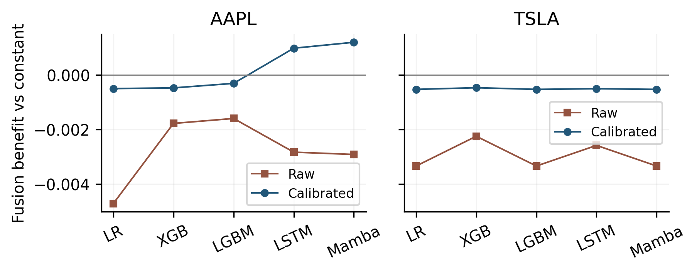
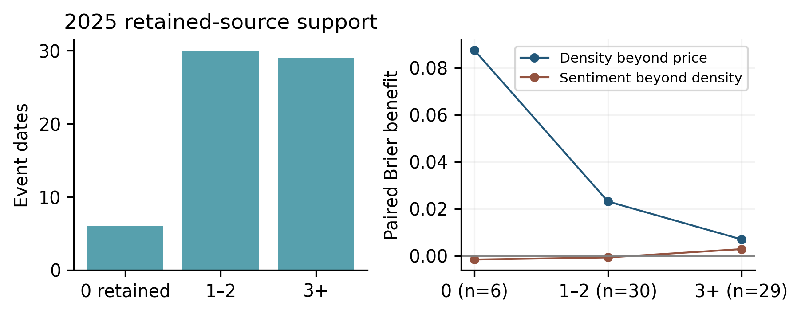

# Explaining Apparent Predictive Gains in Financial Machine Learning

[Author names and order pending confirmation]

[Affiliations and corresponding author pending confirmation]

## Abstract

Adding financial features can improve probability scores through new information, alternative price representations, or forecast contraction and calibration. We examine five-day stock-reversal probabilities for AAPL and TSLA using technical indicators, accounting variables, and issuer news with matched-input and constant-shrinkage controls. Primary technical-feature comparisons yield no corrected advantage; all ten uncalibrated fundamental-fusion settings underperform matched constant shrinkage. In the Apple news cohort, density reproduces most of the sentiment-augmented point improvement. An allocation benefit concentrates in initialization; a secondary news benefit is timing-sensitive. These exploratory findings support an integrated, reproducible evaluation workflow for interpreting predictive gains, subject to historical-version and independent-validation limitations.

Keywords: financial machine learning; incremental predictive value; forecast combination; probability calibration; news density; stock reversal

## 1. Introduction and Related Work

Financial prediction gains may reflect information, representation or estimation [1]. Technical [2] and price/text studies [3], forecast combination [4][5], reliability analysis [6][7] and historical-version concerns [8] motivate matched controls. We integrate three comparisons: technical overlap versus forward stability, accounting fusion versus metadata/price duplication and probability shrinkage, and news density versus sentiment. These coordinated tests provide reproducible empirical insights using established methods.

## 2. Materials and Methods

After session t, define past direction sₜ = sign[log(Cₜ/Cₜ₋₅)]. The five-session reversal label uses next-open entry and fifth-future-close exit:

`Yₜ = 1{sₜ log(Cₜ₊₅/Oₜ₊₁) < 0}.` (1)

C/O denote closing/opening prices; flat reference directions are excluded. Brier score is principal [9], with positive benefit favoring the candidate:

`BS(q) = n⁻¹ Σₜ(qₜ − yₜ)²; Δ = BS(reference) − BS(candidate).` (2)

Log loss and overall/within-state ROC-AUC complement Brier accuracy; states fix past direction, long trend and volatility. Logistic Regression (LR), XGBoost, LightGBM, LSTM and genuine Mamba use sixty-session inputs, flattened for LR/trees. B38 multiscale prices/volatility expands to T51 through twelve indicators and QQQ-relative strength; C39 adds only QQQ.

Accounting fixes P=T51; compact F includes seven values, release age/missingness and past direction. Date-only releases enter after two strictly later sessions (five-session sensitivity). There are 45 training vintages per stock and nine evaluation-used vintages, eight newly released; analyst-consensus vintages were unavailable.

For price probability p, accounting expert f, training constant c and fixed weight w, compare q=(1−w)p+wf with q₀=(1−w)p+wc:

`L(q₀,y) − L(q,y) = 2w(f−c)(y−q₀) − w²(f−c)².` (3)

Original calibration and per-seed comparisons are retained. BS=REL−RES+UNC+G preserves the continuous-probability grouping remainder; this diagnoses realized pipelines rather than causal information shares.

Apple news uses 448 reconstructed issuer articles: P8 market summaries; D adds retained-news existence/density; S adds FinBERT tone [10] and its direction interaction; T adds four event-type proportions. Logistic and hierarchical shrinkage predictors share dates. Next-session availability is a proxy, tested with additional one-/two-session delays. Zero retained articles is distinct from verified market-wide absence.

## 3. Experimental Setup

Market studies use AAPL/TSLA, 2012–2022 training, 2023 selection/stopping/calibration, 2024–2025 evaluation, 482 common dates per stock and seeds 42–46. News uses 2023/2024/2025: 224/232/230 dates, 28/36/65 acute-event dates, and 42 reversals in 2025; the fixed nonoverlap diagnostic retains 22 events. Different cohorts are evaluated separately.

Dated supplementary plans fix 24 LR and 36 tree fits on development data only: 1,450 evaluation dates per stock during 2017–2022, expanding splits, sixty-session history and twenty-session boundary purging. Matched P+M inputs (release age/missingness) receive seven accounting values, zeros or duplicate prices, always sixty-by-sixty-six. Candidate-zero settings avoid a new search. Six Ridge fits reconstruct all thirteen contemporaneous indicators from B38 with penalty ten and preceding-fold preprocessing. The tree addendum follows LR diagnostics and precedes tree fitting.

Fusion starts at .5; later weights/component choices use prior folds. Constants share weights or receive separate prior-fold tuning. Paired HAC/circular-bootstrap tests preserve Holm families [11][12]: technical (8), information (8) and fusion (20); new LR6/tree6 also receive Holm12. Synchronized block60 retains shared-market dependence, with 20/120 sensitivities and 4,999 resamples. Intervals are pointwise; seeds reflect algorithmic rather than market replication. Full protocols accompany the versioned code.

## 4. Results and Analysis

### 4.1. Technical Representation

Table 1 preserves all eight primary contrasts; none has a corrected positive advantage. TSLA XGBoost's point change is almost reproduced by QQQ alone: T-versus-C benefit −0.000000510, adjusted p=1.

Table 1. Calibrated five-seed T-versus-B Brier benefits; positive favors T. Original paired bootstrap Holm8 values are retained. Absolute scores, pointwise intervals and HAC results are supplied separately.

| Model | AAPL benefit | Holm8 p | TSLA benefit | Holm8 p |
| --- | --- | --- | --- | --- |
| xgboost | -0.000420 | 0.9952 | +0.000235 | 1.0000 |
| lightgbm | -0.000020 | 1.0000 | -0.000033 | 1.0000 |
| lstm | -0.001643 | 1.0000 | -0.000009 | 1.0000 |
| mamba | -0.003616 | 1.0000 | -0.000506 | 1.0000 |

RSI/z20 development correlations are 0.889536/0.880338 for AAPL/TSLA, yet forward RSI reconstruction has mean R² 0.754527/−0.948142. Moving-average-gap R² is 0.211020/−0.456444. All thirteen targets remain in the supplement. Training overlap and transferable linear representation are different measurements. Flattened width rises 2,280→3,060; AAPL Mamba's calibrated seed SD rises 0.000700→0.004474.

### 4.2. Fusion and Calibration

Original reversal information/fusion families have zero positive contrasts jointly passing their corrected HAC/bootstrap criteria. All ten raw settings lose to matched constant shrinkage (Figure 1). AAPL LSTM/Mamba raw benefits −0.002834/−0.002919 become +0.000980/+0.001198 after calibration, with new block60 intervals [−0.001351,0.003419]/[−0.000735,0.003321].

Figure 1. Fusion benefit beyond matched-weight constant shrinkage, averaged across frozen seeds. All ten stock/expert settings appear; positive favors accounting fusion. Raw and calibrated probabilities represent distinct complete pipelines.

AAPL LSTM Brier is P 0.251127, constant 0.247902 and fusion 0.246922; Mamba is 0.252111/0.248822/0.247623. Their probability SDs contract from 0.086365/0.064149 to fusion 0.019636/0.021147, close to constant 0.021961/0.021203. Both mixtures reduce empirical reliability penalties; resolution and grouping terms differ.

A significant secondary direct-up exception remains: AAPL LR 0.315318→0.251362, bootstrap Holm12 p=0.0024/all-twenty p=0.004. Weight 1 identifies F-only replacement; its calibration-period constant scores 0.251469. This differs from complementary two-expert fusion.

### 4.3. Matched Inputs and Initialization

Table 2 reports LR controls: C1/C2 compare P+M+F with zero/duplicate values; C3 uses P; C4/C5 compare fusion with same-weight/prior-tuned constants; C6 uses the prior-selected single expert. Full tree C1/C2/C3 benefits are XGBoost −0.000332/+0.000095/+0.000157 and LightGBM +0.000149/−0.001027/−0.000308, all family-adjusted bootstrap p≥0.4032. Their complete intervals remain supplementary.

Table 2. Development-only paired LR benefits, conditional on two stocks, block60. Holm6 is the original supplementary family; Holm12 includes all six tree contrasts. Intervals are pointwise.

| Contrast | Benefit | 95% pointwise CI | Holm6 p | Holm12 p |
| --- | --- | --- | --- | --- |
| LR C1 | -0.007655 | [-0.021292, 0.007731] | 0.5972 | 1.0000 |
| LR C2 | -0.006319 | [-0.020165, 0.009262] | 0.5972 | 1.0000 |
| LR C3 | -0.023083 | [-0.042023, -0.003594] | 0.1050 | 0.2310 |
| LR C4 | +0.001931 | [0.000110, 0.003728] | 0.1520 | 0.3800 |
| LR C5 | +0.001931 | [0.000110, 0.003728] | 0.1520 | 0.3800 |
| LR C6 | +0.005726 | [0.001548, 0.009306] | 0.0240 | 0.0480 |

C6 has HAC Holm6 p=0.023606 and bootstrap p=0.0240; combined bootstrap p=0.0480. Its entire difference comes from 2017–2018 initialization (.5 blend versus initial P). Later both select F and yield identical forecasts. Block120 raises adjusted bootstrap p to 0.0744; fixed F also outperforms fusion over the full development period. The positive allocation comparison therefore localizes initialization rather than persistent complementarity.

### 4.4. News Density and Sentiment

Table 3 preserves all displayed models. LR S-versus-P benefit 0.022569 has primary bootstrap Holm2 p=0.1512 and interval[−0.002035,0.047736]. Density alone contributes 0.021825; sentiment beyond density adds 0.000744, secondary adjusted p=0.8564. T-versus-S deteriorates by 0.001248.

Table 3. Apple 2025 extreme-event cohort, next-session proxy, n=65. Lower Brier/log loss and higher AUC are preferable. Its P8 information set and dates differ from Table 1.

| Model | Brier | Log loss | AUC |
| --- | --- | --- | --- |
| lr_P | 0.318276 | 0.841749 | 0.394410 |
| lr_D | 0.296450 | 0.790007 | 0.476190 |
| lr_S | 0.295706 | 0.788906 | 0.534161 |
| lr_T | 0.296955 | 0.791471 | 0.532091 |
| hier_P | 0.265713 | 0.725124 | 0.522257 |
| hier_S | 0.259011 | 0.711600 | 0.586957 |
| hier_T | 0.257149 | 0.707756 | 0.575569 |
| global | 0.256489 | 0.706133 | 0.500000 |

Figure 2. Retained-article strata contain 6/30/29 events. Benefits are descriptive; the six zero-retained windows have sparse class support. Source-window absence is not verified absence of news.

Additional sentiment benefits are −0.001646/−0.000753/+0.002787 across strata. Hierarchical S-versus-P improves 0.006702: HAC Holm2 p=0.013587, bootstrap Holm2 p=0.028. Additional one-/two-session delays raise the latter to 0.1894/0.3714. Within-state AUC 0.5532 has unadjusted p=0.5721, separating this local probability gain from robust event-timing discrimination.

## 5. Discussion and Limitations

Matched controls distinguish representation, contraction/calibration, initialization and retained-source composition. Two surviving stocks, repeatedly inspected 2024–2025 data, fixed budgets, calibration sensitivity, quarterly repetition, overlapping labels and sparse text strata bound generalization. Multiplicity families cover specified contrasts rather than the full research history.

Retrospective adjusted prices, accounting date proxies and reconstructed issuer text lack complete historical versions, corporate-action chains, feature-model vintages and arrival evidence. Strict audits still contain zero qualified historical source-version/arrival records; computational reproduction addresses a separate criterion. The existing 2026 protocol remains unchanged and unexecuted; earlier incidental exposure to 2026 aggregates/discovery material is disclosed in supplementary integrity records. This preparation adds no model fit or financial evaluation. Broader lawful data, independent document QA and separately registered unseen validation are the next evidence requirements.

## 6. Conclusions

Information- and probability-matched controls link technical representation, contraction/calibration, initialization and news density within a reproducible exploratory workflow for testing multi-source financial prediction claims.

## Back Matter

Supplementary Materials/Data Availability: Code, full results and integrity records: https://github.com/yoyocar2333/financial-sequence-benchmark (v.3a1ab2e); raw snapshots/weights remain private. Author, funding, acknowledgments, ethics and conflict declarations: [Confirmation pending]. AI Assistance: Codex assisted writing, code and formatting; authors must verify and approve.

## References

1. Gu, S.; Kelly, B.; Xiu, D. Empirical Asset Pricing via Machine Learning. Rev. Financ. Stud. 2020, 33, 2223-2273. doi:10.1093/rfs/hhaa009

2. Lo, A.W.; Mamaysky, H.; Wang, J. Foundations of Technical Analysis: Computational Algorithms, Statistical Inference, and Empirical Implementation. J. Finance 2000, 55, 1705-1765. doi:10.1111/0022-1082.00265

3. Xu, Y.; Cohen, S.B. Stock Movement Prediction from Tweets and Historical Prices. Proceedings of the 56th Annual Meeting of the Association for Computational Linguistics (Volume 1: Long Papers) 2018, 1970-1979. doi:10.18653/v1/P18-1183

4. Bates, J.M.; Granger, C.W.J. The Combination of Forecasts. J. Oper. Res. Soc. 1969, 20, 451-468. doi:10.1057/jors.1969.103

5. Ranjan, R.; Gneiting, T. Combining Probability Forecasts. J. R. Stat. Soc. B 2010, 72, 71-91. doi:10.1111/j.1467-9868.2009.00726.x

6. Bröcker, J. Some Remarks on the Reliability of Categorical Probability Forecasts. Mon. Weather Rev. 2008, 136, 4488-4502. doi:10.1175/2008MWR2329.1

7. Dimitriadis, T.; Gneiting, T.; Jordan, A.I. Stable reliability diagrams for probabilistic classifiers. Proceedings of the National Academy of Sciences 2021, 118. doi:10.1073/pnas.2016191118

8. Glasserman, P.; Lin, C. Assessing Look-Ahead Bias in Stock Return Predictions Generated By GPT Sentiment Analysis. arXiv preprint arXiv:2309.17322 2023. doi:10.48550/arXiv.2309.17322

9. Gneiting, T.; Raftery, A.E. Strictly Proper Scoring Rules, Prediction, and Estimation. J. Am. Stat. Assoc. 2007, 102, 359-378. doi:10.1198/016214506000001437

10. Dogu Araci FinBERT: Financial Sentiment Analysis with Pre-trained Language Models. arXiv preprint arXiv:1908.10063 2019. doi:10.48550/arXiv.1908.10063

11. Newey, W.K.; West, K.D. A Simple, Positive Semi-Definite, Heteroskedasticity and Autocorrelation Consistent Covariance Matrix. Econometrica 1987, 55, 703. doi:10.2307/1913610

12. Holm, S. A Simple Sequentially Rejective Multiple Test Procedure. Scandinavian Journal of Statistics 1979, 6, 65–70. https://www.jstor.org/stable/4615733
