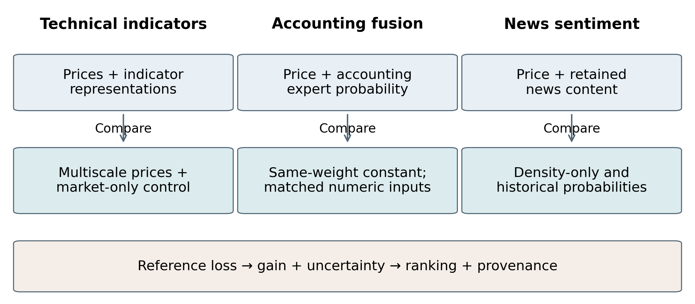
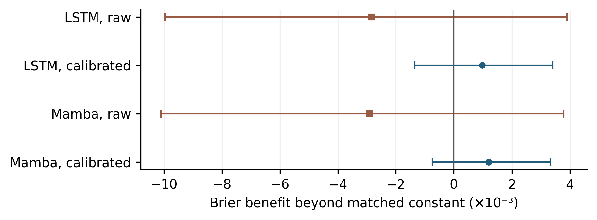

# Diagnosing Apparent Predictive Gains in Financial Machine Learning

Hsieh Hao-Hsuan

[Affiliation and corresponding author details pending confirmation]

## Abstract

{{ABSTRACT}}

Keywords: financial machine learning; incremental information; probability calibration; forecast combination; news density; reversal prediction

## 1. Introduction and Related Work

Financial features can lower prediction loss through new content, alternative price representations or probability stabilization [1–3].

We integrate forecast combination [4], pooling [5], reliability [6,7] and temporal-bias [8] methods to ask: what gain remains after controlling its alternative explanation? Contributions are matched-information comparisons, shrinkage/calibration-aware fusion, and density-controlled sentiment analysis, with cohort-specific uncertainty.

## 2. Methods and Experimental Setup

### 2.1. Tasks, Data and Models

The principal target is a five-session reversal. After session t, past direction is sₜ=sign[log(Cₜ/Cₜ₋₅)]. Entry is at the next open and exit at the fifth future close:

`Yₜ = 1{sₜ log(Cₜ₊₅/Oₜ₊₁) < 0}.` (1)

C/O denote close/open; flat past directions are excluded. Brier score measures mean squared probability error [9]. Define

`ΔBS = BS_ref − BS_candidate; Gain(%) = 100 ΔBS / BS_ref.` (2)

Positive gains favor candidates. Percentages use unrounded same-cohort references, measuring loss reduction, not accuracy/returns. Log loss, ROC-AUC and within-state AUC (past-direction/trend/volatility cells) complement Brier.

Market studies use AAPL/TSLA: 2012–2022 training, 2023 stopping/calibration, and repeatedly inspected 2024–2025 evaluation (482 common dates/stock; seeds 42–46). Regularized logistic regression, XGBoost/LightGBM trees, long short-term memory (LSTM) networks and Mamba selective state-space models use 60-session histories; nonsequential models flatten them. Original bounded searches and early stopping remain fixed.

The 38-feature multiscale price/volatility representation gains 12 technical transforms and QQQ-relative strength; a relative-market-only arm controls the extra series. Accounting comparisons fix the resulting 51-feature price model, adding seven reported measures and release-age/missingness metadata. Date-only releases enter after two strictly later sessions (five-session sensitivity); each stock has 45 training and nine evaluation-used vintages.

The separate Apple news cohort uses 448 reconstructed issuer articles: 2023/2024/2025 training/validation/exploration, 224/232/230 eligible dates and 28/36/65 extreme events. Evaluation has 42 reversals; nonoverlap leaves 22 events. Eight price summaries gain retained-news density/existence, FinBERT tone [10]/direction interaction, then four event-type proportions. Hierarchical models augment shrunk state probabilities with sentiment categories. Zero retained articles is not verified market-wide absence.

### 2.2. Controls, Calibration and Inference

Accounting fusion mixes each price model with a compact logistic accounting expert at a development-selected weight; sparse vintages preclude a new neural accounting encoder. The critical control substitutes a historical constant for the accounting probability at the same weight. Each complete pipeline is calibrated separately; raw and calibrated comparisons therefore answer different questions.

Market calibration fits L2-regularized Platt logistic regression (C=1) on second-half 2023 logits, clipped to [10⁻⁶,1−10⁻⁶]:

`q_cal = sigmoid[a logit(q_raw) + b].` (3)

An unconstrained slope can be negative, reversing ranking. Calibration learns from validation outcomes, not new accounting measurements. News retains its different identity-regularized monotone calibration and reuses 2024 for selection/calibration.

## 3. Development Controls and Statistical Evaluation

Development controls replace accounting values with zeros or duplicated prices, holding metadata/width fixed. Existing 24 logistic and 36 tree fits cover 1,450 dates/stock in 2017–2022, with 60-session histories and 20-session purging. Sequential fusion starts at weight 0.5; later weights and expert choices use earlier folds, as do constant controls.

Paired HAC [11], circular bootstrap and Holm [12] preserve separate families: eight technical, twenty fusion, two-contrast news, six logistic/six tree development and combined-12 sensitivity. Original studies use 9,999 resamples; development/block 60 diagnostics use 4,999. Block 20/120 sensitivities remain separate. Seeds are algorithmic replications, not independent markets. Full settings/comparisons are supplementary.

## 4. Results and Analysis

### 4.1. Overview of Experimental Findings

We ask whether gains survive controls for representation, probability processing and coverage (Figure 1): prices/relative-market inputs for technical indicators; constant shrinkage/matched metadata for accounting; density/historical probabilities for sentiment. Across these distinct cohorts, stronger controls change or weaken the interpretation of improved scores.

Figure 1. Candidate sources and their critical controls. Evaluation principles are shared; scores and p-values are not pooled.

### 4.2. Technical Indicators: Representation versus New Information

Do indicators improve models already observing multiscale prices? Moving-average, momentum, band-position and volume/breakout transforms yield no corrected positive advantage in eight comparisons. TSLA XGBoost gains 0.000235 ({{TECH_TSLA_PERCENT}}% of reference 0.250207), interval [−0.000378,0.000837]; the market-only control almost reproduces it. All models, stocks and negative changes remain in Supplementary Table S1.

RSI and standardized price deviation have training rank correlations 0.890/0.880 (AAPL/TSLA), yet forward linear RSI reconstruction has mean R² 0.755/−0.948. Strong contemporaneous association can coexist with unstable transfer under changing distributions/nonlinear mappings. Neither proves conditional redundancy. Together, these diagnostics and forecasts show no established incremental reversal signal from these representations in the tested models.

### 4.3. Fundamental Fusion: Calibration versus Information Gain

Does accounting fusion outperform simply contracting the price forecast? All ten raw stock/expert settings trail same-weight constant shrinkage. For AAPL LSTM/Mamba, raw benefits are −0.002834/−0.002919, becoming +0.000980/+0.001198 after separate calibration. The latter equal only {{LSTM_PERCENT}}%/{{MAMBA_PERCENT}}% reductions relative to their calibrated constant controls. Existing block 60 intervals cross zero (Table 1); these are small, unresolved score differences, not established added accounting information.

Table 1. Calibrated fusion versus constant shrinkage; existing pointwise block 60 CIs. Original block 20 fusion-family p=1 throughout. All ten raw/calibrated settings: Supplementary Table S2.

{{FUSION_TABLE}}

Figure 2. AAPL raw/calibrated fusion gains over matched constants (10⁻³ Brier); existing block 60 intervals include zero after calibration.

Why does calibration change the sign? Accounting deviations can add loss unless aligned with the constant control’s errors; separate sigmoid maps then change range or ranking. AAPL LSTM probability SD contracts from 0.086 (price) to 0.020 (fusion), near 0.022 (constant). Both reduce binned reliability error; the constant has lower reliability penalty, while fusion differs in resolution/grouping. The decomposition retains its signed grouping remainder. These diagnose probability pipelines, not causal information shares.

A secondary direct-up exception remains: AAPL logistic Brier 0.315318→0.251362; adjusted p=0.0024 within 12 directional contrasts, 0.004 across 20. Accounting weight is 1; a calibration-period constant scores 0.251469. This replaces a weak price expert rather than combining complementary experts.

### 4.4. Matched Controls: Does Additional Accounting Information Help?

Do accounting values beat equally formatted inputs? Tests against zero values, duplicated prices and price-only forecasts establish no corrected positive tree advantage (six contrasts; adjusted p≥0.4032). Equal width controls representation, not effective capacity; all logistic/tree comparisons remain in Supplementary Table S3.

Against same-weight and independently tuned shrinkage, fusion gains 0.001931 with adjusted p=0.152. Against the prior-selected single expert, ΔBS=0.005726 ({{INIT_PERCENT}}%), CI [0.001548,0.009306], six-family p=0.0240 and combined-12 p=0.0480. The entire gain arises in 2017–2018: initial 0.5 fusion versus price-only allocation. Later both select accounting and forecast identically. Block 120 gives p=0.0744; fixed accounting alone has lower full-period loss. This is an initialization effect, not persistent complementarity.

### 4.5. News Density versus Sentiment

Does sentiment add after controlling publication density? In the 65-event Apple cohort, adding density to price gives 0.021825 ({{NEWS_DENSITY_PERCENT}}%); adding sentiment after density gives just 0.000744 ({{NEWS_SENTIMENT_PERCENT}}% of that different reference). The complete price-to-sentiment change is 0.022569 ({{NEWS_TOTAL_PERCENT}}%), with primary adjusted p 0.1512 and interval [−0.002035,0.047736]. Thus most of this point change appears before sentiment enters; the remaining increment has secondary adjusted p 0.8564 (Table 2).

Table 2. Same 65 news events; row-specific references. Primary, density and hierarchical two-contrast families remain separate; prior comparison is descriptive.

{{NEWS_TABLE}}

The secondary hierarchical gain 0.006702 has adjusted p=0.028, rising to 0.1894/0.3714 with one-/two-session extra delays. Its Brier 0.259011 exceeds the historical prior’s 0.256489 ({{NEWS_PRIOR_PERCENT}}% gain). Within-state AUC 0.5532 has unadjusted p=0.5721. Improving on one price comparator does not establish superiority to the prior or reliable reversal timing.

Density reflects source publication activity; tone reflects retained language, not necessarily causal attention. Density strata have 6/30/29 events and extra sentiment gains −0.001646/−0.000753/+0.002787. These sparse descriptive strata cannot establish a market-wide “no-news” state. Supplementary Table S4 preserves all eight predictors and event-feature losses.

### 4.6. Cross-Experiment Synthesis

The same diagnostic logic connects the results (Table 3). Transforming or augmenting forecasts sometimes improves point scores. Representation, contraction, metadata and historical-prior controls then change their interpretation: calibrated accounting gains remain uncertain, allocation gains occur only at startup, and density precedes most of one news-model change.

Table 3. Cross-experiment synthesis; every row retains its own cohort and correction family.

{{SYNTHESIS_TABLE}}

These counterexamples to “lower Brier implies new information” motivate controls for representation, estimation and source composition; they do not rule out all information value.

## 5. Discussion and Limitations

The contribution is a control sequence: match information/probability-processing budgets, report uncertainty, then check ranking/provenance. The AAPL LSTM gain of 0.395% measures loss reduction, not accuracy or trading performance.

Limits include two surviving stocks, repeated 2024–2025 exploration, fixed model budgets, calibration sensitivity, overlapping labels, quarterly repetition and sparse news. Local multiplicity corrections do not cover the full research history. Retrospective adjusted prices, date-lag accounting proxies and incomplete historical news versions/arrival evidence constrain availability claims. Supplementary integrity records retain provenance and prior data-contact disclosures. Broader lawful samples, independent document checks and separately registered unseen validation are needed.

## 6. Conclusions

Matched controls make apparent gains interpretable: price representation, probability processing, initialization and news coverage explain different changes in these exploratory cohorts. The integrated evaluation keeps incremental information, statistical uncertainty and investment utility distinct.

## Back Matter

Supplementary Materials/Data Availability: Full comparisons, calculations and integrity records: https://github.com/yoyocar2333/financial-sequence-benchmark. Raw snapshots/weights are private. Author, funding, ethics and conflict declarations: [Confirmation pending]. AI Assistance: Codex assisted writing/code/formatting; authors must verify and approve.

## References

{{REFERENCES}}
