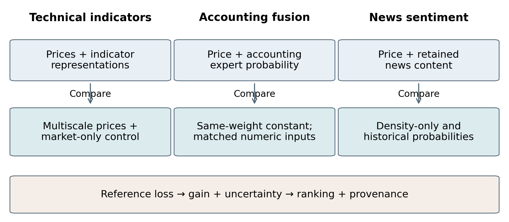

# Diagnosing Apparent Predictive Gains in Financial Machine Learning

Hsieh Hao-Hsuan

[Affiliation and corresponding author details pending confirmation]

## Abstract

Apparent financial prediction gains in small, repeatedly explored samples may reflect information, representation, or probability processing. We compare price, technical, accounting, and news forecasts using matched controls for five-day reversals. Technical additions show no corrected advantage. AAPL calibrated fusion gains 0.000980/0.001198 over constant shrinkage, with intervals crossing zero. Sequential allocation improves only the first development interval; later forecasts coincide. Archived calibrators verify one Mamba seed’s ranking reversal. In an Apple news cohort, density precedes most sentiment-model score improvement. These exploratory results support integrated, reproducible evaluation that separates observed loss changes from claims about incremental information, calibration, discrimination, or investment value.

Keywords: financial machine learning; incremental information; probability calibration; forecast combination; news density; reversal prediction

## 1. Introduction and Related Work

Financial features can improve forecasts through new content, price representation or probability stabilization [1–3].

We integrate pooling [4,5], reliability [6,7] and temporal-bias diagnostics [8] to distinguish these channels. Contributions are matched-information evaluation, shrinkage/calibration-aware fusion and density-controlled sentiment analysis, with cohort-specific uncertainty.

## 2. Methods and Experimental Setup

### 2.1. Tasks, Data and Models

The principal target is a five-session reversal. After session t, past direction is sₜ=sign[log(Cₜ/Cₜ₋₅)]. Entry is at the next open and exit at the fifth future close:

`Yₜ = 1{sₜ log(Cₜ₊₅/Oₜ₊₁) < 0}.` (1)

C/O denote close/open. Reversal requires a nonzero past-five-session direction; exact zero returns are excluded (Supplementary Methods). Positive Brier gain is BS(reference)−BS(candidate); relative gain is 100 times this difference divided by its unrounded reference. These measure probability loss, not accuracy or returns [9].

Overall and within-state ROC-AUC assess ranking; the latter pairs opposing outcomes within past-direction/trend/volatility cells. Five training seeds assess stability on the same evaluation observations.

Market studies use AAPL/TSLA: 2012–2022 training, 2023 stopping/calibration, and repeatedly inspected 2024–2025 evaluation (482 common dates/stock; seeds 42–46). Regularized logistic regression, XGBoost/LightGBM trees, long short-term memory (LSTM) networks and Mamba selective state-space models use 60-session histories; nonsequential models flatten them. Selection uses three candidates and three expanding folds; neural training uses batch 64, up to 24 epochs and patience 4.

The 38-feature price/volatility representation is extended with 12 technical indicators and one QQQ-relative feature; a market-only arm controls the extra series. Accounting comparisons fix this 51-feature price model and add seven reported measures plus age/missingness metadata. Date-only releases enter after two strictly later sessions (five-session sensitivity); each stock supplies 45 training and nine evaluation-used vintages.

Apple news uses 448 reconstructed issuer articles: 2023/2024/2025 training/validation/exploration; 224/232/230 dates and 28/36/65 extreme events. Evaluation has 42 reversals; nonoverlap leaves 22 events. Eight price summaries gain corpus-based density/existence, FinBERT tone/direction interaction [10], then four event proportions. Hierarchical models extend shrunk state probabilities with sentiment categories. Density counts articles retained in the reconstructed Apple Newsroom corpus.

### 2.2. Fusion, Calibration and Brier Diagnostics

Let p and f denote price and compact logistic-accounting probabilities, c a training constant, and w the development-selected accounting weight. The compact expert reflects limited quarterly updates. Compare

`q = (1−w)p + wf; q₀ = (1−w)p + wc.` (2)

For squared loss L(q,y)=(q−y)², the exact raw-mixture benefit is

`L(q₀,y)−L(q,y) = 2w(f−c)(y−q₀)−w²(f−c)².` (3)

The alignment term rewards deviations f−c that match the control’s error y−q₀; the nonnegative deviation penalty subtracts their squared cost. This identity applies to raw linear mixtures, not to two separately calibrated nonlinear pipelines.

For ten fixed probability bins, let vₖ denote bin weight, μₖ mean forecast, oₖ outcome rate, and o the overall rate:

`BS = REL − RES + UNC + G.` (4)

REL=Σvₖ(μₖ−oₖ)² measures binned reliability error; RES=Σvₖ(oₖ−o)² measures resolution; UNC=o(1−o). The signed grouping remainder G is the difference between continuous-probability loss and loss after replacing forecasts by their bin means. Omitting it breaks equality for continuous forecasts [6,7]. Five-bin sensitivity and full definitions are supplementary.

Each market pipeline receives its own L2-regularized Platt map (C=1), fitted on 2023 H2 logits clipped to [10⁻⁶,1−10⁻⁶]:

`q_cal = sigmoid[a logit(q_raw) + b].` (5)

A positive slope preserves single-seed AUC; a negative slope reverses ranking. News uses a distinct identity-regularized monotone calibration, reusing 2024 for selection/calibration.

### 2.3. Representation Diagnostics

Spearman ranks use 2,768 development dates/stock in 2012–2022. Fixed Ridge (alpha=10) reconstructs 13 added features from 38 price features, with training-only input/target scaling. Three expanding folds fit through 2016/2018/2020 H1 and evaluate 2017–2018/2019–2020/2021–2022. Forward denotes temporal evaluation of same-date features, not tomorrow’s RSI. Reported R² is the unweighted mean of three fold values; full filtering/scalers are supplementary.

## 3. Development Controls and Statistical Evaluation

Development controls replace seven accounting values with zeros or duplicated prices, holding metadata/width fixed. Twenty-four logistic and 36 tree fits cover 1,450 dates/stock in 2017–2022, with 60-session histories and 20-session purging. Sequential fusion starts at weight 0.5; later weights, single-expert choices and constant controls use earlier folds.

Paired HAC [11], calendar-block bootstrap and Holm [12] keep separate families: eight technical, twenty fusion, two-contrast news, six logistic/six tree development, plus combined-12 sensitivity. Primary studies use 9,999 resamples; development/block 60 diagnostics use 4,999. Block 20/120 sensitivities are retained. Full settings are supplementary.

## 4. Results and Analysis

### 4.1. Overview of Experimental Findings

We ask whether gains survive controls for representation, probability processing and coverage (Figure 1): prices/relative-market inputs for technical indicators; constant shrinkage/matched metadata for accounting; density/historical probabilities for sentiment. Across these distinct cohorts, stronger controls change or weaken the interpretation of improved scores.

Figure 1. Candidate sources and their critical controls. Evaluation principles are shared; scores and p-values are not pooled.

### 4.2. Technical Indicators: Representation versus New Information

Can indicators improve models already observing multiscale prices? All eight primary comparisons lack a corrected positive benefit (Table 1). TSLA XGBoost gains 0.000235 (0.094% of reference 0.250207), CI [−0.000378,0.000837]; the market-only control almost reproduces it. The neural additions worsen AAPL point loss rather than revealing a general architecture advantage.

Table 1. Added technical indicators versus multiscale prices. Gain=reference−candidate Brier, in 10⁻³ units; p is primary bootstrap Holm 8. Full scores, HAC and intervals: Supplementary Table S1.

| Model | AAPL gain | AAPL p | TSLA gain | TSLA p |
| --- | --- | --- | --- | --- |
| XGBoost | -0.420 | 0.9952 | +0.235 | 1.0000 |
| LightGBM | -0.020 | 1.0000 | -0.033 | 1.0000 |
| LSTM | -1.643 | 1.0000 | -0.009 | 1.0000 |
| Mamba | -3.616 | 1.0000 | -0.506 | 1.0000 |

RSI and standardized price deviation have Spearman 0.890/0.880 (AAPL/TSLA), while forward Ridge R² is 0.755/−0.948. Strong same-period association can coexist with unstable temporal transfer under changing distributions or nonlinear relations. Neither diagnoses conditional redundancy by itself; forecasting tests establish no reliable incremental signal from these representations.

### 4.3. Fundamental Fusion: Calibration versus Information Gain

Does accounting fusion beat equal contraction toward a constant? All ten raw settings score worse. AAPL LSTM/Mamba benefits −0.002834/−0.002919 become +0.000980/+0.001198 after separate calibration: only 0.395%/0.482% of the constant references. Block 60 intervals cross zero; TSLA gains are negative (Table 2).

Table 2. Calibrated neural fusion versus same-weight constant shrinkage. Gains/CIs are 10⁻³ Brier; percentages use the row reference. Pointwise block 60 intervals; primary block 20 Holm 20 p=1 throughout.

| Stock/model | Reference BS | Gain ×10³ | Gain % | 95% CI ×10³ |
| --- | --- | --- | --- | --- |
| AAPL LSTM | 0.247902 | +0.980 | 0.395 | [-1.351, +3.419] |
| AAPL Mamba | 0.248822 | +1.198 | 0.482 | [-0.735, +3.321] |
| TSLA LSTM | 0.250159 | -0.506 | -0.202 | [-2.026, +0.964] |
| TSLA Mamba | 0.250121 | -0.530 | -0.212 | [-2.440, +1.464] |

The saved calibrators clarify what changes (Table 3). All LSTM slopes are positive, so its fusion AUC stays 0.583474. Mamba’s seed 46 has a negative slope in price, fusion and constant pipelines; fusion mean AUC changes 0.573053→0.549749. Applying archived coefficients reproduces probabilities within 2.3×10⁻¹⁶. Metrics average per-seed scores, not an averaged-probability ensemble.

Table 3. AAPL fusion calibration. Slopes span five seeds (negative count/5); scores average per-seed values. Price/constant pipelines, intercepts, within-state AUC and full diagnostics: Supplementary Calibration Audit.

| Pipeline | a range (negative) | Brier raw→cal | AUC raw→cal |
| --- | --- | --- | --- |
| LSTM fusion | 0.066…0.490 (0/5) | 0.256221→0.246922 | 0.583474→0.583474 |
| Mamba fusion | -0.160…0.552 (1/5) | 0.257093→0.247623 | 0.573053→0.549749 |

LSTM fusion probability SD contracts 0.055→0.020; its price SD 0.102→0.086. Both calibrated mixtures have lower binned reliability error, but the constant has lower reliability penalty than fusion. Resolution/grouping also differ. The verified ranking changes explain the mean-AUC difference; they do not causally identify why calibrated Brier ordering changes. That comparison concerns complete probability pipelines, not isolated information value.

A secondary direct-up comparison is positive: AAPL logistic Brier 0.315318→0.251362; adjusted p=0.0024 within 12 directional contrasts, 0.004 across 20. Accounting weight is 1; a calibration-period constant scores 0.251469. This replaces a weak price expert rather than combining complementary experts.

### 4.4. Matched Controls: Does Additional Accounting Information Help?

Do accounting numbers beat equally formatted inputs? No corrected positive tree advantage appears across six contrasts (p≥0.4032). Matching width controls representation, not effective capacity; all logistic/tree comparisons are supplementary.

Against same-weight and tuned constants, fusion gains 0.001931 (adjusted p=0.152). Against the prior-selected expert, benefit 0.005726 (2.257%), CI [0.001548,0.009306], has six-family p=0.0240/combined-12 p=0.0480. All gain occurs in 2017–2018: initial 0.5 fusion versus price-only allocation. Later both choose accounting and forecast identically. Block 120 p=0.0744; fixed accounting has lower full-period loss. This is initialization, not persistent complementarity.

### 4.5. News Density versus Sentiment

Does tone add beyond publication density? Across 65 Apple events, price→density gains 0.021825 (6.857%); density→tone adds 0.000744 (0.251%; secondary adjusted p=0.8564). Full price→tone gain 0.022569 (7.091%) has primary p=0.1512, CI [−0.002035,0.047736]. Most point improvement precedes sentiment, rather than establishing its incremental value.

The secondary hierarchical gain 0.006702 has adjusted p=0.028, rising to 0.1894/0.3714 with one-/two-session extra delays. Its Brier 0.259011 exceeds the historical prior’s 0.256489 (-0.983% gain). Within-state AUC 0.5532 has unadjusted p=0.5721. Improving on one price comparator does not establish superiority to the prior or reliable reversal timing.

Density strata contain 6/30/29 events and are descriptive. Zero denotes no matching retained corpus article, not no market news. All predictors, stratified gains, event-feature losses and delay sensitivities are supplementary.

### 4.6. Cross-Experiment Synthesis

Table 4 connects the cohorts without pooling scores or p-values: stronger controls change what favorable point estimates imply.

Table 4. Cross-experiment synthesis. Each row has its own cohort and multiplicity family.

| Question | Critical control | Cohort-specific finding |
| --- | --- | --- |
| Technical | Multiscale prices; market-only | Eight contrasts: no corrected positive gain. |
| Accounting fusion | Same-weight constants; raw/calibration audit | Calibrated AAPL gains uncertain; TSLA gains negative. |
| Values / allocation | Matched formats; preceding-fold expert | No tree advantage; sequential gain only at startup. |
| News sentiment | Density; historical probability | Primary p=.1512; secondary p=.028 is delay-sensitive; prior scores better. |

The common finding is that lower loss alone does not distinguish new content from representation, estimation or coverage.

## 5. Discussion and Limitations

The integrated controls make attribution testable. Verified slopes distinguish discrimination from calibration, just as initialization and density qualify apparent fusion and sentiment gains. The contribution is an evaluation design, not a new forecasting algorithm.

Limits include two surviving stocks, repeated 2024–2025 exploration, overlapping labels, quarterly repetition, fixed model budgets and sparse news. Local corrections do not cover the full research history. Date-lag accounting and reconstructed news are not authenticated historical PIT: source audits found zero L3 version-qualified or L4 arrival-qualified records. Retrospective prices/calibration sensitivity further constrain inference. Generalization requires broader stocks and independently held-out periods; integrity details are supplementary.

## 6. Conclusions

Matched controls make apparent gains interpretable: price representation, probability processing, initialization and news coverage explain different changes in these exploratory cohorts. The integrated evaluation keeps incremental information, statistical uncertainty and investment utility distinct.

## Back Matter

Data Availability: Evidence/code at https://github.com/yoyocar2333/financial-sequence-benchmark, commit 6f29a9f8375b21ac2894878aa424f12b8d6fa138; manuscript/supplement hashes accompany the source index. Restricted inputs/weights are private. Affiliation, correspondence, funding and declarations: [Confirmation pending]. Generative AI assisted language/formatting; authors verify the work.

## References

1. Gu, S.; Kelly, B.; Xiu, D. Empirical Asset Pricing via Machine Learning. Rev. Financ. Stud. 2020, 33, 2223-2273. doi:10.1093/rfs/hhaa009

2. Lo, A.W.; Mamaysky, H.; Wang, J. Foundations of Technical Analysis: Computational Algorithms, Statistical Inference, and Empirical Implementation. J. Finance 2000, 55, 1705-1765. doi:10.1111/0022-1082.00265

3. Xu, Y.; Cohen, S.B. Stock Movement Prediction from Tweets and Historical Prices. Proceedings of the 56th Annual Meeting of the Association for Computational Linguistics (Volume 1: Long Papers) 2018, 1970-1979. doi:10.18653/v1/P18-1183

4. Bates, J.M.; Granger, C.W.J. The Combination of Forecasts. J. Oper. Res. Soc. 1969, 20, 451-468. doi:10.1057/jors.1969.103

5. Ranjan, R.; Gneiting, T. Combining Probability Forecasts. J. R. Stat. Soc. B 2010, 72, 71-91. doi:10.1111/j.1467-9868.2009.00726.x

6. Bröcker, J. Some Remarks on the Reliability of Categorical Probability Forecasts. Mon. Weather Rev. 2008, 136, 4488-4502. doi:10.1175/2008MWR2329.1

7. Dimitriadis, T.; Gneiting, T.; Jordan, A.I. Stable reliability diagrams for probabilistic classifiers. Proceedings of the National Academy of Sciences 2021, 118. doi:10.1073/pnas.2016191118

8. Glasserman, P.; Lin, C. Assessing Look-Ahead Bias in Stock Return Predictions Generated By GPT Sentiment Analysis. arXiv preprint arXiv:2309.17322 2023. doi:10.48550/arXiv.2309.17322

9. Gneiting, T.; Raftery, A.E. Strictly Proper Scoring Rules, Prediction, and Estimation. J. Am. Stat. Assoc. 2007, 102, 359-378. doi:10.1198/016214506000001437

10. Dogu Araci FinBERT: Financial Sentiment Analysis with Pre-trained Language Models. arXiv preprint arXiv:1908.10063 2019. doi:10.48550/arXiv.1908.10063

11. Newey, W.K.; West, K.D. A Simple, Positive Semi-Definite, Heteroskedasticity and Autocorrelation Consistent Covariance Matrix. Econometrica 1987, 55, 703. doi:10.2307/1913610

12. Holm, S. A Simple Sequentially Rejective Multiple Test Procedure. Scandinavian Journal of Statistics 1979, 6, 65–70. https://www.jstor.org/stable/4615733
