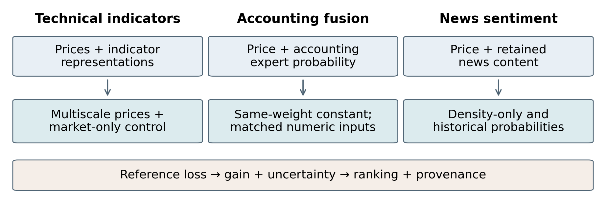

# Diagnosing apparent predictive gains in financial machine learning

Hsieh Hao-Hsuan and Jian-Jiun Ding *

Graduate Institute of Communication Engineering, National Taiwan University, Taipei 106319, Taiwan;

* correspondence: jjding@ntu.edu.tw; Tel.: +886-3-33669652

† 7th International Conference on Electronic Communications, Internet of Things and Big Data 2027 (ICEIB 2027). April 23-25, 2027, Tamkang University

## Abstract

Financial prediction gains can reflect new information, price representation, or probability processing. We develop a matched-control evaluation of five-day reversal probabilities using technical indicators, accounting measures and reconstructed news. AAPL/TSLA market experiments evaluate the repeatedly explored 2024–2025 period; a separate Apple news cohort evaluates 2025. Price, constant-shrinkage, matched-input and density controls test alternative explanations across logistic, tree and sequence models. None of eight primary technical comparisons establishes corrected improvement. Calibrated AAPL neural fusion gains 0.000980/0.001198 over constant shrinkage (0.395%/0.482%), but intervals cross zero and TSLA gains are negative. Saved calibrators verify a seed-specific ranking reversal; sequential gains are confined to initialization. News density precedes most of the price-to-sentiment improvement, whose primary corrected comparison is inconclusive. The resulting workflow makes apparent gains interpretable without equating lower loss with independent information, stronger discrimination, or investment value.

Keywords: financial machine learning; incremental information; probability calibration; forecast combination; news density; reversal prediction

## 1. Introduction and Related Work

Adding financial features may lower probability loss through new information, alternative price representations, or forecast stabilization. Which mechanism explains an observed gain in short-horizon reversal prediction?

Gu et al. [1] link machine-learning gains to nonlinear interactions; Lo et al. [2] formalize technical-pattern analysis; Xu and Cohen [3] combine price and text for stock movements. These motivate richer inputs, but differing targets and samples preclude assuming transfer to five-day reversals.

Forecast combination [4] and probability pooling [5] can change calibration and dispersion [6,7]. Glasserman and Lin [8] examine language-model look-ahead and knowledge effects in text backtests. Proper scores [9] assess complete probability forecasts; FinBERT [10] measures financial sentiment. Success at sentiment classification alone does not establish return predictability.

We connect these findings using matched controls for technical, accounting and news inputs. The question is whether gains survive representation, constant-contraction, calibration and density controls. This integrated evaluation retains cohort-specific uncertainty; it is neither a new forecaster nor a cross-dataset ranking.

## 2. Methods and Experimental Setup

Our contribution is a common diagnostic workflow with source-specific controls for representation, probability contraction and coverage. Matched inputs, calibration audits and the equations test alternative explanations for lower loss.

### 2.1. Tasks, Data and Models

Five-session reversal uses the known past direction sₜ=sign[log(Cₜ/Cₜ₋₅)], entry at the next open and exit at the fifth future close:

`Yₜ = 1{sₜ log(Cₜ₊₅/Oₜ₊₁) < 0}.` (1)

C/O denote close/open; exact-zero preceding directions are excluded. For N observations, the probability loss [9] and candidate benefit are

`BS = N⁻¹Σᵢ(pᵢ−yᵢ)².` (2)

`ΔBS = BS_ref−BS_cand; r(%) = 100ΔBS/BS_ref.` (3)

Positive gains favor the candidate. Relative gains use unrounded same-cohort references and are neither accuracy nor investment returns.

Overall AUC assesses ranking; within-state AUC pairs opposing outcomes within past-direction/trend/volatility cells.

The cohorts are separated in Table 1. Logistic regression, XGBoost/LightGBM, long short-term memory (LSTM) and Mamba receive 60-session histories, flattened for nonsequential models. Selection uses three candidates/three folds; neural training uses batch 64, at most 24 epochs and patience 4.

Table 1. Cohorts and temporal splits; market seeds 42–46 share evaluation dates.

| Cohort | Training | Stopping/calibration | Evaluation |
| --- | --- | --- | --- |
| Market: AAPL/TSLA | 2012–2022 | 2023 | 2024–2025; 482 dates/stock |
| Apple news | 2023: 224 dates/28 events | 2024: 232 dates/36 events | 2025: 230 dates/65 events |

Technical inputs extend 38 price features with 12 indicators and QQQ-relative strength; accounting fixes the 51-feature price model, adding seven measures/age/missingness. Releases enter after two later sessions (five-session sensitivity); stocks supply 45 training/nine evaluation-used vintages.

The 448-article corpus adds density, FinBERT tone/direction [10] and four event proportions to eight price summaries; hierarchical models shrink state probabilities. Evaluation has 42 reversals; thinning retains 22 events.

### 2.2. Fusion, Calibration and Brier Diagnostics

Let p,f denote price/logistic-accounting probabilities, c a training constant and w the development-chosen weight. The compact expert accommodates limited quarterly updates:

`q = (1−w)p + wf; q₀ = (1−w)p + wc.` (4)

For squared loss L(q,y)=(q−y)², the exact raw-mixture benefit is

`L(q₀,y)−L(q,y) = 2w(f−c)(y−q₀)−w²(f−c)².` (5)

Alignment rewards f−c matching the residual y−q₀; the squared deviation penalty subtracts their cost. This identity applies to raw linear mixtures, not separately calibrated nonlinear pipelines.

For ten fixed bins, vₖ is bin weight, μₖ mean forecast, oₖ outcome rate, o overall rate and Eₖ a within-bin mean. Define REL=Σvₖ(μₖ−oₖ)² (reliability), RES=Σvₖ(oₖ−o)² (resolution), UNC=o(1−o):

`BS = REL − RES + UNC + G.` (6)

`G = ΣₖvₖEₖ[(p−μₖ)²−2(p−μₖ)(y−oₖ)].` (7)

The signed grouping remainder reconciles continuous and bin-mean losses [6,7]; five-bin sensitivity is supplementary.

Each market pipeline receives its own L2-regularized Platt map (C=1), fitted on 2023 H2 logits clipped to [10⁻⁶,1−10⁻⁶]:

`q_cal = sigmoid[a logit(q_raw) + b].` (8)

A positive slope preserves single-seed AUC; a negative slope reverses ranking. News uses a distinct identity-regularized monotone calibration, reusing 2024 for selection/calibration.

### 2.3. Representation Diagnostics

Spearman uses 2,768 development dates/stock in 2012–2022. Ridge(alpha=10) reconstructs 13 added features from 38 prices with training-only input/target scaling. Three expanding fits through 2016/2018/2020 H1 evaluate 2017–2018/2019–2020/2021–2022. Forward means temporal evaluation of same-date features, not tomorrow’s RSI; R² averages folds equally. Full filters/scalers are supplementary.

### 2.4. Development Controls and Statistical Evaluation

Matched development uses the same folds (2017–2022;1,450 dates/stock), 24 logistic/36 tree fits, 60-session histories and 20-session purging. Zero/duplicate accounting arms share metadata/width. Sequential fusion starts at 0.5; later weights, expert choices and constants use preceding folds.

Paired HAC [11], calendar-block bootstrap and Holm [12] keep separate families: eight technical, twenty fusion, two-contrast news, six logistic/six tree development, plus combined-12 sensitivity. Primary studies use 9,999 resamples; development/block 60 diagnostics use 4,999. Block 20/120 sensitivities are retained. Full settings are supplementary.

## 3. Results and Analysis

### 3.1. Overview of Experimental Findings

Figure 1 applies representation, contraction, matched-input and density controls to diagnose apparent improvements.

Figure 1. Source-specific matched controls; cohorts are evaluated separately.

### 3.2. Technical Indicators: Representation versus New Information

No primary technical contrast establishes corrected benefit (Table 2). TSLA XGBoost gains 0.000235 (0.094% of reference 0.250207), CI[−0.000378,0.000837]; the market-only arm almost reproduces it.

Table 2. Technical additions to the same prices: gain=reference−candidate Brier (10⁻³); primary bootstrap Holm 8 p.

| Model | AAPL gain | AAPL p | TSLA gain | TSLA p |
| --- | --- | --- | --- | --- |
| XGBoost | -0.420 | 0.9952 | +0.235 | 1.0000 |
| LightGBM | -0.020 | 1.0000 | -0.033 | 1.0000 |
| LSTM | -1.643 | 1.0000 | -0.009 | 1.0000 |
| Mamba | -3.616 | 1.0000 | -0.506 | 1.0000 |

RSI/standardized price deviation have Spearman 0.890/0.880 (AAPL/TSLA), but forward Ridge R²=0.755/−0.948. Strong same-period association can coexist with unstable linear transfer. Neither proves conditional redundancy; forecast tests establish no reliable incremental signal from these representations.

### 3.3. Fundamental Fusion: Calibration versus Information Gain

Does accounting fusion beat equal constant contraction? All ten raw settings score worse. AAPL LSTM/Mamba benefits −0.002834/−0.002919 become +0.000980/+0.001198 after calibration (0.395%/0.482%). Block 60 intervals cross zero; TSLA gains are negative (Table 3).

Table 3. A: calibrated fusion vs same-weight constants (gain/CI×10⁻³; pointwise block 60; primary block 20 Holm 20 p=1). B: AAPL fusion calibration, raw→calibrated per-seed means.

| Stock/model | Reference BS | Gain ×10³ | Gain % | 95% CI ×10³ |
| --- | --- | --- | --- | --- |
| AAPL LSTM | 0.247902 | +0.980 | 0.395 | [-1.351, +3.419] |
| AAPL Mamba | 0.248822 | +1.198 | 0.482 | [-0.735, +3.321] |
| TSLA LSTM | 0.250159 | -0.506 | -0.202 | [-2.026, +0.964] |
| TSLA Mamba | 0.250121 | -0.530 | -0.212 | [-2.440, +1.464] |
| AAPL calibration | a range | Negative/5 | Brier raw→cal | AUC raw→cal |
| LSTM fusion | 0.066…0.490 | 0/5 | 0.256221→0.246922 | 0.583474→0.583474 |
| Mamba fusion | -0.160…0.552 | 1/5 | 0.257093→0.247623 | 0.573053→0.549749 |

LSTM slopes are positive; Mamba seed 46 is negative in all three pipelines. Saved maps reproduce probabilities within 2.3×10⁻¹⁶. Scores average seeds, not ensemble probabilities. LSTM fusion SD contracts 0.055→0.020, versus price 0.102→0.086. Reliability, resolution and grouping differ; the constant has lower reliability penalty. These are complete-pipeline comparisons, not causal information shares.

A secondary direct-up comparison is positive: AAPL logistic Brier 0.315318→0.251362; adjusted p=0.0024 within 12 directional contrasts, 0.004 across 20. Accounting weight is 1; a calibration-period constant scores 0.251469. This replaces a weak price expert rather than combining complementary experts.

### 3.4. Matched Controls: Does Additional Accounting Information Help?

Do accounting numbers beat equally formatted inputs? No corrected positive tree advantage appears across six contrasts (p≥0.4032). Matching width controls representation, not effective capacity; all logistic/tree comparisons are supplementary.

Against same-weight/tuned constants, fusion gains 0.001931 (adjusted p=0.152). Against the prior-selected expert, gain 0.005726 (2.257%), CI[0.001548,0.009306], has six-family p=0.0240/combined-12 p=0.0480. All gain occurs in 2017–2018 (initial 0.5 fusion versus price); later policies choose accounting identically. Block 120 p=0.0744; fixed accounting scores better overall. This is initialization, not persistent complementarity.

### 3.5. News Density versus Sentiment

Does tone add beyond density? Across 65 Apple events, price→density gains 0.021825 (6.857%); extra tone adds 0.000744 (0.251%; secondary adjusted p=0.8564). Full price→tone gain 0.022569 (7.091%) has primary p=0.1512, CI[−0.002035,0.047736]. Most improvement precedes sentiment.

The secondary hierarchical gain 0.006702 has adjusted p=0.028, rising to 0.1894/0.3714 with one-/two-session extra delays. Its Brier 0.259011 exceeds the historical prior’s 0.256489 (-0.983% gain). Within-state AUC 0.5532 has unadjusted p=0.5721. Improving on one price comparator does not establish superiority to the prior or reliable reversal timing.

Density strata contain 6/30/29 events and are descriptive. Zero denotes no matching retained corpus article, not no market news. All predictors, stratified gains, event-feature losses and delay sensitivities are supplementary.

### 3.6. Cross-Experiment Synthesis

Table 4 connects the cohorts without pooling scores or p-values: stronger controls change what favorable point estimates imply.

Table 4. Cohort-specific findings with separate correction families.

| Question | Critical control | Cohort-specific finding |
| --- | --- | --- |
| Technical | Same prices; market-only | No corrected positive gain. |
| Accounting | Same-weight shrinkage | AAPL gains unresolved; TSLA negative. |
| Values / allocation | Matched inputs; prior expert | No tree advantage; startup-only gain. |
| News | Density; historical prior | Primary inconclusive; secondary delay-sensitive. |

The common finding is that lower loss alone does not distinguish new content from representation, estimation or coverage.

## 4. Discussion and Limitations

These controls distinguish probability processing, initialization and coverage from information attribution, making lower-loss claims more precise without introducing a new forecasting algorithm.

Limits are two surviving stocks, repeatedly explored 2024–2025, overlapping labels, quarterly repetition, bounded model budgets and sparse news. Local corrections exclude the full research history. Date-lag accounting/news versions lack authenticated PIT: audits found zero L3 version-qualified or L4 arrival-qualified records. Retrospective prices/calibration sensitivity further constrain inference. Generalization requires broader stocks and independently held-out periods; integrity details are supplementary.

## 5. Conclusions

Matched controls expose representation, probability-processing, initialization and news-coverage effects. In these exploratory cohorts, lower loss alone establishes neither incremental information nor investment utility.

## Back Matter

Author Contributions: Investigation and experiments, Hsieh Hao-Hsuan; supervision, Jian-Jiun Ding.

Funding: This research received no external funding.

Institutional Review Board Statement: Not applicable.

Informed Consent Statement: Not applicable.

Data Availability Statement: Code and aggregate results: https://github.com/yoyocar2333/financial-sequence-benchmark, commit 6f29a9f8375b21ac2894878aa424f12b8d6fa138. Restricted raw data/weights are not public.

Conflicts of Interest: The authors declare no conflicts of interest.

Acknowledgments: Generative AI assisted drafting/code/formatting; authors verify outputs and accept responsibility.

## References

1. Gu, S.; Kelly, B.; Xiu, D. Empirical Asset Pricing via Machine Learning. Rev. Financ. Stud. 2020, 33, 2223-2273. doi:10.1093/rfs/hhaa009

2. Lo, A.W.; Mamaysky, H.; Wang, J. Foundations of Technical Analysis: Computational Algorithms, Statistical Inference, and Empirical Implementation. J. Finance 2000, 55, 1705-1765. doi:10.1111/0022-1082.00265

3. Xu, Y.; Cohen, S.B. Stock Movement Prediction from Tweets and Historical Prices. Proc. ACL (Vol. 1: Long Papers) 2018, 1970-1979. doi:10.18653/v1/P18-1183

4. Bates, J.M.; Granger, C.W.J. The Combination of Forecasts. J. Oper. Res. Soc. 1969, 20, 451-468. doi:10.1057/jors.1969.103

5. Ranjan, R.; Gneiting, T. Combining Probability Forecasts. J. R. Stat. Soc. B 2010, 72, 71-91. doi:10.1111/j.1467-9868.2009.00726.x

6. Bröcker, J. Some Remarks on the Reliability of Categorical Probability Forecasts. Mon. Weather Rev. 2008, 136, 4488-4502. doi:10.1175/2008MWR2329.1

7. Dimitriadis, T.; Gneiting, T.; Jordan, A.I. Stable reliability diagrams for probabilistic classifiers. Proc. Natl. Acad. Sci. USA 2021, 118. doi:10.1073/pnas.2016191118

8. Glasserman, P.; Lin, C. Assessing Look-Ahead Bias in Stock Return Predictions Generated By GPT Sentiment Analysis. arXiv preprint arXiv:2309.17322 2023. doi:10.48550/arXiv.2309.17322

9. Gneiting, T.; Raftery, A.E. Strictly Proper Scoring Rules, Prediction, and Estimation. J. Am. Stat. Assoc. 2007, 102, 359-378. doi:10.1198/016214506000001437

10. Dogu Araci FinBERT: Financial Sentiment Analysis with Pre-trained Language Models. arXiv preprint arXiv:1908.10063 2019. doi:10.48550/arXiv.1908.10063

11. Newey, W.K.; West, K.D. A Simple, Positive Semi-Definite, Heteroskedasticity and Autocorrelation Consistent Covariance Matrix. Econometrica 1987, 55, 703. doi:10.2307/1913610

12. Holm, S. A Simple Sequentially Rejective Multiple Test Procedure. Scand. J. Stat. 1979, 6, 65–70.
