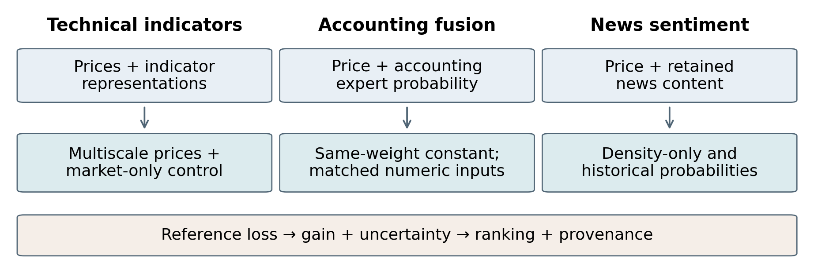

# Supplementary design and complete evidence

The professor-requested expansion retains all five expert families in the main fusion table. To preserve the template's eight-page budget, the unchanged authored design diagram is provided here instead of shrinking its text. The main cross-experiment synthesis remains Table 4.

Figure S1. Source-specific controls; no scores are pooled across cohorts.

## Complete model results and calibration evidence

- [All primary, negative and secondary comparisons](../round2/SUPPLEMENTARY_RESULTS.md) and [unrounded effects, references and CIs](../round2/tables/R2_SCORE_INTERPRETATION.csv).
- [Saved calibration coefficients, slope ranges, raw/calibrated Brier and ranking diagnostics](../round3/CALIBRATION_AUDIT.md); [full calibration table](../round3/tables/CALIBRATION_SUMMARY.csv).
- [Unchanged prior main manuscript](../round4/ICEIB2027_FULL_PAPER.md) for the former panel layout.

All original numerical results remain available at these preserved paths. The compact fusion table adds all ten raw/calibrated model-stock settings using existing tables, not new model fitting. The raw→calibrated loss difference is a pipeline comparison; confidence intervals and multiplicity families are preserved.
